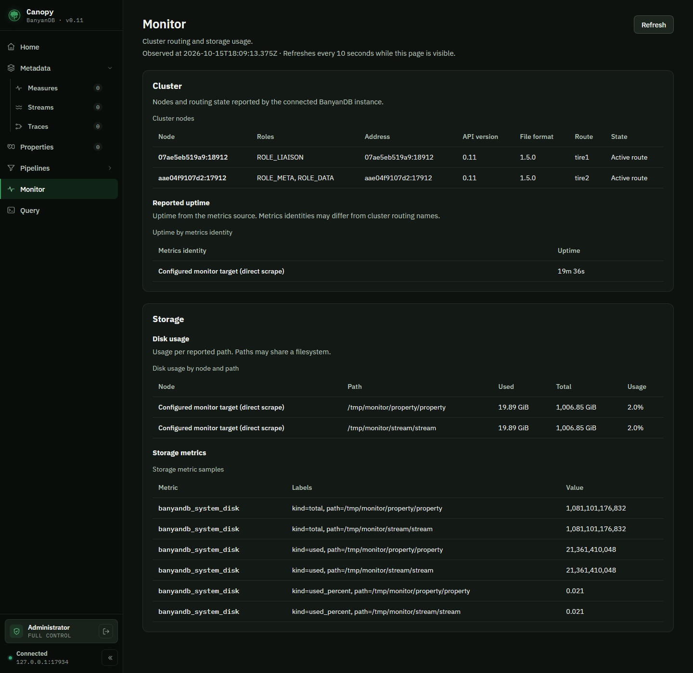

# Monitor page

Tracks [apache/skywalking#13992](https://github.com/apache/skywalking/issues/13992).

## First release

The Monitor sidebar entry opens `/monitor`. The initial view shows cluster routing
membership and current storage observations from existing BanyanDB endpoints.
It does not introduce a database API, alter persisted formats, or replace the OAP
observability dashboards.

The BFF's `GET /api/monitor/overview` reads these configured sources independently:

| Section | Source | Meaning |
| --- | --- | --- |
| Cluster | `BANYANDB_TARGET/api/v1/cluster/state` | Registered nodes, their routes, roles, gRPC addresses, reported API/file-format versions, and active/evictable membership |
| Storage | `MONITOR_TARGET/metrics` | Reported uptime, disk capacity/usage, and current memory/file part, element, block, and byte gauges |

The shared type-only contract is `canopy/shared/src/monitor.d.ts`. Each section
returns either data or an unavailable status, with a collection timestamp and
refresh settings. One unavailable source does not discard the other section.



## Interpretation

An active route is a routing observation, not an additional liveness probe.
Registered nodes without an active or evictable route are labeled accordingly.
API/file-format versions are not the application release version. Uptime comes
from the `banyandb_system_up_time` gauge, which reports seconds, and is displayed
under the metrics source's identity rather than joined to unrelated route names.
It is not inferred from node creation time. A standalone server can return no route tables.

For cluster-wide metrics, configure the FODC proxy as the monitoring target.
Its `pod_name` and `container_name` labels preserve node identity. A direct scrape
reports only its configured target; unlabelled samples are identified as that
target and are not attributed to arbitrary cluster nodes. Disk paths can share a
filesystem, so the page does not sum path capacities. Missing totals/usage are
unavailable, not zero, and percentages are only shown for valid pairs.

The storage table selects the documented `banyandb_system_disk` and
`banyandb_{measure,stream_tst,trace_tst}_total_*` part, element, block, and byte
gauges. Query/queue/plugin samples are excluded. No rates or historical percentiles
are calculated from a single scrape.

## Access and resource bounds

- Existing encrypted browser sessions authenticate the BFF request.
- Administrators can access Monitor by default. Operators can explicitly enable
  readonly access with `CANOPY_MONITOR_ALLOW_READONLY=true`.
- Browser credentials are never forwarded upstream. Only the configured database
  service credential is sent to the database endpoint, not the monitoring target.
- The existing endpoint safety check runs for every upstream request. Redirects
  are not followed, response bodies are capped at 4 MiB, and scrapes are capped at
  10,000 samples. Invalid or oversized data makes the affected section unavailable.
- HTTP requests and body consumption have a deadline of at most 10 seconds,
  bounded further by `UPSTREAM_TIMEOUT_MS`.
- Responses are not cached. Errors do not expose upstream bodies or credentials.

The page polls every 10 seconds by default, with a configurable 5-second to
5-minute interval. It stops polling when hidden or unmounted and cancels abandoned
requests. Failed refreshes mark retained data stale; a subsequent authorization
failure removes it. Monitor observations are not retained in the shared query
cache after leaving the page.

## Deferred sections

Query metrics, recent events, and trace-pipeline views remain hidden.
`CANOPY_MONITOR_EXPERIMENTAL=true` exposes unavailable placeholders only.
No extra upstream calls or fabricated data are used for these sections.

## Verification

```sh
cd canopy
npm ci
npm run typecheck
npm run lint
TZ=UTC npm test
npm run build
npx playwright test --config=e2e/playwright.config.ts e2e/tests/monitor.spec.ts
```

The normal E2E setup builds a real standalone BanyanDB and authenticates the browser.
The Monitor smoke test checks the real overview response, disk paths, navigation,
and manual refresh, and attaches a screenshot. Backend tests cover access rules,
base paths, configured credential isolation, SSRF denial, unavailable/redirected/
oversized upstreams, body timeouts, and parsing. UI tests cover empty and partial
states, stale-data recovery, access loss, cancellation, bounded polling,
reverse-proxy prefixes, and unavailable disk values.
