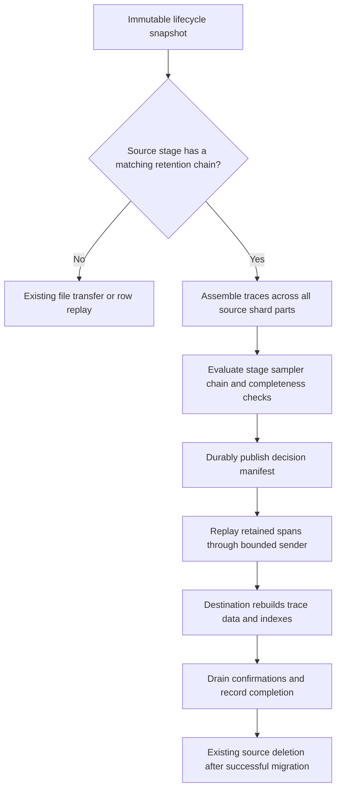

# Trace sampling before lifecycle migration

Status: implemented. This document specifies agent-side migration sampling and
its durable preparation and replay protocol. For deployment, group API examples,
and restart instructions, see [trace retention sampling](../../operation/lifecycle.md#trace-retention-sampling).

## Scope decisions

The migration-related questions are closed for this proposal. Post-sampling
inherits the lifecycle agent's existing snapshot scope, late-write handling,
source deletion, destination acknowledgement and at-least-once retry contracts.
It does not require new trace sealing, source-node coordination, receiver
deduplication or stronger delivery guarantees. These are scope decisions, not
claims that the existing contracts have been strengthened or newly verified.

Reuse the existing sampling completeness protections; uncertain decisions retain
data. Row replay is the selected transport for sampled migrations. Native-part
transfer and broader migration performance redesign are outside this scope;
benchmarking is useful validation, not an unresolved architecture decision or a
prerequisite for designing post-sampling.

The new work is policy selection, trace assembly, sampling, durable decisions,
delivery checkpoints, batching across source parts and focused verification of
those changes. There are no remaining open design questions in this proposal.

## Decision

The lifecycle agent evaluates the **source stage's retention chain before sending
trace data to the next stage**. Sampling applies to the immutable migration
snapshot. It does not rewrite the live source segment.

For the first implementation, sampled migrations use row replay for every
retained span, including migrations that would otherwise use file transfer.
The destination's normal write path rebuilds its indexes from those retained
spans. Unsampled migrations keep their existing transport selection.

Persist a complete sampling decision manifest for each source segment/shard
before its first write to the destination. Retries replay the same snapshot
with the same manifest, without rerunning the sampler.



## Current implementation and placement

- [`migrateTraceWithFileBasedAndProgress`](../../../banyand/backup/lifecycle/migration_integration.go)
  traverses a filesystem snapshot and constructs a migration visitor.
- [`traceMigrationVisitor.VisitShard`](../../../banyand/backup/lifecycle/trace_migration_visitor.go)
  transfers core and SIDX files when the source fits one target segment, and
  otherwise replays rows. Sampled migration runs **before** this choice.
- `VisitSeries` can send the original series index before shard visitation.
  Sampling mode is selected before traversal and suppresses that transfer. Series
  work completes after retained rows have been delivered and their indexes rebuilt.
- [`traceRowReplayer.replayPart`](../../../banyand/backup/lifecycle/row_replay_trace.go)
  currently sends rows immediately, one part at a time. A predicate inside this
  loop is insufficient: one trace may have blocks in several parts.
- `traceRowReplayer.publishRow` already reconstructs writes and routes each trace
  using the target shard count. Reuse it and the bounded sender after decisions
  are fixed. Preserve its confirmation/error handling.

This proposal supersedes the migration mechanism in
[the earlier post-trace design, section 7.2](../archive/0.11.0/post-trace-pipeline.md#72-hot-to-warm-tier-migration-pre-migration-filter-rewrite):
the agent performs a decision pass followed by filtered replay, rather than
building reduced native parts for byte-copy transfer. The source-stage policy
semantics remain the same. In particular, source TTL does not prove that every
trace is complete or that late writes have stopped.

## Policy selection

Use the existing `TracePipelineConfig.stages` and `StageRule.plugins` fields;
no new pipeline event or sampler ABI is needed.

| Condition | Migration behavior |
| --- | --- |
| Pipeline absent or disabled | Existing lossless migration |
| Schema not targeted by the pipeline selectors | Existing lossless migration |
| No rule for `GroupConfig.SourceStage`, or empty chain | Existing lossless migration |
| Matching source-stage chain | Prepare decisions, then replay retained rows |
| Matching chain cannot be loaded or validated | Fail migration before sending; report configuration error |

`MERGE` and `FINALIZE` in `enabled_events` control the data-node passes. They do
not gate migration sampling. Do not rerun the top-level `pipeline.plugins`
chain during migration, and do not apply the destination stage's chain early.
All links see the same batch and their keep masks are AND-ed, using the existing
SDK chain semantics.

For example, `hot -> warm` uses the `hot` rule; `warm -> cold` uses the `warm`
rule. If the initial hot tier is implicit in `resource_opts`, use the source
stage identity already resolved by `parseGroup` from the node's `type` label.
An ambiguous or missing source identity must be reported, not guessed. A stage
without a successor has no migration pass.

Resolve the trace schema before traversal. The current replay path supports
exactly one trace schema per group; preserve that explicit restriction in v1.
Pin the schema, ordered plugin configuration, source and destination stage
configuration, and routing parameters for the migration attempt. Configuration
updates take effect for new migration work, not midway through a prepared shard.

## Sampling scope and completeness

The decision unit is `(snapshot, group, source segment, source shard, trace ID)`.
Assemble every block for that trace across **all core parts in the unit** before
calling `Decide`. Make one decision for all its spans, before splitting retained
rows between target segments or target shards. Never independently sample each
part, row, or target segment.

Use a trace-ID-ordered merge of part/block cursors. Decode the union of plugin
projections for the decision pass; avoid decoding span bodies unless requested.
Storage readers and column conversion stay in the trace storage module. The
existing dump iterator decodes full blocks and eagerly gathers block metadata;
it is not by itself a bounded, projected multi-part scanner. Implement the
scanner explicitly and verify ordering instead of collecting the entire shard
in memory. Bound open readers, metadata buffers, batch bytes and per-trace bytes;
use bounded external merge runs when the part fan-in exceeds the reader budget.

A trace exceeding the decision budget is retained in its entirety. Once that
decision is made, skip remaining projected payloads for that trace while
continuing the ordered scan. A partial trace must never be presented as complete
to a sampler. Decoder-owned buffers must be copied or kept pinned until the
sampler finishes, including a worker that outlives a timeout.

The snapshot only establishes a stable local input set. It does not establish a
globally complete trace across segments, nodes, or future arrivals. Apply the
existing fragment-guard policy through a snapshot reader adapter: retain traces
near source-segment edges, with unavailable/incomplete input coverage, or with
possible fragments outside the decision unit. The snapshot adapter uses the
same grace-window and temporal assumptions as the existing data-node sampling
guard; establishing a new global fragment-gap contract is outside scope. If
input bounds or coverage required by that guard are unavailable, convert the
proposed drop to keep and report that reason. Tests must verify both eligible
interior drops and conservative keeps under the inherited guard semantics.

Migration sampling is therefore conservative and scoped to the captured input.
It adds no global trace-sealing guarantee. Writes arriving after snapshot capture
remain subject to the existing migration/deletion contract, which is inherited
unchanged and is not a blocker for post-sampling. This proposal must not
treat sampling completion as new evidence that live source data is sealed.

## Module interface and ownership

Keep the lifecycle-facing interface small. Package-private operations:

```go
prepareTraceMigration(ctx, sourceSnapshotShard, pinnedPolicy) (*preparedTraceMigration, error)
prepared.Replay(ctx, traceRowReplayer) error
prepared.Close() error
```

These are conceptual signatures, not new SDK declarations. Preparation owns
assembly, plugin execution, conservative keep decisions and manifest durability.
Replay owns manifest verification, filtering and acknowledgement draining.
Close releases handles; it does not remove resumable state. Artifact reclamation
belongs to successful migration cleanup.

The storage module exposes a projected snapshot scanner, hiding native formats.
The lifecycle module owns stage selection, durable state and sending. Factor the
reusable plugin loader and bounded execution logic out of data-node-private code
into an internal pipeline runtime, used by both callers. Keep `pkg/pipeline/sdk`
and its existing `EvaluateChain` contract unchanged. Do not copy the loader,
timeout, projection-union or panic-handling implementations into lifecycle.

Plugin instances belong to a pinned policy execution session. Serialize calls to
an instance unless concurrency is explicitly supported. Close instances only
after workers finish; a timeout cannot kill a native Go call. Use bounded worker
slots and the existing circuit-breaker behavior to prevent accumulation of
timed-out workers and retained batches.

## Merging and small outputs

Source part boundaries are read boundaries, not output boundaries. The ordered
decision pass logically merges blocks across parts to assemble complete local
traces, but does not create a reduced file for each source part. Concurrent live
source compaction cannot change the pinned filesystem snapshot's inputs; keep
those snapshot files alive until the attempt no longer needs them.

Sampled replay must feed retained rows across all source parts into a continuous,
bounded batching session. Reuse `publishRow` and the sender's enqueue/flush/drain
primitives, **not** the current `replayPart` driver unchanged: that driver flushes
the trailing batch and drains confirmations at every part boundary. Flush on
batch byte/row limits, a bounded linger deadline, or the end of the prepared
shard. Check in-flight errors continuously and drain all confirmations before
recording shard delivery. Crossing a source-part boundary alone causes no flush.

Destination buffers and parts remain scoped to `(group, target segment, target
shard)`. Route retained rows together for the same destination where practical;
bound the number and combined memory of any destination-specific buffers. Never
merge different target segments to reach a size goal. Transport batch size is
not a guarantee of physical part size: destination flush timing and memory
pressure can still produce small parts.

Use the destination's existing memory-part merging and file compaction to combine
these outputs. The current trace flusher already has a memory-part pileup/merge
path (`banyand/trace/flusher.go`). This does not guarantee a minimum size or an
immediate merge, particularly for a cold segment with little remaining traffic.
A small final remainder is valid; do not retain extra traces, wait indefinitely,
or force full-segment compaction merely to fill a part. Delivery completion does
not wait for background compaction.

For example, if 100 source parts each retain about 100 KiB and share one target
segment/shard, replay treats the approximately 10 MiB of survivors as one bounded
stream rather than forcing 100 part-ending batches. Actual destination part count
depends on its write/flush/merge scheduling. If a later optimization writes native
reduced parts in the agent, its writer must likewise span source parts and rotate
based on retained output size, allowing a small terminal part and no empty parts.

Verify this behavior with many parts and a low keep rate: assert that source part
boundaries do not force replay flushes, memory stays bounded, final residual rows
are confirmed, and all-drop inputs create no output. Benchmark destination part
count, size distribution and compaction backlog as well as transfer bytes.

## Manifest and retry protocol

Use a versioned, disk-backed decision table sorted by trace ID, with bounded
lookup buffers during replay. Record an explicit keep/drop result for every
trace; an absent entry during replay is an integrity error. A table plus a sparse
on-disk index avoids an unbounded in-memory trace-ID map. No span bodies need be
duplicated in this artifact because replay reads the pinned source snapshot.

The manifest binds the table to:

- Snapshot identity and source part inventory, including integrity information.
- Group, schema revision, source segment/shard and source/target stages.
- Pinned destination interval, shard count and replication configuration.
- Canonical policy digest, ordered plugin identities, ABI and plugin binary
  digests. A filename alone does not identify plugin code.
- Decision-table format, checksum, counts and preparation outcome.

The durable state transitions are:

```text
PREPARING -> PREPARED -> DELIVERING -> DELIVERED -> cleanup after source removal
```

1. Write the table and manifest under a temporary artifact directory. Flush
   files, publish by atomic rename on the same filesystem, and sync the parent
   directory. Every durability failure returns an error. No destination write
   occurs before `PREPARED` is durable.
2. Replay only retained rows. Always skip source core/SIDX/series file transfer
   in this mode, even if the manifest retains every trace. The destination write
   path rebuilds all indexes from the retained rows.
   Give delivery batches monotonically increasing sequence numbers and record
   their ending source cursor (part ID, block position and row offset) against
   the immutable input inventory. A batch may cross source-part boundaries.
   Advance a durable delivery checkpoint only through the contiguous sequence
   of batches whose required destination confirmations have all succeeded.
   Later successful batches cannot advance past an earlier unconfirmed batch.
   Persist checkpoints with the same error-returning atomic protocol as the
   manifest; checkpoint failure stops further sending after safely draining
   outstanding work. Keep in-flight batches and uncheckpointed acknowledged
   batches bounded so crash replay remains bounded.
3. Drain all required confirmations before durably recording `DELIVERED`.
   A shard with zero retained rows is a successful, explicit all-drop result;
   persist it and advance progress without sending an empty write batch.
4. Project durable delivery status into the existing progress/report structures.
   Only successful migration of all required work allows existing source
   deletion. Persisted all-drop results count as completed work, not missing data.
5. On restart, discard incomplete preparation only if no send was possible.
   Resume a prepared or partially delivered shard using its original manifest
   and snapshot, starting after the last durably confirmed delivery cursor.
   Never resample it under new policy, new plugin code or new schema.
   If the artifact or required snapshot is missing/corrupt, stop that migration
   and retain available source state; do not silently generate different verdicts.

[`Progress.Save`](../../../banyand/backup/lifecycle/progress.go) currently logs
errors and uses `os.WriteFile` without an atomic durability protocol. It cannot
serve as the sampling commit record. The new artifact store must return errors
and be authoritative for sampled replay and completion. Discover its pending
attempts before interpreting legacy progress, including when the progress file
is missing or damaged.

Delivery retains the current replay path's at-least-once behavior. A crash after
receiver acknowledgement but before delivery checkpointing may resend retained
rows. The manifest guarantees stable selection, not exactly-once delivery.
Delivery checkpoints are independent of physical part creation and do not force
the receiver to compact or create a part. Efficient cursor seeking needs an
explicit reader operation; reopening an iterator and scanning to its cursor is
correct but does not deliver the intended restart performance.

Preparation has a different restart unit: the source segment/shard. A crash before
its complete decision manifest is published can require resampling that shard;
already prepared shards are reused. V1 does not promise mid-shard sampling resume.
The general sampler ABI permits state across calls and offers no state checkpoint
operation, so skipping earlier calls in a newly constructed plugin is not a
transparent optimization. Finer sampling checkpoints would require a documented
stateless/trace-local plugin contract or plugin state restoration. This restriction
does not affect delivery resume, which never calls the sampler.
Retain snapshot and artifact ownership until source deletion and cleanup are
confirmed; filesystem paths alone must not permit another cleanup pass to remove
an active attempt's inputs.

## Failure behavior

| Failure | Required result |
| --- | --- |
| Plugin panic, error, invalid verdict length | Bypass that link; other successful links still apply |
| Execution timeout or open circuit | Retain affected batch |
| Rule input cannot be evaluated | Preserve sampler's fail-open semantics |
| Oversized trace or uncertain fragment coverage | Retain whole trace |
| Missing plugin, incompatible ABI, invalid configured chain | Fail preflight; no migration send |
| Source read/corruption error | Fail preparation/replay; never reinterpret missing input as a drop |
| Manifest disk full, checksum mismatch or durability failure | Fail migration; no completion or source deletion |
| Cancellation or send/confirmation failure | Stop, drain/close safely, preserve prepared state for retry |

Runtime fail-open decisions are persisted like ordinary keeps. A retry must not
turn an earlier timeout keep into a successful drop after some spans were sent.
An unreadable source differs from a sampler failure: retaining data requires
being able to read and deliver it.

## Deployment, observability and compatibility

The lifecycle process becomes a native plugin host. Add explicit enablement,
trusted-directory, timeout and circuit-breaker configuration to its command and
deployment. Mount matching plugin binaries into the lifecycle container and
build it with the same Go/toolchain/CGO/SDK compatibility rules as the data-node
plugin host. Loading a pipeline on a data node does not load it in the agent.
If an applicable stage chain is configured but the agent cannot host it, fail
preflight instead of silently migrating unfiltered data.

Report per group and transition: input/kept/dropped traces and spans, fail-open
reasons, preparation time, manifest bytes, replayed bytes, and resume counts.
Keep intentional drops separate from missing/corrupt-source and transport errors.
Record policy/artifact identities in structured reports rather than metric
labels. The artifact's logical counts are recorded once; transport attempts may
be counted repeatedly.

Group protobuf and destination write protocol remain unchanged. New durable
state belongs to the lifecycle agent. Deploy capable agents before activating
stage rules; an old agent may ignore those rules. Do not downgrade an agent with
pending sampled attempts to a binary that does not understand their manifests.
Unsampled in-flight legacy migrations finish without retroactive filtering.

## Alternatives and cost

Filtering individual replay rows is simpler but cannot evaluate error/duration
rules over a trace spanning parts. Destination-side filtering wastes bandwidth
and cannot satisfy the agent-before-send requirement.

A reduced native-part rewrite can preserve efficient chunk transfer, as proposed
in the earlier design. It requires coordinated rewriting of core metadata,
Bloom filters, SIDX and series indexes, plus a second path for target segment or
shard repartitioning. Filtered replay reuses the existing destination write path
and gives both transfer geometries the same sampling semantics. Its cost is a
decision pass, local decision-table I/O, and replay decode/re-encode CPU. These
costs are accepted for v1; measurements can inform subsequent tuning without
reopening the transport decision. Reduced-part transfer is outside this proposal.

## Verification requirements

1. Add source-stage selection/preflight and shared runtime extraction. Test
   disabled/unmatched/empty policy, implicit hot identity, schema selection,
   chain semantics and independence from MERGE/FINALIZE enablement.
2. Add bounded projected assembly and manifest storage. Test traces split across
   parts, buffer lifetime, oversized traces, source-edge fragments, unavailable
   coverage, malformed input and failure at every publication step.
3. Add sampled replay before transport selection and suppress original index
   shipping. Test same-interval, split-interval and changed-shard-count migrations;
   query destination data and indexes to prove dropped traces are absent and all
   spans of retained traces arrive. Include keep-all, drop-all and empty sources.
4. Inject restart before send, during partial delivery and after acknowledgement.
   Confirm out-of-order acknowledgements cannot advance the durable cursor past
   an unconfirmed batch, checkpoint failure halts further sending, and restart
   replays only the bounded uncheckpointed suffix without calling the sampler.
   Change policy/schema/plugin code between attempts and prove the old decisions
   remain authoritative. Verify failed delivery never marks work complete or
   requests source deletion, including an all-drop manifest persistence failure.
5. Run targeted lifecycle, pipeline-runtime, SDK and plugin tests, then the trace
   migration roundtrip suite. Benchmark peak memory, local disk usage, transfer
   bytes and elapsed time against unsampled replay and chunk transfer, varying
   retention rate, part count and large-trace size.

The acceptance criterion is observable at the sender: no span of a trace marked
drop enters the destination queue, and no retained trace is partly omitted because
of part layout, target segmentation, retry or sampler failure.


## Implemented components and regression coverage

- [Policy selection](../../../banyand/backup/lifecycle/sampling_policy.go) resolves
  the source-stage chain and pins plugin identities; the shared
  [pipeline runtime](../../../banyand/internal/pipeline) hosts native samplers.
- The [snapshot scanner](../../../banyand/trace/snapshot_scanner.go) assembles
  projected trace blocks across source parts with bounded metadata merging.
- [Preparation](../../../banyand/backup/lifecycle/sampling_prepare.go), the
  [artifact store](../../../banyand/backup/lifecycle/sampling_store.go), and
  [recovery](../../../banyand/backup/lifecycle/sampling_recovery.go) publish and
  validate decisions and recover pending attempts independently of legacy progress.
- [Sampled replay](../../../banyand/backup/lifecycle/sampling_replay.go) filters
  spans and persists confirmed source cursors while reusing the existing sender.
- The regular lifecycle E2E suite includes
  [normal sampling](../../../test/cases/lifecycle/sampling.go) and
  [crash recovery](../../../test/cases/lifecycle/sampling_recovery.go). The recovery
  case kills a separate lifecycle process after an incomplete durable delivery
  checkpoint, removes access to its sampler binary, and restarts against the same
  snapshots and artifacts. It verifies checkpoint advancement, unchanged committed
  decisions, retained payloads and indexes, dropped-trace absence, source removal,
  and artifact cleanup. Exact duplicate deliveries are permitted by the inherited
  at-least-once contract. The process-kill case requires Linux.

Run the regular suite from the repository root with the repository's Go toolchain
and native plugin build prerequisites installed:

```bash
go test ./test/integration/distributed/lifecycle -count=1 -timeout=8m
```

The opt-in [real-data migration suite](../../../test/integration/distributed/lifecycle_real/README.md)
can exercise normal migration and process-kill recovery using a locally available
native snapshot. It is separate from the self-contained regular E2E suite.
