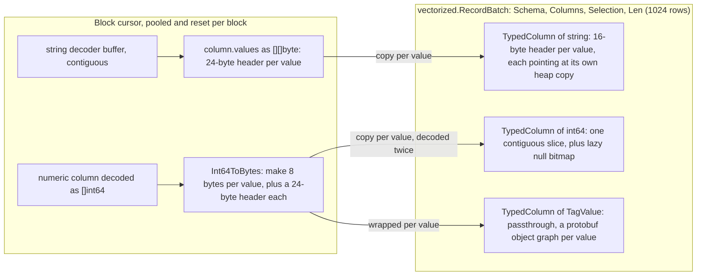
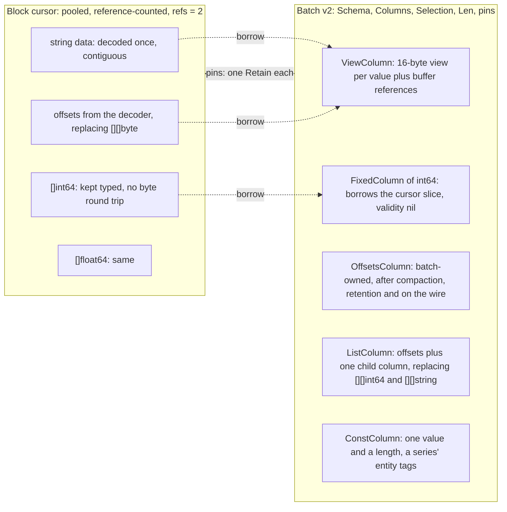
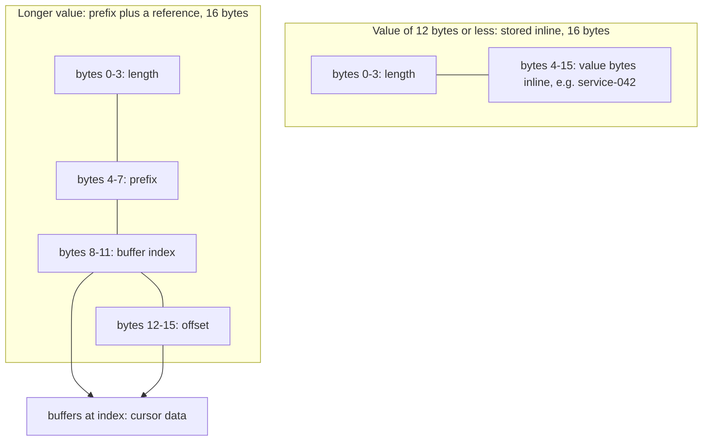
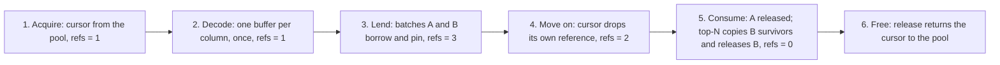
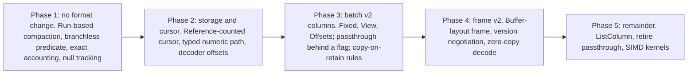

# Measure Batch v2: Reference-Counted, Columnar Data Unit

Status: **implemented** in 0.12.0 (see "As built" in each document).

This document specifies the vectorized query batch on measure data nodes: the in-memory data unit
(`pkg/query/vectorized`), its storage source (the block cursor in `banyand/measure`) and its wire
form (the frame between data nodes and the liaison). It is the data-unit half of a pair; the other
half, [Measure scan path v2](../measure-scan-path-v2/README.md), describes how the scan turns
storage blocks into these batches.

The original proposal was written against the an external benchmark harness that is not in this
repository (BanyanDB's vectorized core as of `origin/main` at the time; Go 1.25.13 and 1.26.8,
arrow-rs 60.0.0, arrow-go v18.8.0). Sections marked *design-time evidence* keep those
measurements because they justify the decisions. Where the shipped code differs from the proposal
the body says so, and [section 2](#2-as-built) lists every deviation.

---

## 1. Summary

Before this work, the data-node batch used Arrow's column-per-buffer idea for numbers but stored
every string, byte value and array as its own heap object, and round-tripped numbers through bytes
before they reached the batch. The design replaces those per-value objects with shared,
reference-counted buffers: borrowed from the block cursor while it is pinned, and copied into
batch-owned buffers only when a row must outlive the cursor.

| Design-time measurement (8,192-row string column) | Before | After |
|---|---|---|
| Heap allocations to build the column | 8,194 | 3 |
| Memory retained, zero-copy views | 524 KB | 131 KB |
| One GC cycle with 100 such batches alive, Go 1.26 | 3.8 ms | 1.1 ms |

The proposal, in one list:

- **A reference-counted block cursor.** Every batch that borrows its buffers pins it; it returns to
  the pool when the last pin is released.
- **Fewer, flatter column kinds** in place of eight, with a constant column for a series' entity
  tags, and protobuf passthrough columns retired.
- **No numeric round trip.** Storage keeps the `[]int64` / `[]float64` it already decodes instead of
  re-encoding each value into an 8-byte slice.
- **Frame v2**, which sends column buffers as laid out in memory so the liaison decodes by slicing.
- **Our own structure with Arrow-compatible layouts**, not the arrow-go library (section 12).

## 2. As built

Everything below shipped in 0.12.0, in this order. The
proposal's rollout (section 13) was followed, with the scan-path work (steps 4a-4d) interleaved.

### 2.1 What shipped

- **Typed numeric decode** . Null-free `int64` / `float64` columns read for a
  query decode straight into column-owned `[]int64` / `[]float64` and fill batch columns in bulk.
  Merge, flush, TopN and columns with nulls keep the byte form (`[][]byte`). Filling an 8,192-row
  numeric column drops from about 0.5 ms and 8,196 allocations to 40-86 us and 2 allocations
  (`CHANGES.md`).
- **Reference-counted block cursors.** `pkg/query/vectorized/owner.go` defines the `Owner`
  interface (`Retain` / `Release`) and the `Owners` pin set carried by `RecordBatch` and
  `MeasureBatch`. The block cursor is the canonical owner and returns to its pool when the last
  borrowing batch releases it. String, bytes and string-array tag cells borrow the decoded block
  memory; decoding an 8,192-row string column drops from 8,193 allocations to 1, and 33-58% in time.
- **Copy-on-retain.** Group-by, aggregation and TopN copy what they keep (`cloneOneValue`), and the
  response edge copies strings (`strings.Clone`). The liaison's distributed merge also clones
  borrowed frame strings it wraps into protobuf values (a bug found under release poisoning).
- **Per-row allocation removed from aggregation and TopN.** Group and replica-dedup keys are looked
  up from a reused buffer and copied only when a new group is inserted; a TopN row that displaces
  the heap root reuses the root's storage. On real stored blocks group-by + aggregation drops from
  about 103k to 2.8k allocations and TopN from 472k to 32k.
- **Native projected columns by default.** Every projected tag and field with a known schema type is
  a typed column instead of a protobuf passthrough column, and each response value is built in one
  allocation.
- **Borrowed numeric and timestamp columns** (scan step 4a):
  `TypedColumn.Borrow` lets a batch borrow the cursor's typed slice and copies before any write.
- **Constant columns** (step 5): `ConstColumn` holds one value and a length and reports
  the logical `ColumnType` of the column it stands for, so schemas and planners are unchanged.
  `ColumnDef.Entity` marks entity tags. A batch lent from a single series turns its projected
  entity tags into constants; interleaved merge pages stay typed. Run-based aggregation,
  time-bucket runs and `SelectRows` / `BatchColumnFilter` (a predicate on a constant column is
  evaluated once per batch) shipped with it; see the scan-path document, section 2.
- **Frame v2** : a custom columnar frame, **wire version 4**, measure only. Per
  column, a validity bitmap (only when there are nulls), `int64` / `float64` data, or `int32`
  offsets plus values, each zero-padded to 8 bytes, little-endian. Constant columns are sent as one
  value, bounded by a 256 MiB frame-wide expansion budget that the encoder respects by flattening.
  Arrays stay `TagValue` proto cells. Decode slices the received message: numeric columns borrow
  typed slices (copied once into an aligned buffer when the message is not 8-byte aligned or on
  big-endian), and strings are `[]string` views over the message, pinned by a `MessageOwner`. Every
  length and offset is validated; truncation and 30,000 random mutations error without panics.
- **Leak and use-after-release tooling.** `BYDB_POISON_RELEASED_CURSOR=1` overwrites released
  cursor memory so a use after release fails tests visibly; `verifyNoScanLeaks`,
  `ScanResourceSnapshot` and `OutstandingOwnerPins` fail a test (and the test binaries' `TestMain`)
  when cursors or owner pins remain at the end. The first run found 385 leaked cursors, all in
  tests that never released their batches.
- **Storage-backed gates.** `TestVectorizedStorageGates` in
  `banyand/measure/vectorized_gates_benchmark_test.go` decodes real stored parts inside the timer,
  compares against the previous passthrough column selection and pins absolute allocation budgets.
  The old gates, which built protobufs outside the timer, were removed.

### 2.2 Deviations from the proposal

| Proposal | As built |
|---|---|
| `FixedColumn[T]` borrowing the cursor's slice | The existing `TypedColumn[T]` gained `Borrow` for numerics and timestamps; there is no separate `FixedColumn` type. |
| `ViewColumn` of 16-byte views plus buffer list | Not built. Tag cells are ordinary Go `string` headers pointing into cursor memory; the pinned cursor keeps them valid. |
| `OffsetsColumn` (offsets + values) as the owned form | Not built as a batch column type. Offsets-plus-values exists only in the frame; owned data on the data node stays `TypedColumn[string]` (copied on retain). |
| `ListColumn` for arrays | Not built. Arrays stay slices; string arrays are slab-allocated. |
| `ConstColumn` | Built, for entity tags of single-series lent batches. |
| Retire protobuf passthrough columns | Partly. Passthrough columns remain for tags and fields the schema does not declare and for multi-group type conflicts. |
| Frame v2 negotiated per request, v1 still accepted | **No negotiation, no env var, no fallback.** 0.12.0 supports whole-cluster upgrades only (`docs/operation/upgrade.md`); the data node always sends version 4 and the liaison accepts only version 4. The old row frame (version 3) was deleted for measure. Stream and trace frames are unchanged. |
| Liaison keeps strings as offsets | Strings decode as `[]string` views over the received message, pinned by a `MessageOwner`; there is no offsets column on the liaison. |
| Branchless predicate loop, exact capacity-based accounting, cached null count (phase 1) | Branchless predicate loop and capacity-based accounting were not built; `TypedColumn.MayHaveNulls` is a boolean "a null was ever marked" flag that range loops use to skip per-row validity checks, not a cached count. See section 14.3. |
| SIMD kernels (Go 1.26 `archsimd`) and radix sort | **Not built.** Aggregation stopped being the bottleneck once folds became run-based, and float SIMD would reorder additions and change results. |
| Dictionary encoding, default batch size change | Not built. Owned batches stay at 1,024 rows; batches lent from storage pass through at block size, up to 8,192 rows. |

### 2.3 Measured results

All on real stored blocks with the gate workloads in
`banyand/measure/vectorized_gates_benchmark_test.go` (W1-W15; the core commit measured the first
eight), unless noted.

| Change | Result |
|---|---|
| Batch v2 core (typed decode, borrowing, native columns, no per-row allocation) | Geomean -6% time and -75% allocations across the eight gate workloads; group-by + aggregation -97% allocations |
| Full scan, native columns | 16% faster, 38% fewer allocations; limited and TopN scans 23-65% faster |
| Distributed full-scan frame, native columns (wire unchanged) | -49% time, -99.7% allocations |
| Constant entity-tag columns and run-based aggregation (step 5) | Geomean -25%; group-by + SUM/COUNT -67%, group by entity tags -68% |
| Frame v2, 4 columns x 8,192 rows | Decode 0.85 ms and 16,416 allocations down to 0.14 ms and 38; encode 1.3 down to 0.43 ms; frame 6% larger; distributed full scan -38% |

Soak: the in-process measure soak `TestMeasureVecSoak` (`DQB_SOAK=1`) ran 5,488 queries in 70 s
with every scan resource back to baseline. The soak's heap gate reads live heap as the minimum of
five samples after four GC rounds; twelve clean runs grew 1.0-1.6%.

---

## 3. Problem and evidence

*Design-time evidence.* All figures are for 8,192 rows on an AMD EPYC 7B13. Memory counters are
deterministic across runs; times are means of two runs, and GC times are medians of seven.

Memory retained by one long-string column (8,192 endpoint-like strings, 42.7 bytes average):

| Layout | Retained (KB) | Note |
|---|---|---|
| Then: `[]string` column | 524 | 8,194 heap objects |
| Then: passthrough protobuf column | 1,573 | 32,770 heap objects |
| arrow-go `Utf8` | 429 | 15 allocations |
| Offsets, owned | 393 | 3 allocations |
| Views, borrowed | 131 | 3 allocations; the cursor buffer is shared |

One GC cycle with 100 batches alive (Go 1.26.8, Green Tea GC, median of 7):

| Layout | GC cycle (ms) | Heap objects |
|---|---|---|
| Then: `[]string` column | 3.79 | 822 K |
| Then: passthrough protobuf column | 19.15 | 3.3 M |
| Offsets, owned | 1.16 | 3 K |
| Views, borrowed | 1.14 | 3 K |

Where the cost came from:

| What | Then | Arrow layout | Cause |
|---|---|---|---|
| Build long-string column: allocations | 8,194 | 3 | `c.Append(string(raw))` copies each value into its own object (`banyand/measure/batch_decode.go:59`) |
| Passthrough protobuf column: allocations / retained | 32,770 / 1.57 MB | - | A `TagValue`, `Str` and `string` per value |
| Whole 4-column batch retained | 896 KB | 633 KB | Per-value objects and their 16-byte headers (arrow-rs `Utf8`) |
| Frame decode: allocations / retained | 16,416 / 897 KB | 28 / 1.1 KB | Row-oriented frame: varint length + bytes per value; Arrow IPC decode slices the message |
| Compact after a 90% filter | 513-537 us | 64 us | `AppendActiveRows` copied one cell at a time through a type switch |
| Memory estimate vs actual | 1.22x in 20.6 us | 1.00x in 11 ns | `EstimatedRetainedBytes` walked every string cell |

A cost the benchmarks did not capture: before the batch saw a numeric value, storage decoded the
column into `[]int64`, then converted every value back into an 8-byte heap slice with
`convert.Int64ToBytes` (`banyand/measure/column.go:359-361`, float64 at `:404-406`;
`make([]byte, 8)` at `pkg/convert/number.go:27`), and the batch decoded those bytes into `int64`
again. The benchmark started from raw bytes, so the real numeric path was more expensive than
measured. (Line numbers are at design time, `origin/main` `18386182`.)

## 4. Goals and non-goals

| Goals | Non-goals |
|---|---|
| No per-value heap objects in a batch or in the block cursor. | Changing on-disk formats. |
| Decode each stored value at most once; copy it only when it must outlive the cursor. | Adopting arrow-go or any Arrow library for data-node internals (section 12). |
| Exact, cheap memory accounting, so the query memory budget is trustworthy. | Buffer alignment work: measured to make no difference to scans (0-4%, within noise). |
| A wire format the liaison can decode without rebuilding columns. | Dictionary encoding: promising for low-cardinality tags, but unmeasured; a follow-up. |
| ~~Rolling upgrades in either order.~~ Dropped: 0.12.0 supports whole-cluster upgrades only. | Changing the default batch size of 1,024 rows. |

## 5. The data unit before this work

`vectorized.RecordBatch` holds a schema, one `Column` per projected tag or field, an optional
`Selection []uint16` and a row count (`pkg/query/vectorized/batch.go:33`). A column is a
`TypedColumn[T]`: a Go slice plus a lazily allocated null bitmap. That is Arrow-like for `int64`
and `float64`; for every other type, `T` is itself a pointer-bearing Go value.



*Figure 1.* Every separate heap object is also a pointer the Go garbage collector must trace, which
is why GC time follows the object count rather than the byte count. 8,192 long strings are 8,194
heap objects (524 KB); the passthrough form is 32,770 objects (1.57 MB).

## 6. The data unit as proposed

The batch stops owning values one by one. It owns, or borrows, a few buffers per column, and
records who owns what it borrows. The block cursor becomes a reference-counted owner: the batch
pins it and borrows its decoded buffers directly.



*Figure 2.* Solid boxes in the batch are buffers it owns or its own bookkeeping; dotted arrows are
borrows from the pinned cursor. Per column there are at most three buffers and no object per
value, so the GC traces a handful of pointers per column rather than one per value. As built, the
`ViewColumn`, `OffsetsColumn` and `ListColumn` of this figure were not introduced as types; see
section 2.2.

### 6.1 Type sketch (proposal)

This sketch fixed the shapes under review. The shipped `Owner` is an interface with `Retain` and
`Release`, and the pin set is `vectorized.Owners`; the column types other than `ConstColumn` were
not built as drawn.

```go
// Owner is a reference-counted holder of buffers other objects borrow.
// The block cursor embeds one; its release returns the cursor to its pool.
type Owner struct {
	refs    atomic.Int32
	release func()
}

func (o *Owner) Retain()  { o.refs.Add(1) }
func (o *Owner) Release() { if o.refs.Add(-1) == 0 { o.release() } }

type Batch struct {
	Schema    *BatchSchema
	Columns   []Column
	Selection []uint16 // optional, as today
	Len       int
	pins      []*Owner // one Retain each; Release on batch release
}

// FixedColumn borrows (or owns) a typed slice.
type FixedColumn[T int64 | float64] struct {
	values   []T
	validity Bitmap // nil when there are no nulls
	nulls    int    // cached null count
}

// ViewColumn: 16-byte views into buffers it does not own.
type View [16]byte
type ViewColumn struct {
	views    []View
	buffers  [][]byte // borrowed; kept alive by Batch.pins
	validity Bitmap
	nulls    int
}

// OffsetsColumn: batch-owned; the retained and wire form of strings.
type OffsetsColumn struct {
	offsets  []int32 // len = rows + 1
	values   []byte
	validity Bitmap
	nulls    int
}

// ListColumn replaces per-row []int64 / []string slices.
type ListColumn struct {
	offsets  []int32
	child    Column
	validity Bitmap
	nulls    int
}

// ConstColumn holds one value for every row: a series' entity tags in a batch
// borrowed from a single series. Grouping and filtering on it is per batch.
type ConstColumn struct {
	value  Scalar // typed scalar (int64, float64, string, bytes) or null
	length int
}
```

### 6.2 Column kinds, before and proposed

| Before | Proposed | Built as | Why |
|---|---|---|---|
| `TypedColumn[int64]`, `[float64]` | `FixedColumn`, borrowing the cursor's slice | `TypedColumn` with `Borrow` | Removes the byte round trip; the layout is already right |
| `TypedColumn[string]`, `[[]byte]` | `ViewColumn` while streaming; `OffsetsColumn` once retained | Go string headers into cursor memory; copy on retain | No per-value object; zero-copy while the cursor is pinned |
| `TypedColumn[[]int64]`, `[[]string]` | `ListColumn` | Unchanged slices; string arrays slab-allocated | One offsets buffer instead of a slice per row |
| `TypedColumn[*modelv1.TagValue]`, `[*FieldValue]` | Retired; protobuf values built only at the response edge | Retired for schema-declared columns only | 3x the memory of a typed column and 16x the GC time of Arrow layouts |
| Any of the above holding a series' entity tag repeated in every row | `ConstColumn` | `ConstColumn` | Stored once; grouping is free; a filter keeps or drops the whole batch. Decision 5 of the scan-path design |

## 7. The 16-byte view

*Design-time evidence; the view layout itself was not built (section 2.2).* A view is Arrow's
`Utf8View` layout. Short values, which is most tag values (the benchmark's tags averaged 10.3
bytes), live entirely inside the view. Longer values keep a 4-byte prefix, so comparisons and
filters can often decide without touching the buffer.



*Figure 3.* Same layout as arrow-rs `ByteView` (`arrow-data/src/byte_view.rs:70-79`) and arrow-go
`arrow.ViewHeader`, so buffers stay Arrow-compatible. The offset locates the start and the length
gives the end.

**Why views here but offsets on the wire.** Views are the cheapest way to borrow: building one
copies nothing. Offsets are the cheapest way to own and to send: for the benchmark's short tags they
cost about 14 bytes per row (a 4-byte offset plus 10.3 bytes of data) against a flat 16 for a view,
and they never pin anyone else's buffer. Arrow's own copying view builder retained 640-725 KB for
350 KB of strings in the benchmarks, so owned strings should not be views.

## 8. Ownership and lifetime

Pools already mean manual memory management (`releaseBlockCursor`, `BatchPool.Put`,
`ReleaseColumn`). Sharing one cursor between several batches adds the one thing a single-owner pool
cannot express: a count of borrowers. That is the reference-counting model of arrow-go's
`memory.Buffer` (`arrow/memory/buffer.go:44-95`), which the benchmark verified end to end.



*Figure 4.* The cursor's count starts at 1 for itself, gains one per borrowing batch, and returns
the cursor to its pool at zero.

Rules:

- Streaming batches borrow freely. An operator that keeps rows across batches (top-N, group-by keys,
  sort, the liaison merge) copies them when it keeps them, then releases the source batch. A few
  survivors must never pin a whole block.
- Accounting counts each pinned cursor buffer once, however many batches share it; otherwise the
  memory budget undercounts.

Reference counting fails silently. While writing the arrow-go benchmark a reference was leaked
twice: once with an extra `Retain` (arrow-go's `NewData` already retains its buffers), once by
dropping arrays without `Release`. Neither crashed or reported anything; the release hook simply
never ran, which in production means a cursor that never returns to its pool. Two safeguards are
part of this design, and both were built (section 2.1):

- a test-mode check that fails a test if any reference is still held at the end;
- a test-mode poison that overwrites released buffers, so a use after release shows up as wrong data
  in the existing equivalence suites rather than silently.

Because a missed `Release` only keeps an owner from being recycled (the garbage collector still
frees it) while an early release is the dangerous direction, callers release only when they can
prove no borrowed value is read again.

## 9. End-to-end data path

```mermaid
flowchart LR
    subgraph DN["Data node"]
        direction LR
        ST["Storage block: compressed on disk"] --> CD["Cursor decode: decompress once, typed buffers"]
        CD --> BV["Batch v2: zero-copy, borrowed"]
        BV --> FI["Filter: selection vector or bitmap"]
        FI --> AG["Aggregate: copy on retain, run-based"]
        AG --> EN["Frame v2 encode: copy, write buffers"]
    end
    subgraph LI["Liaison"]
        direction LR
        DE["Frame v2 decode: zero-copy, slices the message"] --> ME["Merge and reduce: copy on retain, pins the message"]
        ME --> RE["Response edge: build protobuf, only rows returned"]
    end
    EN -- network --> DE
```



*Figure 5.* Copies happen only at ownership boundaries: when a value is retained, when it is sent,
and when it is turned into the response, never once per operator. Before this work a string was
also copied at decode, in the frame decode, and inside every passthrough protobuf.

## 10. Filtering, accounting, SIMD

| Area | Change | Evidence (design-time) |
|---|---|---|
| Selection vector | Keep it: the cheapest way to mark rows (one fixed 16 KB slice). | measured 13-17 us at any selectivity |
| Predicate loop | Branchless: always write the index, advance only on a match. | measured 6.0 us at every selectivity vs 7.8-10.6 us; 1.3-1.8x |
| Entity-tag filters | Evaluate a predicate on a `ConstColumn` once per batch, then keep or drop the whole batch. | one comparison per batch instead of one per row (built) |
| Compaction | Copy runs of consecutive survivors once per column, not one cell per call. | 513-537 us at 90% before, arrow-rs 64 us |
| Null handling | Cache the null count; skip per-row checks when it is zero. | as Arrow's `NullBuffer` (`null.rs:34-37`) |
| Memory accounting | Sum buffer capacities per column; count pinned buffers once by identity. | 1.22x over in 20.6 us before; arrow-rs exact in 11 ns; arrow-go's length-based count undercounts by 27-41%, so use capacities |
| SIMD (Go 1.26 `archsimd`) | After the layout change, for fixed-width kernels: sum, min/max, predicate to bitmap. Build tag, scalar fallback, runtime AVX2 check. | measured sum 1.5-1.9x; predicate to bitmap 3.4 us. Converting a mask to a selection vector with SIMD loses at high selectivity (15.2 us at 90% vs 5.9 us scalar). **Not built.** |

Go 1.26 changes none of the memory findings: allocations and retained bytes were identical to the
byte, and Green Tea GC cut the `[]string` column's GC cycle by 17% while leaving it 3.3x the Arrow
layouts. SIMD cannot operate on per-value objects at all, so the layout change had to come first.

## 11. Wire format v2

Frame v2 sends each column's buffers (validity, offsets, values, fixed-width data) as they sit in
memory, padded to 8 bytes. The liaison builds each column by slicing the received message, which it
keeps pinned until the columns are released or copied on retention. Borrowed strings are copied into
the frame at encode, so a frame never references another process's memory.

| | Row frame (then, version 3) | Frame v2, projected | Arrow IPC (arrow-rs), measured | Frame v2, as built (version 4) |
|---|---|---|---|---|
| Size, 4-column 8,192-row batch | 586 KB | about 630 KB | 636 KB | +6% over the row frame |
| Decode allocations | 16,416 | tens | 28 | 38 |
| Retained after decode | 897 KB | about 1 KB + pinned message | 1.1 KB | not measured |
| Decode time | 722 us (0.85 ms in the final benchmark run) | tens of us | 51 us | 0.14 ms |

The design predicted frames about 8% larger because offsets become fixed 4-byte integers instead of
varints; the built frame was 6% larger. Per-buffer compression can win that back if network cost
matters (not built).

### 11.1 Negotiation (proposed, not built)

The proposal had the liaison advertise `max_frame = 2` in the request, the data node reply with the
highest version both sides support, and the liaison accept both v1 and v2, so that new and old
liaisons and data nodes could be mixed in either order. This was implemented first (additive
`InternalQueryRequest.max_frame_version`, `BANYAND_MEASURE_FRAME_MAX_VERSION`, a three-cluster
mixed-version integration suite) and then removed: BanyanDB 0.12.0 supports
whole-cluster upgrades only (stop every node, start the new binary; see
[Upgrading to 0.12](../../../operation/upgrade.md#upgrading-to-012)). Measure data nodes always send
version 4, the liaison rejects any other measure frame version with an error that names the upgrade
rule, and there is no fallback. The old measure row frame (version 3) encode and decode were
deleted.

## 12. Decision: our own structure vs arrow-go

*Design-time evidence.* arrow-go v18.8.0 was measured on the same workloads in the same Go 1.26.8
program as BanyanDB's batch (8,192 rows).

| | BanyanDB then | Own code, Arrow layout | arrow-go |
|---|---|---|---|
| Build long-string column: allocations / retained / time | 8,194 / 524 KB / 335 us | 3 / 393 KB / 175 us | 15 / 429 KB / 305 us |
| Zero-copy string views | - | 3 / 131 KB / 81 us | 5 / 131 KB / 75 us (low-level API only) |
| Build int64 column: retained | 65.6 KB | - | 142 KB |
| Filter at 10% / 90% | 67 / 513 us | - | 167 / 453 us; views unsupported |
| Memory estimate vs actual | 1.22x | - | 0.59-0.73x (undercounts) |
| Binary size added | - | - | +4.6 MB core, +24 MB with compute |

Decision: a BanyanDB-specific structure with Arrow-compatible buffer layouts, and reference
counting modelled on arrow-go's `memory.Buffer`.

- arrow-go's ownership model fits the pinned cursor well: `NewBufferWithAllocator` calls `Free` once
  the last reference goes, verified in the benchmark.
- But the layout this design depends on is poorly supported: compute cannot filter view columns
  (`function 'array_take' has no kernel matching input types (string_view, uint16)`), and its
  builders only copy.
- Its generic kernels are slower than purpose-built code at this batch size, and its accounting
  undercounts.
- Keeping buffers Arrow-compatible preserves a cheap path to arrow-go's `ipc` package later, at an
  external boundary, for about 5 MB and no compute.

## 13. Rollout

The proposal was five phases, each gated on the benchmark suite, the existing proto-equivalence
suites and the soak test before the next began.



*Figure 7.* Phase 1 was low-risk and useful on its own. Phases 2-3 carry the memory win and touch
most of the 115 variable-width and 149 passthrough call sites.

As built, the work shipped as one branch in this order: typed decode and reference-counted cursors
with copy-on-retain and native columns, the scan-path steps 4a-4d (see the
[scan-path document](../measure-scan-path-v2/README.md#2-as-built)), constant columns and run-based
aggregation, then the columnar frame (its version negotiation was added and then removed). The
ListColumn, passthrough-flag, SIMD and negotiation parts of phases 3-5 were not
built as proposed (section 2.2).

### 13.1 Expected effect (projected at design time)

Projected from the benchmarks, not measured end to end, for a 4-column 8,192-row batch:

- Retained memory about 896 KB to 630 KB (-29%) with owned offsets; lower while streaming as views.
- GC cycle time for string columns about -70-80%.
- Frame decode allocations -99%; decode time from hundreds of microseconds to tens.
- The numeric round trip removed: one heap object and one 24-byte header fewer per numeric value in
  the cursor.

The measured end-to-end results are in section 2.3.

## 14. Risks

| Risk | Mitigation | Outcome |
|---|---|---|
| A borrowed string or slice used after its cursor is released | Test-mode poisoning; lifetime contract documented on every accessor that returns borrowed data | Built (`BYDB_POISON_RELEASED_CURSOR=1`); it found a liaison merge that wrapped borrowed strings without copying |
| A leaked reference: the cursor never returns to its pool | Test-mode check for outstanding references; pool metrics in soak tests | Built (`verifyNoScanLeaks`, `OutstandingOwnerPins`, soak) |
| A few survivors pinning whole blocks | Copy on retain for every operator that buffers rows; accounting charges pinned buffers to the query | Built for group-by, aggregation, TopN and the response edge |
| More cursors alive at once | Bounded by the number of batches in flight; pool size tracked in metrics | Bounded by per-cursor reservations (scan-path document, section 11) |
| Wire incompatibility during upgrades | Negotiated frame version; v1 remains supported | Superseded: whole-cluster upgrade, version 4 only |
| Building protobufs at the edge costs more than passthrough saved | Measure before retiring passthrough; keep it behind a flag until then | Measured (section 15); passthrough kept only where the schema does not declare the column |

### 14.1 Cost of retaining a borrowed batch

A retained batch keeps its whole cursor alive. The accounting rule (count each pinned buffer once)
and the copy-on-retain rule are what keep this bounded.

### 14.2 Alignment

Buffer alignment was measured to make no difference to scans (0-4%) and was not pursued. The frame
decoder copies once into an aligned buffer only when the received message is not 8-byte aligned.

### 14.3 Phase 1 items

Checked against the code at the end of this work:

- **Branchless predicate loop.** Not built. `SelectRows` evaluates a constant column once per batch
  and any other column row by row with the caller's predicate.
- **Capacity-based memory accounting.** Not built. `EstimatedRetainedBytes` keeps its per-row
  heuristic; the scan's own memory accounting is the per-cursor reservation described in the scan
  path design.
- **Cached null count.** Partly built. `TypedColumn.MayHaveNulls` reports whether a null was ever
  marked, which is enough for aggregation range folds to skip per-row validity checks, but no null
  count is kept.

## 15. Decisions and remaining open questions

### 15.1 Decided

- **Frame v2 vs Arrow IPC.** A custom frame with Arrow-compatible buffers. Real IPC would buy
  interoperability at 9-28% larger messages and a dependency; the compatible layout keeps an IPC
  adapter cheap if an external boundary ever needs one.
- **Views on the liaison.** Proposed: keep decoded strings as offsets, as sent. Built differently:
  strings decode as `[]string` views over the received message, pinned by a `MessageOwner`. The
  reasoning that the liaison has no cursor to borrow from still holds; the message plays the cursor's
  role.
- **Passthrough retirement.** Retire it for anything that can be filtered, limited or aggregated
  before the response; built for every schema-declared column. Measured on one 8,192-row block with
  three string tags and an int64 tag, building `TagValue`s at the response edge
  (external harness, Go 1.26.9):

  | Rows reaching the response | Then (passthrough) | View column | Offsets column |
  |---|---|---|---|
  | 100% | 13.7 ms, 205k allocs | 13.7 ms | 13.7 ms |
  | 10% | 8.5 ms, 131k allocs | 1.6 ms, 20k allocs | 2.3 ms |
  | 1% | 7.4 ms, 124k allocs | 0.48 ms, 2k allocs | 1.1 ms |

  At 100% both build the same objects, only later, so they tie; v2 never loses. Decode alone drops
  from 7.3 ms and 123k allocations to 0.49 ms and 6.
- **Numeric storage path.** Decode into a typed slice for the query path and keep `[][]byte`
  alongside it. Query-path readers (`block_batch.go`, `batch_decode.go`) take `[]int64` /
  `[]float64`; aggregation, TopN and the frame encoder already read typed batch columns. The byte
  form stays for columns with nulls, the write path, and merge/flush, which append raw values
  between blocks. Measured per 8,192-row column (external harness):

  | Column | Then | Typed slice |
  |---|---|---|
  | int64 counter | 331 us, 8,193 allocs | 20 us, 0 allocs |
  | int64 gauge | 334 us | 39 us |
  | float64 counter / gauge | 331 / 480 us | 72 / 74 us |

  Columns with nulls and merge/flush with two representations were not measured at design time.
- **Batch size.** Batches borrowed from storage pass through at block size, up to 8,192 rows, and
  only tiny windows (under 256 rows) are copied together (scan-path decision 4). Batch-owned columns
  stay at 1,024 rows. The `uint16` selection caps a batch at 65,536 rows.

### 15.2 Remaining open

- Whether the default for batch-owned columns should move from 1,024 toward 8,192 rows.
- SIMD kernels for fixed-width columns and a radix sort for grouping, deferred: aggregation is no
  longer the bottleneck after run-based folds, and float SIMD would reorder additions.
- Adopting the same reference-counted, columnar batch in the stream and trace engines (their frames
  are unchanged).
- `ConstColumn` on the liaison: the frame carries constants as one value; keeping them constant
  through the liaison's merge was not part of this work.
- An offsets-based string column on the liaison or in batch-owned columns (the benchmark's 393 KB vs
  524 KB case), if retained-memory pressure shows up.
- Dictionary encoding for low-cardinality tags, and per-buffer frame compression.

## Appendix: method and sources

*Design-time.*

- **Benchmarks:** External harness (not in this repository): Go (`go/cmd/bench`, including `arrowgo.go` and the SIMD
  kernels), Rust (`rust/src/main.rs`), results in `data/` and `data/v2/`, full report in its
  `README.md`. A fixed-seed generator writes identical input for both languages.
- **Memory metrics:** allocations per op, bytes allocated per op, and bytes retained by the result.
  Go uses `testing.Benchmark` and `runtime.MemStats`; Rust a counting allocator recording
  `malloc_usable_size`.
- **Machine:** AMD EPYC 7B13 (Zen 3), AVX2, no AVX-512; 32 KiB L1d and 512 KiB L2 per core;
  single-threaded runs.
- **Versions:** Go 1.25.13 and 1.26.8; arrow-rs 60.0.0 (the version DataFusion depends on); arrow-go
  v18.8.0.
- **Key code references at design time:** `pkg/query/vectorized/batch.go:33`, `typed_column.go`,
  `appendrange.go`, `retained_bytes.go`, `frame/doc.go:59-62`; `banyand/measure/batch_decode.go:59,66`,
  `block.go:907`, `column.go:359-361,404-406`; `pkg/encoding/bytes.go:106-123`;
  `pkg/convert/number.go:26-29`.
- **Where the built code lives:** `pkg/query/vectorized/owner.go`, `const_column.go`,
  `typed_column.go` (`Borrow`), `frame/columnar.go`, `frame/columnar_decode.go`;
  `banyand/measure/block_batch.go` (`lendBatch`).
- **Caveats:** cross-language times include compiler and runtime differences; the data has no nulls
  and is ASCII; alignment and SIMD results are for sequential scans on Zen 3; projected figures are
  marked as such.
