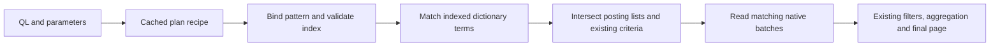
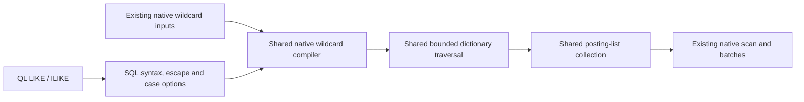
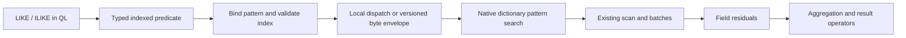

# Indexed LIKE and ILIKE for measure QL

This follow-up extends the merged Catalog B engine with indexed whole-value pattern predicates. The baseline is main `b54a9fc76` (PR #1438). External protobuf definitions and persisted index formats remain unchanged.

## Public interface

Expose two infix predicate operators, with one shared implementation:

```sql
WHERE name LIKE ?
WHERE name ILIKE ?
WHERE name LIKE ? ESCAPE '!'
```

LIKE is case-sensitive. ILIKE ignores case under the deterministic Unicode simple-fold contract below. There are no LIKE()/ILIKE() function-call aliases in this ticket. Existing MATCH remains analyzed token search; SUBSTRING remains available as a future name for text extraction, not boolean search.

Patterns match the **entire indexed value**. To search anywhere inside a name, bind `%clau%`; bind `clau%` for a prefix or `%sonnet` for a suffix. Applications can keep their existing logic that escapes user text and adds surrounding percent signs.

```sql
SELECT name, COUNT(DISTINCT member) AS members
FROM MEASURE activity IN metrics
WHERE time >= ? AND time < ?
  AND name ILIKE ?
  AND value::FIELD > 0
GROUP BY name
ORDER BY members DESC, name ASC
LIMIT ? OFFSET ?
-- Bind the pattern to %clau%; time is the measure's native timestamp.
```

## How execution works

The compiled plan remembers the source tag and the pattern parameter slot. Each execution binds its own pattern, validates the current index bindings, and sends the predicate to the existing native scan. Reusing a compiled plan never reuses another execution's pattern or mutable matcher.

Suppose the name dictionary contains `api-v1`, `API-v2` and `web`. For `name LIKE '%api%'`, the matcher accepts `api-v1`. For `name ILIKE '%api%'`, it accepts both `api-v1` and `API-v2`. It then reads the accepted terms' posting lists, which identify matching documents. Metric rows outside those postings are not fetched to test the pattern. Projection, field filtering, aggregation and pagination use the existing query operators.



Both operators lower to the native wildcard request and share its restricted matcher with existing wildcard searches: literal characters, `_` for one Unicode scalar and `%` for any number of scalars. Escapes turn the following character into a literal. ILIKE changes literal comparison to Unicode simple folding; it does not rewrite stored names, split punctuation or require a new analyzer. Distinct counts and grouping still see the original strings.

A case-sensitive pattern with no wildcard uses an exact term lookup. A literal prefix narrows the dictionary range before the matcher runs. A leading `%` can require exploring many dictionary terms, even when no term matches; this is why substring search costs more than an exact lookup. The lazy automaton creates states and byte transitions as traversal needs them, retaining UTF-8 decoding state so `_` consumes a complete scalar rather than one byte. Work, expansion and allocation limits stop excessive exploration with an error.

## Pattern and value semantics

| Construct | Meaning |
|---|---|
| `%` | Zero or more Unicode scalar values, including newlines. |
| `_` | Exactly one Unicode scalar value, including newline; not one UTF-8 byte. |
| Other characters | Literal, including `*`, `?`, `.`, `[`, `]`, hyphens and spaces. |
| Escaped character | The following character is literal, including `%`, `_` and the escape character itself. |
| No ESCAPE clause | Backslash is the escape character. |
| `ESCAPE '!'` | The specified single Unicode scalar is the escape character. |
| `ESCAPE ''` | Escaping is disabled. Backslash is then literal. |
| Trailing escape | Invalid pattern; return a query error. |
| Empty pattern | Matches only an empty string. |
| NULL source or pattern | UNKNOWN; excluded by the supported positive WHERE placement. |

Accept a scalar STRING source tag and a string literal, scalar string binding, or NULL pattern. Reject arrays, numeric coercion, computed patterns and unsupported source expressions. The optional ESCAPE is a literal string containing zero or one Unicode scalar. Parameterized ESCAPE and NULL ESCAPE are outside this first grammar contract and fail explicitly. Invalid UTF-8 patterns and invalid escape literals fail before storage opens. Do not trim or split strings.

Examples use decoded pattern values, not SQL source-literal escaping:

| Value | Operator | Pattern | Escape | Result |
|---|---|---|---|---|
| `Claude-Sonnet` | LIKE | `%clau%` | default | false |
| `Claude-Sonnet` | ILIKE | `%clau%` | default | true |
| `Claude-Sonnet` | LIKE | `%ude-Son%` | default | true |
| `Claude-Sonnet` | LIKE | `Claude` | default | false: whole-value matching |
| `Claude-Sonnet` | LIKE | `Claude_Sonnet` | default | true |
| `a_b` | LIKE | `%a!_b%` | `!` | true |
| `a-b` | LIKE | `%a!_b%` | `!` | false |
| `20%` | LIKE | `20!%` | `!` | true |
| `a*b` | LIKE | `a*b` | default | true: star is literal |
| `a中b` | LIKE | `a_b` | default | true |
| `a` + newline + `b` | LIKE | `a_b` | default | true |
| empty string | LIKE | empty string | default | true |
| empty string | LIKE | `%` | default | true |
| NULL | LIKE | `%` | default | UNKNOWN |

ILIKE uses locale-independent Unicode simple folding, without accent folding, Unicode normalization or multi-character expansion. Keep original names intact for projection, grouping and COUNT DISTINCT. This matches the required ASCII-name behavior but is not universal PostgreSQL locale/collation equivalence. Arbitrary COLLATE clauses and session locales are excluded.

Keep the existing QL string-literal decoder unchanged. It interprets backslash escapes differently from PostgreSQL's usual standard-conforming strings. Prefer parameter bindings for patterns; for readable literal examples use a custom escape, such as `name LIKE '%a!_b%' ESCAPE '!'`. Tests must prove that equivalent decoded literal and bound patterns produce identical results. Parsing a QL string and parsing a LIKE pattern are separate steps.

Reference: PostgreSQL [pattern matching](https://www.postgresql.org/docs/current/functions-matching.html) and [string functions](https://www.postgresql.org/docs/current/functions-string.html). The limitations above must appear in QL documentation; do not claim full PostgreSQL expression/collation compatibility.

## Required index configuration

An active single-tag inverted index must preserve the complete scalar string. The analyzer may be omitted, empty, or `keyword`:

```yaml
metadata:
  name: name_search
  group: metrics
tags:
- name
type: TYPE_INVERTED
# analyzer: keyword is optional.
```

Both current write encoders and native analysis preserve whole values for these configurations. Empty strings are already indexed and native dictionary iteration distinguishes an empty term from exhaustion. No analyzer registration, write-format change or index rebuild is required for compatible existing data.

Reject `simple`, `standard`, `url`, missing indexes, array tags, unsupported index types and ambiguous tag identity. Also reject a tag covered by more than one distinct valid index rule, including a keyword rule alongside a tokenized or multi-tag rule. Writes populate the first valid covering rule, while binding order can differ across nodes; selecting another rule would silently search an empty field. Repeated bindings of the same identified rule are deduplicated. Rules referencing removed tags are ignored, matching write-path validation. A tokenized index cannot reconstruct separators or complete names.

QL and workers validate eligibility in every requested group, including cache hits and empty candidate sets. The liaison shares one binding/rule lookup per group when a query needs both pattern and array-membership validation. Index-rule/binding changes invalidate eligibility or trigger revalidation until they are tracked cache dependencies. A missing posting in a valid index retains BanyanDB's normal visibility semantics; it does not trigger a scan, write barrier or backfill.

## Supported composition

V1 supports positive source-WHERE conjuncts, including parenthesized AND, with existing time/tag predicates and typed field residuals. Multiple LIKE/ILIKE predicates intersect. Reject new predicates under OR/NOT, NOT LIKE/NOT ILIKE, projection, HAVING or computed source expressions until exact indexed lowering is supplied. Existing predicate behavior is unchanged.

The plan must apply operations in this order:

```text
time/series selection + indexed patterns + ordinary index criteria
    -> native rows/batches
    -> remaining field filters
    -> aggregate / COUNT DISTINCT
    -> HAVING, result ordering and pagination
```

A NULL pattern can select no candidates in this positive WHERE context. Retain its logical UNKNOWN semantics; do not advertise a general false-valued scalar expression. Validate bound types and pattern syntax before opening storage. A future negative predicate must exclude NULL sources explicitly; complementing all documents is incorrect.

## Planner and native search

Represent the pattern in the typed expression AST at comparison precedence. Its source and pattern are expression children; the operator carries case mode and a literal escape descriptor. LIKE, ILIKE and ESCAPE are contextual expression words, not new globally reserved resource names: existing names such as `like-rate` and `escape-group` remain valid. Preserve pattern parameter order and traverse it through preparation, binding, cloning and cache accounting. Keep LIKE/ILIKE out of the general row evaluator.

Add an extraction pass over safe AND conjuncts. Produce immutable source-index recipes for patterns and compile the remaining expression using the existing field filter engine. The existing necessary-criteria helper is insufficient: it retains the complete residual and cannot evaluate an index-only pattern. The old MATCH/residual limitation need not be expanded to deliver these operators.

At bind time, create query-local pattern values. Carry source/tag identity, pattern and escape/case semantics to each selected worker. Validate live index bindings through the existing per-execution measure membership-validation seam or a focused shared helper. Native aggregate shortcuts must be disabled unless their actual request carries and applies the complete new predicate before aggregation.

Extend the existing native wildcard request with typed `WildcardPattern` options: pattern, syntax, escape and case mode. The existing `Wildcard` byte patterns and typed `WildcardPatterns` both enter one compiler, one compiled-pattern list and one candidate collector. QL uses the SQL syntax option; there is no separate native `SQLPatterns` execution branch. Compile once per bound predicate per native call, reuse across segments, and intersect matching postings with the existing candidate universe. Ordinary Terms/Prefix requests and legacy wildcard results keep their meanings.

| Rule | Existing wildcard defaults | LIKE / ILIKE |
|---|---|---|
| Any sequence | `*` | `%` |
| One Unicode scalar | `?` | `_` |
| Escape | Disabled; backslash literal | Configurable, default backslash |
| Wildcards consume LF newline | No | Yes |
| Case comparison | Sensitive | LIKE sensitive; ILIKE simple folding |

Typed wildcard options also support explicit escaping and case folding for native glob callers. The defaults above preserve existing call behavior. Legacy wildcard `?` already consumed a Unicode scalar, despite its earlier byte-oriented comment. Literal newlines still match themselves in either syntax.



The shared wildcard compiler recognizes only literal runs, any-rune and any-rune-star. It treats all other regexp characters literally and uses whole-key acceptance rather than adding unsupported regexp anchors. Existing native dictionary/automaton and postings machinery supplies execution; do not build another index or expose arbitrary regexp syntax.

Safe optimizations:

- LIKE with no wildcard lowers to exact term lookup after unescaping, including an empty term.
- A case-sensitive literal prefix can narrow the dictionary range while the full pattern automaton still checks acceptance.
- Do not replace ILIKE with lowercased exact/prefix lookups: dictionary values preserve their case.
- Do not remove Unicode validation from a prefix shortcut merely because native fields hold bytes. Native index APIs permit malformed UTF-8; wildcard matching must not accept malformed suffixes that the Unicode automaton rejects. Keep the automaton unless valid-string provenance is enforced.

Preserve native index ordering and valid limit/offset pushdown for fully native raw queries. The typed binder pushes an OFFSET + LIMIT window for this fully native shape and applies the final page in QL for both deployment modes. Raw queries that would require QL row sorting are rejected; callers can order by time or an explicit native index rule. Existing grouped-result sorting remains unchanged.

## Distributed execution without protobuf edits

LIKE/ILIKE do not fit the existing protobuf MATCH/analyzer fields. Use a versioned internal measure-QL byte topic. The bounded envelope carries the unchanged native request bytes plus logical typed pattern predicates. Never encode operation names in analyzer strings or unknown enum/field values; do not transmit compiled automata or physical index IDs.

Standalone uses the same typed scan extension in-process. Distributed execution encodes it only at remote send and resolves the index independently on every worker. Both paths reuse existing native scans, batches, responses and aggregation. Queries without patterns retain their existing payload/topic.



Carry the extension through BatchQueryRequest, standalone query processor, distributed single/multi-group plans, ScanParams, MeasureQueryOptions and IndexSearchOpts. Register the topic/receiver with existing response codecs and query operation classification. Include it in native receive-window/fanout admission, raw response allowance and frame counters. Byte messages must explicitly retain group identity; it cannot be recovered from opaque data.

The byte codec lives beside vectorized measure requests; `api/data` owns only topic registration and classification. Decode validates version, counts, lengths, case/escape values and native scan shape before allocation. Use the existing message cap and clamp budgets to server policy. Preserve routing, schema access, cancellation/deadline and allocation scope. Old nodes reject the unknown topic; their error must fail the whole query, with no missing-node success, predicate dropping or unfiltered retry. Test this through the actual queue/collector.

## Resource limits and plan reuse

Cache immutable AST and index-predicate recipes. Patterns, compiled automata, counters and candidates belong to each execution. Do not cache arbitrary user patterns globally or let concurrent bindings mutate the template. Include validation and compilation in performance measurements.

Policy: pattern at most 1 KiB valid UTF-8, at most 16 pattern conjuncts, at most 1,000,000 dictionary state/arc work units and 100,000 term expansions per worker request, shared across its predicates/segments. The SQL byte/count limits are shared constants; wildcard state bitsets are sized from the parsed pattern and admitted before allocation. Candidate, response and envelope memory remain subject to existing query/message limits. These limits fail with ResourceExhausted; they never truncate successful counts.

The transport's 4 MiB envelope cap is a wire-format maximum, not a promise that every request of that size fits the query budget. Encoding holds protobuf bytes and the enclosing body; decoding can allocate many Go message objects from compact wire fields. Named admission helpers therefore retain distinct conservative estimates. The worker reserves `64 * envelopeBytes + 4096` before decoding and holds it until transport ownership ends. Under the default 256 MiB query allowance, a near-cap envelope can fail before any scan. This conservative admission policy is unchanged; reducing it requires a separately justified decoder allocation bound.

The native wildcard implementation uses a lazy Unicode NFA through the existing dictionary automaton interface. It replaces the previous uninstrumented Vellum regexp compiler for wildcard requests; both syntaxes use the same bounded implementation. Each automaton has a 1 MiB cumulative allocation bound; all pattern programs and automata share a 16 MiB worker allowance, subject to the existing query memory budget. Immutable programs are compiled once per worker budget and remain charged to the shared query tracker across group source closures. The dispatch owner closes this cache after all eager native selections finish. Native callers without an explicit cache owner retain programs only within each call. Mutable transitions remain local to each native call and are reused across its segments. Construction, traversal and term expansion consume the shared work allowance. State bitsets are sized to the pattern; a charged scratch buffer is reused during transitions and new states copy their bits only after reservation succeeds.

The SQL byte/count/default-work/default-term policy is not imposed on legacy series selectors. Legacy wildcard requests retain their caller-supplied expansion bounds and accept long patterns and more than 16 operands, subject to memory admission. Explicitly supplied wildcard budgets apply to all participating patterns. Cancellation is checked inside traversal even when no term matches. Both dialects use the same allocation accounting and cleanup.

Vellum's regexp instruction-size limit did not cover its parser and DFA allocations and offered no caller cancellation or allocation hooks. Keeping that compiler behind a wrapper would not provide the pre-allocation memory guarantee. The shared bounded compiler supplies that guarantee without creating a second LIKE-only search engine.

Dictionary traversal must check cancellation/work inside state transitions, including searches yielding no terms. A wrapper may record exhaustion and prune further work, but callers must check the recorded error after iterator construction and every advance before interpreting exhaustion as success. Cover both admitted and paged dictionaries. Bound term expansions and posting growth independently and release native pool ownership on every exit. No spilling, stronger consistency or recovery sorting is introduced.

## Verification

See the [verification record](indexed-patterns-verification.md) for observed results and limitations.

Generated QL-only scenarios use a neutral name fixture, an independent dynamic-programming pattern oracle and pinned PostgreSQL reference examples. The same cases run through the real QL RPC with compiled-plan reuse enabled and bypassed, in standalone and distributed deployments. They cover scalar/grouped COUNT DISTINCT, field residuals, native-index pagination, bindings, empty/NULL values and unsupported index/source shapes.

Native tests cover persisted/reopened indexes, randomized Unicode patterns, no-match work limits, allocation cleanup and cancellation inside admitted and paged dictionaries. Transport tests cover the envelope, live schema validation, explicit group routing, receive admission and worker failures. The focused benchmark compares pattern COUNT DISTINCT queries with equivalent precomputed IN lists and one exact-name control; fixture discovery is outside timing.
