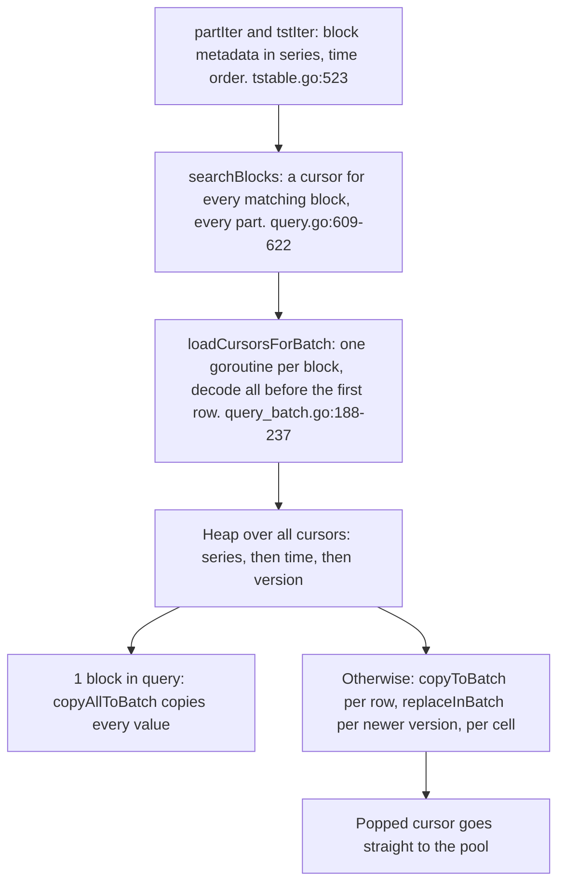
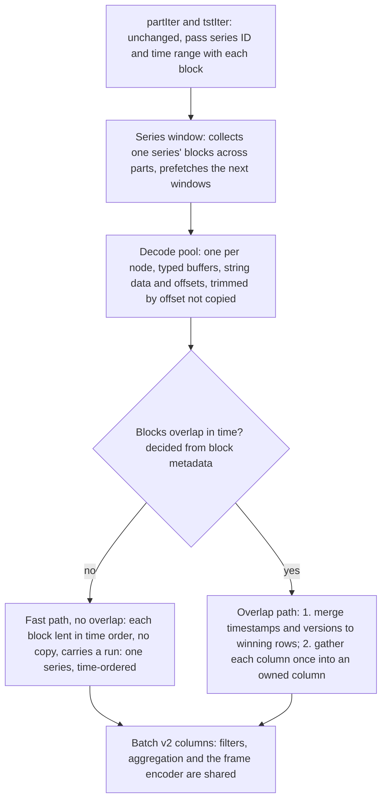
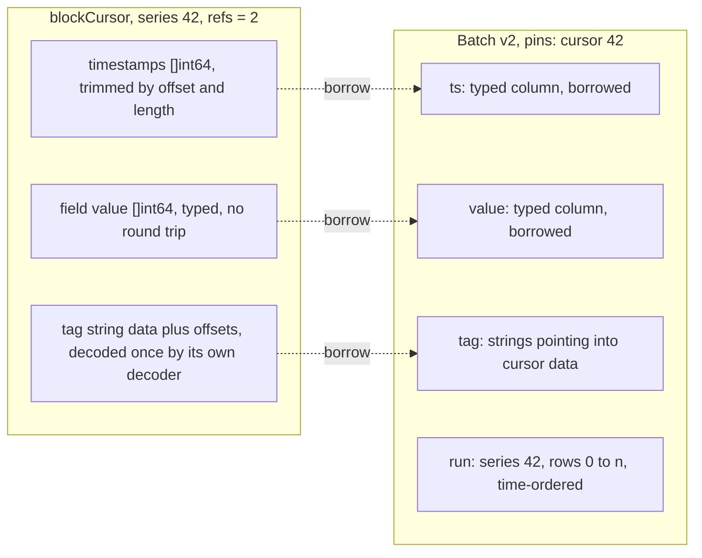
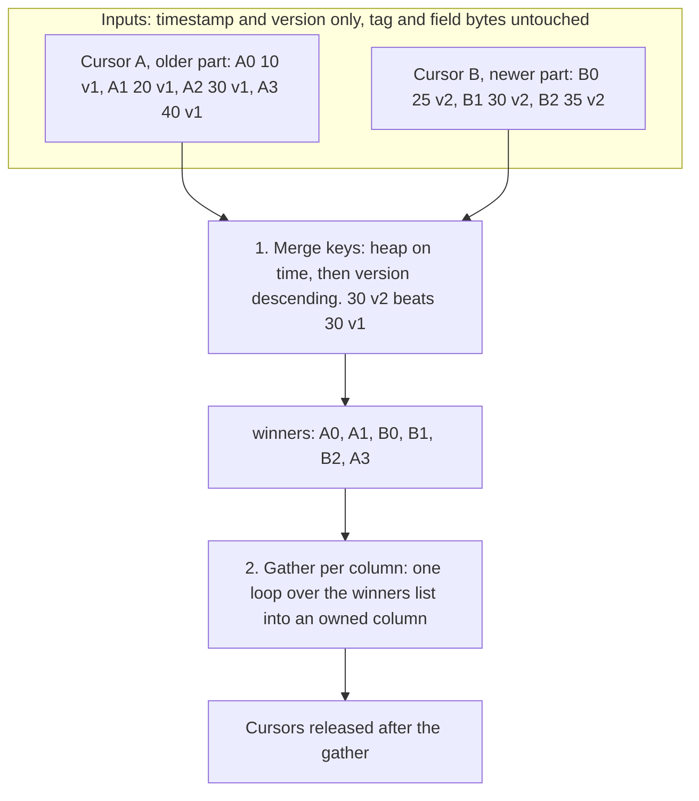
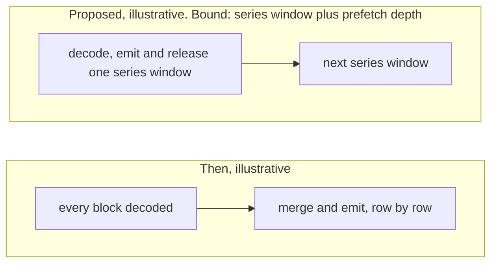
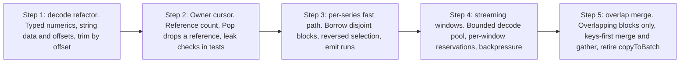

# Measure Scan Path v2: Streaming Series Windows and a Time-Ordered Merge

Status: **implemented** in 0.12.0 (see "As built" in each document).

This document specifies how a measure query turns storage blocks into batches on a data node:
`partIter` / `tstIter`, block decoding, `blockCursor`, and the scan orchestration in
`banyand/measure/query.go` and `query_batch.go`. It is the companion of
[Measure batch v2](../measure-batch-v2/README.md), which defines the batch, the reference-counted
cursor and the frame this scan produces and consumes.

Code references in the original proposal were to `origin/main` at `18386182`; sections that
describe the pre-change code keep them as design-time references. The shipped code is in
`banyand/measure/scan_window.go`, `scan_merge.go`, `scan_prefetch.go`, `scan_decode_pool.go` and
`scan_resources.go`.

---

## 1. Summary

Before this work, a measure query decoded every matching block before it emitted a row, then merged
them one row at a time. The design streams the scan one series at a time: blocks of a single series
are lent to batches without copying, and only series whose blocks overlap in time are merged, on
timestamps first, then one column at a time.

| Then (design-time reading of the code) | |
|---|---|
| All blocks | decoded before the first row is emitted, one goroutine per block |
| 1 block | the only case that skipped the row-by-row merge: the whole query had to match exactly one block |
| Per cell | type dispatch on every copied cell; newer versions overwrote rows cell by cell |

The changes, by component:

- `partIter` / `tstIter`: keep. They already yield blocks in (series, time) order.
- Block decoding: refactor. Typed numeric columns, string data plus offsets, and time-range trimming
  by offset instead of copying.
- `blockCursor`: redesign. It becomes the reference-counted owner of its decoded buffers and lends
  them to batches.
- Scan orchestration: redesign. Stream per series with bounded prefetch; a zero-copy fast path per
  series; a keys-first merge plus column gather where blocks overlap.

## 2. As built

Shipped as steps 4a (series windows), 4c (time-ordered merge), 4b (decode pool), 4d (validation) and
step 5 (constant columns and runs), on top of the batch-v2 core.

### 2.1 What shipped

- **Series windows and segments (4a).** The matching blocks are grouped into series windows: all the
  in-range blocks of one series, from every part. A window is cut into segments from block metadata
  alone: blocks ordered by first timestamp, a block that starts at or before the running segment's
  last timestamp (an equal boundary may be a duplicate version) joining that segment. A segment is
  decoded only when the scan reaches it.
- **Zero-copy lend.** A one-block segment is decoded and lent to the pipeline without copying
  (`blockCursor.lendBatch`). String, bytes and string-array cells borrow the cursor's memory, and
  numeric, timestamp and version columns borrow its typed slices through `TypedColumn.Borrow`, which
  copies before any write and drops the borrowed array on reset. Borrowed batches pass through at
  block size, up to 8,192 rows; batches under 256 rows are coalesced into one owned batch.
  Descending order sets a reversed `Selection` instead of reversing a copy.
- **Time-ordered keys-first merge with lazy frontier decode (4c).** `timeMerge` replaces the
  legacy eager decode plus `mergeBatch` for overlapping segments **and** for multi-series
  time-ordered queries (the default no-ORDER-BY case, whose rows are time-ordered across series).
  It orders cursors by first timestamp (last for descending), decodes a cursor only when the merge
  frontier reaches it, and releases it as soon as its rows are consumed, so decoded memory is bounded
  by the blocks overlapping the current instant. Each page first merges (timestamp, series, version)
  keys with newest-version dedup, then gathers every column once: numerics by index copy, strings,
  bytes and string arrays as borrowed views pinned on the batch. Series windows disjoint from all
  others keep the zero-copy lend path. The merge never closes a page inside a duplicate group, which
  fixes the legacy merge emitting a same-series, same-timestamp duplicate twice at its 4,096-row
  page cut.
- **Node-wide decode pool, prefetch and reservations (4b).** One `decodePool` per data node or
  standalone server, `GOMAXPROCS` workers, created in `PreRun` and closed in `GracefulStop`. A
  decode the scan is waiting on goes to an urgent lane, and a prefetched decode that becomes the
  head is promoted there. The scan requests decodes in exactly the order it consumes them and
  collects them head-first, so completion order never changes output. Prefetch depth starts at 2 and
  grows to 8 while reservations succeed (inside a merge, `max(8, frontier/4)`, at most 32). Each
  cursor reserves its uncompressed size before decoding and releases it when its reference count
  reaches zero, after every borrowing batch is released. Prefetch is refused beyond the protector's
  headroom, and the protector is consulted only at query admission: once the query holds memory its
  current cursor never blocks on the protector, which rules out two queries waiting for memory the
  other holds. Cancellation withdraws queued decodes and waits for running ones before a cursor is
  released. A query fails with the existing `block scan quota exceeded` error only when the block it
  needs next would exceed its own quota.
- **Leak checks, soak and audits (4d).** `verifyNoScanLeaks`, `ScanResourceSnapshot` and
  `OutstandingOwnerPins` fail a test that ends with cursors, owner pins, query results, scan
  reservations or decode tasks outstanding; the test binaries' `TestMain` check the same. The
  in-process soak `TestMeasureVecSoak` (`DQB_SOAK=1`) runs a two-data-node cluster with background
  writes, nine query shapes, and concurrent and cancelled queries. Selection-order and large-batch
  audits cover the operators (7 to 65,536 rows; reversed, shuffled and subset selections).
- **Fixes found on the way.** Queries wrote the block cache and shard ID into parts shared with
  concurrent queries and decode workers; both are now carried in a `partRef` beside each part.
  Opening a measure group closed the previous group's query metrics, so a node with several groups
  exported only the last one's; each group now keeps its own.
- **Constant columns and runs (step 5).** Decision 5 of this design: `ConstColumn` for entity tags
  (single-series lent batches only), run-based aggregation and time-bucket runs (galloping search,
  ascending or descending), and `SelectRows` / `BatchColumnFilter`. Count-distinct, reduce mode,
  unknown hints and fragmented batches (runs under three rows on average) use the per-row path.
  `SelectRows` and `BatchColumnFilter` exist but are not wired to the planner.

New metrics, per group, under `banyandb_measure_query_*`: `total_scan_windows`,
`total_scan_windows_overlapped`, `total_scan_segments_fast`, `total_scan_segments_overlap`,
`total_scan_merge_rows`, `total_scan_merge_cursors`, `scan_merge_peak_live_cursors`,
`scan_prefetch_depth`, `scan_decode_queue_wait_seconds`, `total_scan_reservations_waiting` and
`total_scan_reservations_failed`.

### 2.2 Deviations from the proposal

| Proposal | As built |
|---|---|
| Replace `searchBlocks` | Cursors are still created up front by `searchBlocks`, but only as metadata; decoding is lazy and bounded. |
| A small merge for overlap, fast path otherwise | The overlap path became a general keys-first, time-ordered merge, also used for the default no-ORDER-BY multi-series case. |
| One-shot quota check replaced by per-window reservation | Replaced by incremental per-cursor reservations; a failure keeps the `block scan quota exceeded` error. |
| Prefetch cap about eight | Eight for window prefetch; inside a merge `max(8, frontier/4)` capped at 32. |
| One shared decode pool | As proposed, plus an urgent lane for the decode the scan is waiting on and promotion of a prefetched head. |
| TopN and index-mode paths unchanged | Unchanged. The legacy per-row path (`loadCursorsForBatch`, `mergeBatch`, `copyAllToBatch`, `replaceInBatch`) is still in the tree and is still used by queries the window scan does not take; its callers were not audited for this document. |
| "Retire `copyToBatch`" | Not retired; see the previous row. |
| Frame, numeric and string refactor as steps 1-2 | Shipped as part of the batch-v2 core, not as a separate step. |
| A cheap overlap counter read on a real cluster before optimizing | The counters shipped; reading them on a real cluster has not happened. |

### 2.3 Measured results

Real stored blocks; the gate workloads W1-W15 are in
`banyand/measure/vectorized_gates_benchmark_test.go` (W9-W12 are the multi-part layouts, with
disjoint and overlapping blocks; W13-W15 are the entity-group and time-bucket shapes).

| Change | Result |
|---|---|
| Series-window scan with zero-copy lend (4a) | Geomean -53% time across the eight gate workloads |
| Time-ordered keys-first merge (4c), W11 / W12 | -57% / -54%; multi-series queries over a shared time range 54-57% faster |
| Decode pool and reserved prefetch (4b) | Geomean -4% |
| Constant columns and run-based aggregation (step 5) | Geomean -25%; group-by + SUM/COUNT -67%, group by entity tags -68% |

Peak decoded blocks of a time-ordered scan drop from every matching block to about one per series.
The soak ran 5,488 queries in 70 s with every scan resource returning to baseline.

---

### 2.4 QL count scans and reusable decoded storage

A local QL plan may consume complete series when `RawPlan.CanScanSeries` proves
that row order cannot affect its result. The initial proof covers COUNT and
COUNT DISTINCT, nonfallible row expressions, and grouped counts only when the
existing final ORDER BY covers every grouping key. Hidden aggregate calls are
checked too. SUM/AVG, MIN/MAX, time buckets, outer DISTINCT, and incomplete group
ordering retain their existing scan order.

The liaison carries this proof in the in-process `BatchQueryRequest.SeriesOrder`
flag. Local dispatch accepts it only for a complete, single-group raw input,
without native ordering, pagination, aggregation or partial output. It selects
the existing series-order scan; it does not sort source rows in memory. The flag
is not serialized. Distributed queries, multi-group queries and index-mode
requests keep their current dispatch path. Within each series, existing segment
merging and newest-version deduplication still apply.

Series scans with a shared tracker can reuse query-owned decoded storage slots.
Each slot retains its conservative reservation while idle. Reuse transfers actual
timestamp/version, column, decoder and byte-arena backing to the next cursor;
it does not refund or recycle cumulative admission credit. A slot must cover the
next block's row and uncompressed-byte bounds independently. If no idle slot fits,
allocating another slot requires another reservation. Duplicate source
projections use ordinary decoding to avoid undercounting copied payloads.

A slot becomes idle only after the cursor's final borrowing batch releases it.
The existing tracked `measure-blockCursor` pool accounts for held cursors.
Closing the scan releases idle slots; slots pinned by outstanding batches remain
charged until those batches release. Per-active-block native/node reservations,
shared query limits and monotonic admission lease semantics remain in force.

## 3. Relationship to batch v2

| This design uses from batch v2 | This design gives batch v2 |
|---|---|
| The reference-counted `Owner` and the batch's pin set. | The buffers that batch v2 borrows: typed slices and contiguous string data. |
| Typed columns with borrowed slices, and strings borrowed from the cursor. | Runs supplied by storage. Every fast-path batch is one series, so aggregation gets its group runs without comparing rows, the case that measured 45-89x faster than the old aggregation in the batch-v2 benchmarks. |
| The copy-on-retain rule for operators that keep rows. | A bounded memory footprint for the query memory budget. |

The proposal also listed `FixedColumn`, `ViewColumn` and `OffsetsColumn` here; as built the first
is `TypedColumn` with `Borrow`, the second is plain Go strings into cursor memory, and the third was
not introduced (see the batch-v2 document, section 2.2).

## 4. Today's scan path (before this work)



*Figure 1.* Consequences: peak memory is about every matching block decoded plus the copies made
into batches, bounded only by a quota check on the total uncompressed size; and a query over many
series always takes the row-by-row merge, even when each series has a single block and nothing
needs merging.

- `tstIter` keeps a heap of per-part iterators ordered by their current block (`tstable.go:523`),
  yielding blocks in (series, time) order.
- `searchBlocks` creates a `blockCursor` for each block and appends it to `result.data`, checking
  the running total of uncompressed block sizes against `m.pm.AvailableBytes()`
  (`query.go:594-640`).
- `loadCursorsForBatch` starts one goroutine per cursor and calls `loadData` on each
  (`query_batch.go:188-237`).
- `loadData` decodes into a temporary block using the cursor's own `BytesBlockDecoder`, then copies
  the in-range timestamps, versions and per-value `[][]byte` headers into the cursor
  (`block.go:818-895`).
- `PullBatch` takes `copyAllToBatch` only when `len(qr.data) == 1`; otherwise `mergeBatch` pops the
  heap per row, stops at each series boundary, and emits at most 4,096 rows per call
  (`query_batch.go:64-181`).

## 5. Problems

| Problem | Where | Effect |
|---|---|---|
| Everything is decoded before anything is emitted | `searchBlocks`, `loadCursorsForBatch` | Peak memory scales with the whole result; the first row waits for the last block. |
| One goroutine per block | `loadCursorsForBatch` | Fan-out scales with the number of matching blocks, not with available cores. |
| The no-merge path needs a single-block query | `PullBatch`, `len(qr.data) == 1` | Multi-series queries merge row by row even when no series has overlapping blocks. |
| Per-cell copying and dispatch | `copyToBatch`, `fillTagCell`, `replaceInBatch` | A type switch per cell, and cell-by-cell overwrites for newer versions. |
| Values held twice | cursor + batch | Decoded bytes stay in the cursor while copies are made into batch columns. |
| Numbers round-trip through bytes | `column.go:359-361, 404-406` | Each decoded `int64` / `float64` is re-encoded into an 8-byte heap slice, then decoded again. |
| Cursor lifetime tied to the heap | Pop to `releaseBlockCursor` (`query.go:953-958`) | Nothing may borrow from a cursor, so every value must be copied out. |

No benchmark of the scan path existed when this was written; the problems were read from the code.
Section 13 lists the measurements that were to precede the rollout; the gate workloads of
section 2.3 are what was built.

## 6. Goals and non-goals

| Goals | Non-goals |
|---|---|
| Memory bounded by a window of series, not by the whole result. | Changing on-disk formats or the part merge policy. |
| No copy when a series' blocks do not overlap in time: one block, or several from different parts covering disjoint ranges. | The TopN merge (`mergeTopNResult`): a follow-up. |
| Column-at-a-time work where rows must be merged. | Index-mode measures (`indexSortResult`) beyond using the new column kinds. |
| Decoding parallelism bounded by a worker pool. | |
| Byte-identical query results. | |

## 7. Proposed scan path



*Figure 2.* Peak memory is about the current series window plus a reservation-sized prefetch.
Cursors live until the last batch borrowing them is released. Both paths emit batch v2 columns, so
everything downstream is shared. As built, the "overlap" branch is the general time-ordered merge of
section 9 and also takes multi-series time-ordered queries.

## 8. Component changes

| Component | Verdict | Change |
|---|---|---|
| `partIter`, `tstIter` | keep | Pass each block's series ID and time range along with it, so series windows and time-bucket edges come from metadata. Metadata buffers (`primaryBuf`, `compressedPrimaryBuf`) stay as they are. |
| Block decoding: `block.mustReadFrom`, `column.go`, `BytesBlockDecoder` | refactor | Decode `int64` / `float64` into typed slices and stop re-encoding them. Return string data plus offsets instead of `[][]byte` subslices (`pkg/encoding/bytes.go:106-123`). Trim to the query's time range with an offset and length, not a copy (`block.go:850-895`). |
| `blockCursor` | redesign | Embeds a reference-counted owner. The heap holds one reference, each borrowing batch another; the cursor returns to its pool at zero. Pop drops the heap's reference instead of calling `releaseBlockCursor`. |
| Scan orchestration: `searchBlocks`, `loadCursorsForBatch`, `mergeBatch` | redesign | Replaced by a streaming series-window scan with a bounded decode pool and the two emit paths below. |
| `copyAllToBatch`, `copyToBatch`, `replaceInBatch` | replace | Borrowing (fast path) and the column gather (overlap path) take over. The per-cell fill helpers remain only for substituted index tags. |

### 8.1 Sketch (proposal)

Illustrative, to fix the shapes under review. The shipped code is organized differently (a
`windowScan` and a `timeMerge` driven by a `prefetcher`).

```go
// seriesWindow is every in-range block of one series, from all parts.
type seriesWindow struct {
	seriesID common.SeriesID
	cursors  []*blockCursor // decoded; each holds one heap/window reference
}

// scan streams windows in series order and turns each into batches.
func (s *scan) next(ctx context.Context) (*vectorized.Batch, error) {
	w, err := s.windows.next(ctx) // prefetched by the decode pool
	if err != nil || w == nil {
		return nil, err
	}
	// Cursors are ordered by their first timestamp. A segment is a run of
	// cursors whose time ranges intersect; disjoint cursors are segments of one.
	for _, seg := range segments(w.cursors) { // max(prev) < min(next) => new segment
		if len(seg) == 1 {
			s.emit(borrow(seg[0])) // fast path: zero copy, in time order
			continue
		}
		winners := mergeKeys(seg)    // (cursor, row) pairs; newest version wins
		s.emit(gather(seg, winners)) // one loop per column
	}
	return s.pending.next(), nil
}
```

## 9. Fast path: borrow

When a series' blocks in the query's time range do not overlap in time, each block's decoded columns
become a batch's columns directly, one block after another in time order. That covers a single block
and the more common case after flushes: several blocks from different parts that hold disjoint time
ranges. Nothing is copied, and each batch is by construction a single series in time order.



*Figure 3.* The run metadata is what lets aggregation skip per-row key comparison, the measured
45-89x case in the batch-v2 benchmarks. As built, the entity tags of such a batch are
`ConstColumn`s and the batch carries series-end and time-order hints.

This extends the old single-block path, reachable only when the whole query matched one block, to
every series, one series at a time. A block holds at most 8,192 rows and never spans two series
(`measure.go:49`, `part.go:201-202` at design time), so borrowed batches pass through at block size;
see decision 4 in section 14.

## 10. Overlap path: merge keys, then gather

Several blocks for one series do not, by themselves, need merging: parts are flushed in time order,
so their blocks usually cover disjoint time ranges and take the fast path one after another. Merging
is needed only where blocks intersect in time: late or out-of-order writes, or rewrites with a
newer version. Block metadata already records each block's first and last timestamp, and blocks
arrive ordered by first timestamp (`block_metadata.go:186-188`), so overlap is decided before
decoding: a block that starts at or before the previous one's last timestamp joins its segment. An
equal boundary timestamp counts as overlap, since it may be a duplicate version. Within an
overlapping segment, rows are interleaved by time and the newest version of a timestamp wins. The
merge looks only at timestamps and versions; values are copied once per column afterwards.



*Figure 4.* A0 to A3 and B0 to B2 are row positions within each cursor. The winners list is the only
per-row state the merge builds.

Why keys first:

- Before, each row was copied cell by cell as it left the heap, and a newer version overwrote the
  row cell by cell (`replaceInBatch`).
- Splitting decides the order once, on two small columns, then copies each column in one tight loop,
  the same shape as Arrow's `take` kernel.

The overlap path always copies, because the output interleaves rows from several cursors. As built,
strings, bytes and string arrays are the exception: the gather borrows them as views pinned on the
batch, and only numerics are index-copied. With overlap decided from metadata it should be rare;
the counters of section 2.1 exist to confirm that on a real cluster before the path is optimized
further.

## 11. Memory and concurrency



*Figure 5.* Schematic, not measurements: it shows where the peak is set, not its size. Before, the
peak was every matching block; after, it is the current window plus prefetch.

- **Decode pool.** One pool per node, sized to `GOMAXPROCS` and shared by every query, decodes the
  next windows while the current one is emitted. A pool per query would bring back the old fan-out
  under concurrent queries.
- **Prefetch depth.** Derived, not configured. Block metadata gives each block's uncompressed size,
  so a window's cost is known before decoding. Each query starts two windows ahead and grows while
  its reservations succeed, up to a cap of about eight. Metrics expose the depth reached
  (`scan_prefetch_depth`); there is no tuning knob.
- **Accounting.** Each window reserves its decoded size from the query's memory tracker and releases
  it when its cursors return to the pool, counting pinned buffers once. This replaces the one-shot
  quota check over the whole result. As built, the reservation is per cursor rather than per window.
- **Backpressure.** A window is not decoded until its reservation succeeds, so a slow consumer
  stalls decoding instead of growing memory.
- **Cancellation.** Workers check the query context between blocks; an interrupted scan releases
  every reservation and returns cursors to the pool.

## 12. Edge cases

| Case | Before | As designed (and built) |
|---|---|---|
| Descending time order | The cursor is walked backwards (`idx` decrements) | Reversed selection vector: the borrowed batch is unchanged and its `Selection` is `[n-1, ..., 0]`. No column data is copied. See decision 1. |
| Tags substituted from the index (`storedIndexValue`) | Filled per row | Those columns are owned and filled per row; other columns are still borrowed. |
| Projected column missing from a block | Null-filled per row | An owned all-null column: a set validity bitmap and a zero-filled buffer. |
| TopN merge (`mergeTopNResult`) | Row path | Unchanged; follow-up. |
| Index-mode measures (`indexSortResult`) | Rows from index segments | Owned batch v2 columns; no borrowing, since there are no blocks. |
| A low-rate series with only a few rows | - | Copied with other small windows into one owned batch, so per-batch overhead does not dominate. See decision 4. |

## 13. Validation

Planned before implementation (design-time): quantify the old cost on a realistic dataset, since
none of it was measured: peak decoded memory and goroutine count for queries over 1, 100 and 10,000
series; time to first batch versus total query time; and how often a series' blocks overlap in time
against disjoint multi-block windows, via a cheap counter. Only the counter was built, and it has
not been read on a real cluster.

Planned and built during implementation:

- the existing measure query equivalence suites, which stay byte-identical;
- a leak-checking owner in tests (a cursor still referenced at test end fails the test) and buffer
  poisoning on release (`BYDB_POISON_RELEASED_CURSOR=1`);
- `-race` runs of the decode pool with cancellation mid-scan;
- the soak test, watching cursor-pool size and query memory reservations (`TestMeasureVecSoak`);
- an audit that every operator rebuilding a selection keeps the input order, so reversed selections
  stay correct;
- a check that no operator assumes 1,024-row batches, since borrowed batches can be up to 8,192 rows.

## 14. Rollout and decisions



*Figure 6.* Proposed order. Steps 1-2 were phase 2 of the batch-v2 rollout; step 3 needs batch v2's
column kinds. Step 3 was highlighted in the proposal because it delivers most of the value:
zero-copy batches and storage-supplied runs for the common case.

As built, the numbering differs: the decode refactor and cursor owner shipped with the batch-v2
core; 4a delivered the fast path and series windows; 4c the general keys-first merge (the overlap
path); 4b the decode pool and reservations; 4d the leak checks and soak; and step 5 became the
constant columns and runs of decision 5. The legacy `copyToBatch` was not retired.

### 14.1 Decisions

The open questions from the first draft, with the resolution adopted and the reason. All were
implemented as stated unless noted.

| Question | Decision | Why |
|---|---|---|
| 1. Descending time order | Keep the borrowed batch unchanged and set `Selection` to `[n-1, ..., 1, 0]`. | The batch contract already defines row order through `Selection`: the frame encoder emits "rows listed in Selection (in their order)" (`frame/encode.go:35-37, 83-84` at design time), the serializer walks it in order (`measure/serialize.go:54`), and limit preserves it (`measure/limit.go:81-103`). Nothing sorts or binary-searches a selection. Blocks are at most 8,192 rows, so the `uint16` selection always fits; the cost is 2 bytes per row. Copying in reverse would give up zero-copy for every "latest N points" query; a reversed-batch flag would have to be taught to every operator. |
| 2. Window size and prefetch depth | Window = one series. One decode pool per node, sized to `GOMAXPROCS`. Prefetch depth derived from the query's memory reservation: start at two windows, grow while reservations succeed, cap at about eight (built: 8, or `max(8, frontier/4)` up to 32 inside a merge). | A series window is naturally bounded by block limits (8,192 rows, 2 MiB). Window cost is known exactly from block metadata before decoding. A per-query pool would recreate the old fan-out under concurrent load. A failed reservation makes decoding wait; a query fails only if it cannot reserve its current block: the old quota error. |
| 3. Overlap frequency | Split "several blocks" from "overlapping blocks". Disjoint blocks take the fast path in sequence; only time-intersecting segments are merged. | Parts are flushed in time order, so a series' blocks from different parts usually cover disjoint ranges. Overlap is decided from block metadata before decoding. This makes the overlap path rare enough to keep simple; the counters confirm it on a real cluster. |
| 4. Batch size | Pass borrowed batches through at block size; no coalescing at the scan. Exception: windows below about 256 rows are copied together into one owned batch. | Coalescing blocks from different cursors means copying, which defeats the fast path. Blocks never exceed 8,192 rows, so there is nothing to slice. Tiny windows from low-rate series would otherwise make per-batch overhead dominate; DataFusion follows the same rule, copying only batches under about half the target. The threshold is tuned from metrics. |
| 5. Time-bucket runs | Emit them. Runs are a generic list of row offsets where a grouping key changes, so tag runs and bucket runs share one mechanism. Entity tags become constant columns in batch v2. | Bucket edges in a time-ordered block cost one binary search each. A series' entity tags are constant for the whole batch, so a constant column (one value plus a length) removes their per-row memory, makes grouping by them free, and lets a filter on them keep or drop the whole batch at once. Built in step 5. |

Order of resolution in the proposal: decisions 1 and 3 shape the fast path and step 5; decision 2
shapes streaming; decisions 4 and 5 are refined during the fast path.

### 14.2 Remaining open

- The small-window threshold (256 rows) and the prefetch cap (8 windows, 32 inside a merge) are
  starting points, to be set from metrics.
- Whether the overlap counters, once read on a real cluster, show that the overlap path is rare
  enough to stay as specified (the general merge now also serves multi-series time-ordered scans, so
  it is not only the overlap path).
- Adopting the series-window scan in the stream and trace engines.
- The TopN merge (`mergeTopNResult`) and index-mode paths still use the row-oriented machinery.
- SIMD and radix sort for aggregation, deferred (see the batch-v2 document).
- Wiring `SelectRows` / `BatchColumnFilter` into the planner so entity-tag filters are evaluated once
  per batch.
- `ConstColumn` on the liaison and offsets-based strings there.

## Appendix: code references

*Design-time*, at `origin/main` `18386182`, under `banyand/measure/` unless noted.

| What | Where |
|---|---|
| Block iteration across parts, heap order | `tstable.go:397-403, 523-526`; `part_iter.go:36-49` |
| A cursor per matching block; size quota | `query.go:594-640` (cursor creation 609-622) |
| Decode every cursor, one goroutine each | `query_batch.go:188-237` |
| Single-block path only for a single-block query | `query_batch.go:80-86` |
| Row-by-row merge, version replacement, 4,096-row cap | `query_batch.go:122-181` |
| Cursor struct and its own decoder | `block.go:460-475` |
| Decode, trim and copy into the cursor | `block.go:818-895` |
| Popped cursor goes back to the pool | `query.go:953-958` |
| Numeric values re-encoded to bytes | `column.go:359-361, 404-406`; `pkg/convert/number.go:26-29` |
| String values as subslices of the decoder buffer | `pkg/encoding/bytes.go:106-123` |
| Per-cell batch fill | `block_batch.go:77, 241, 275, 317` |

As built: `scan_window.go` (series windows, segments, lend path), `scan_merge.go` (`timeMerge`),
`scan_prefetch.go` (`prefetcher`), `scan_decode_pool.go` (`decodePool`, `scanBudget`,
per-cursor reservations), `scan_resources.go` (leak snapshots), `block_batch.go` (`lendBatch`),
`measure.go` (the scan metrics).
