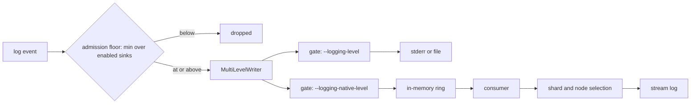

# Self-Stored Logs

Status: phase 1 (standalone and data nodes) **implemented**; phase 2 (liaison and remote routing) is **design**.

BanyanDB self-stores its metrics into the `_monitoring` group but has no equivalent for its own
logs: `pkg/logger` writes to a single `io.Writer` fixed at `logger.Init` time, so logs leave the
process on stderr and are gone when a pod recycles. This document specifies a second, optional
destination for logs — native self-storage into a `_monitoring_log` stream group — alongside
normal logging, which is never disabled.

It follows the native metrics path where that path fits, and departs from it where logs are events
rather than sampled state: a missed metric flush costs nothing because the next one carries the
current value, while a dropped log line is data loss. That single difference is the source of most
departures here.

---

## 1. Feature introduction and scope

BanyanDB already self-stores its own telemetry, but only half of it. Metrics have a native path into the database; logs do not.

| | Metrics today | Logs today |
|---|---|---|
| Destination | `_monitoring` group, one Measure per metric | one `io.Writer`, fixed at `logger.Init` time |
| Turned on by | `--observability-modes=native` | always on, no choice of destination |
| Queryable, retained | yes, with a TTL | no, stderr is the log driver's problem |

> During an incident the metrics are in the database and the logs are not. When a pod recycles, they are gone.

This feature adds a second, optional destination for logs: native self-storage into a new `_monitoring_log` stream group, behind `--logging-native-enabled` (bool, default `false`). Normal logging keeps its current behaviour — one zerolog writer, stderr today, though zerolog also supports file writers — and is never disabled.

| | Roles | Rationale |
|---|---|---|
| In scope | standalone, data, liaison | reach stream storage directly |
| In scope | lifecycle, backup | colocated producers, using the receiver on their host's data node |
| In scope | FODC — the on-demand diagnostics collector, agents plus a proxy | a generic receiver/forwarder serves it, so BanyanDB imports nothing from FODC |
| Out of scope | restore, migration | they run when the data tier is unavailable |

The sections that follow go roles, approach, configuration, failure modes.

## 2. Role → function → log destination

One binary, several roles. One property decides the destination: whether the process owns a storage engine or must reach one.

| Role | Function | Log destination |
|---|---|---|
| `standalone` | full server | own storage, in-process (`queue.Local()`) — as native metrics already do |
| `data` | shards, writes, queries | own storage, in-process (`TopicStreamWrite`) |
| `liaison` | front door: validate, route, batch | one hop to a data node over its tier-2 client, the pool spelled `tire2Client` in the code |
| `backup`, `lifecycle`, FODC agent beside data | snapshot, migration, diagnostics | colocated data node's cluster server, `127.0.0.1:17912` |
| FODC proxy, FODC agent beside a liaison | diagnostics, no colocated data node | liaison gRPC port (`--grpc-port`, default 17912) |
| `restore`, `migration` | offline tools | normal logging only |

> A liaison has local disk: it runs a two-tier write queue whose normal `StreamService/Write` route ends in part files. What it lacks is the storage engine, so it can hold a batch in flight but can never be where logs are read back from.

Three shapes: in-process; the liaison selecting a data node by shard; and every other producer publishing into the generic receiver, subscribed on data nodes' cluster server and on the liaison.

> Restore and migration use normal logging only by construction, not as a gap to close later: a tool that runs while the database is down cannot log into it. The native flags are registered only by the server, backup, lifecycle and FODC binaries.

## 3. Proposed approach

### 3.1 The writer seam

One event, two level-gated writers under zerolog's `MultiLevelWriter`. The zerolog level becomes an admission floor — the more verbose of the enabled sinks — and each sink then applies its own threshold, letting native run at `info` while normal logging stays at `error`.



Worked example, normal logging at `error` and native at `info`, so the floor is `info`.

| event | admitted | normal sink | native sink |
|---|---|---|---|
| debug | no | – | – |
| info / warn | yes | dropped by its own gate | stored |
| error | yes | printed | stored |

Native policy is never found by parsing JSON per line. Every logger writes through one writer that knows its module, gates the console on the logger's own threshold, and resolves native policy for its module against the configuration in force, once per configuration. A package-level logger built with `GetLogger` before initialization therefore follows the configuration that initialization installs; callers keep `GetLogger`, `DefaultLevel` and `ToZapConfig` as they were, and the latter two act on the console threshold.

Native policy is resolved on the logger's **complete** module, every component it was named with, not on the module the console prints. A `--logging-modules` override shortens what is printed — `--logging-modules=measure` prints a `MEASURE.BLOCK` logger as `MEASURE` — and native policy must not follow it. The most specific native override wins, and an exclusion covers a module and its children: `measure` covers `MEASURE.BLOCK`, not `MEASUREMENT`.

### 3.2 Buffer and transport

| property | value |
|---|---|
| unit | one stream `WriteRequest` per event, drawn from and returned to a **pool**. Requests and their nested allocations are reused; a request returns to the pool only after its publish completes or it is dropped, with retained references cleared and oversized buffers discarded rather than kept |
| payload | values carried in tags. The `data:fields` tag holds **only** keys with no tag of their own — no duplicated body |
| bounds | `8MiB` held, queued and in flight; `64KiB` per event. Internal safety bounds, not flags: the memory protector decides when memory is short (section 5.1) |
| triggers | every `1s`, or at `100` events or a quarter of the byte bound. Internal |
| durability | none — no queue files, no WAL, no disk fallback |

The consumer is a dedicated goroutine selecting over the closer, the flush ticker and the ring, so both triggers fire.

> When native is enabled the ring is live from logger initialisation; service start only begins draining it, so no startup line is stranded in a buffer nobody drains.

### 3.3 Routing and shard selection

Phase 1 follows native metrics. A standalone or data node writes its own events through its local write pipeline, always to shard `0` of `_monitoring_log`, which is created with one shard. No entity hash selects a shard and no event goes to another node, so each node's logs stay on that node. A group created by an earlier build with more shards still works, because every group has shard `0`. This aligns the first implementation with native metrics; it does not define node-local, non-replicated shards as a general contract.

> The liaison route below is phase 2 and predates the single-shard group: a selection by shard over one shard would send every liaison's events to one data node, so it is revisited with phase 2.

> **Decided: keep the selection, replace the transport.** Reusing the liaison's existing shard-based routing and never touching disk cannot both hold, because that route terminates in the disk-backed write queue and writes part files. The liaison therefore keeps the shard and node **selection** and publishes directly to the selected data node over its tier-2 client, bypassing the write queue entirely. The new native log topic serves the receiver's foreign producers, not the liaison's own route. Two facts make this modest rather than novel: nothing enforces shard ownership on ingest, and `lifecycle` already publishes straight into a colocated data node in production today.

The receiver is deliberately thin.

| Rule | Behaviour |
|---|---|
| Validation | `InvalidArgument` on a nil or non-millisecond timestamp, empty `element_id` or `node_id`, oversized body, out-of-enum level, oversized batch |
| Back-pressure | `ResourceExhausted` when its own ring is full; never blocks |
| Filtering | no local level, no module override — what arrives is what is stored |
| Echo | received events never enter its own logging path |
| Identity | `element_id` and identity tags pass through unchanged; identity must live in the element |

`--logging-native-enabled` governs only a process's own collection: a node with it `false` still accepts, routes and persists forwarded writes.

### 3.4 Schema

| object | value |
|---|---|
| group | `_monitoring_log`, catalog `STREAM`, TTL `--logging-native-ttl-days` (7), `Replicas` `0` — matching `_monitoring` |
| stream | `log`, one shared by every role |
| entity | `node_id`, `level` |
| searchable tags | `node_id`, `node_type`, `module`, `level`, `grpc_address`, `http_address`, `message`, `log_id` |
| data tag | `fields`, binary — the leftover keys only, omitted when there are none |
| index rules | none in v1 |

`level` is an entity tag; entity tags accept only equality and set membership, so selecting several levels uses `IN` rather than a negation. `module` stays an ordinary tag — module strings splice in group, measure and task names, so entity membership would give unbounded series cardinality. Nothing stores the original line verbatim: known keys become tags, and only the remainder lands in `fields`.

Having no index rules costs more than scan speed. An analyzer is configured on an index rule, so with none defined `MATCH` has no analyzer to tokenize with and falls back to comparing the value whole — `MATCH "timeout"` does not find `write timeout exceeded`, and it reports no match rather than an error. Full-text search over `message` is therefore an index rule away, not available now; `=` and the time range are what narrow a query in v1.

## 4. Parameters and configuration

Two independent namespaces; neither inherits from the other.

| namespace | flags | environment | notes |
|---|---|---|---|
| normal logging | `--logging-*` | `BYDB_LOGGING_*` | unchanged; typically `error` in production |
| native stream | `--logging-native-*` | `BYDB_LOGGING_NATIVE_*` | default level `info`, always JSON |

Every dashed flag binds to `BYDB_<UPPER_SNAKE>`, and the env value applies only when the flag was not set on the command line, so an explicit flag wins.

| flag | default | meaning |
|---|---|---|
| `--logging-native-enabled` | `false` | collect this process's own logs natively |
| `--logging-native-level` | `info` | root level of the native sink |
| `--logging-native-modules` / `--logging-native-levels` | `nil` | per-module overrides on the complete module, most specific wins, length-checked; an override cannot lift an exclusion |
| `--logging-native-exclude-modules` | `nil` | modules never sent natively, with their children; adds to the reserved `NATIVE-LOG` and `_MONITORING_LOG` and cannot remove them |
| `--logging-native-ttl-days` | `7` | retention, proposed when the group is created |
| `--logging-native-receiver-enabled` | `false` | accept forwarded writes, wherever hosted; independent of collection. Phase 2: nothing forwards in phase 1 |

Level semantics are in section 3.1; the four existing `--logging-*` flags keep their names and defaults. Buffering, batching, write handling, shutdown and memory are internal: flush every `1s` or at `100` events, `5s` per publish, `5s` for the final drain, the bounds in section 3.2 and the memory protector's policy in section 5.1. None of them had an operator requirement that a flag would serve. The schema pass against metadata has its own internal timeout, separate from the write timeout: a slow destination is not a reason to wait longer on metadata.

### 4.1 Feedback protection

Logging caused by storing native logs must never be stored, or one stored line produces the next; it still reaches the console. Whole modules are not excluded for it, because the stream and storage modules serve every group and their logs about ordinary writes are worth keeping:

- The consumer publishes under a context marked by `logger.WithNativeWrite`, which carries a `NATIVE-LOG` logger. The stream write callback takes its logger from the context with `FetchOrDefault`, the existing way a logger is passed downstream, so what it logs about a native write is a child of `NATIVE-LOG`. Other writes log as before. Nothing is switched off process-wide.
- The storage of the log group logs under `_MONITORING_LOG`, including its asynchronous flushes and merges: a storage logger is named after its group.
- `NATIVE-LOG` and `_MONITORING_LOG` are reserved. An operator's exclusion list adds to them.

Measured on an in-process standalone node at native level `debug`, idle after startup: about 0.5 stored events per second with the reserved set, and the same without it. The reserved set removes the node's logging about its own log storage — about 700 lines of a 2200-line startup — and guards the paths that log on failure.

> With `--logging-native-enabled=false` — the default — no schema and no counters are created, nothing is admitted, and the cost is one atomic pointer load per event. The ring itself is allocated either way: the sink is built while the command tree is, before the flags are parsed, so the buffer exists for the lines emitted during startup. It is one channel of `8192` entry headers and holds nothing.

## 5. Failure modes

```
event -> producer -> buffer(ring) -> consumer -> schema -> selection -> publish -> destination
                                                                                       |
                      GracefulStop: stop admission, then bounded drain ----------------+
```

Every stage that can fail has a row, carrying one behaviour and one reason from the closed `reason` set on `native_log_dropped_total`. Nine of the reasons exist today; `locate_failed`, marked *phase 2*, is a stage a single node does not have and arrives with remote routing.

The metric names carry the `native_log_` prefix. The native meter provider names each measure with the bare metric name inside the one `_monitoring` group, so a name must be unique across every component that reports there.

| Stage | Situation | Behaviour | Counter reason |
|---|---|---|---|
| producer | event over 64KiB | dropped whole, never truncated — a truncated JSON body is unparseable | `oversize_event` |
| producer | the encoded line is not the JSON the sink expects | dropped and counted; the caller is never made to care | `encode_failed` |
| buffer | the memory protector reports high pressure | drop the newest event, the writer still returning `(len(p), nil)` | `memory_pressure` |
| buffer | ring at its byte or event bound | drop the newest event; admission never waits for capacity and queued events are never evicted, so a burst keeps its head | `buffer_full` |
| consumer | stalled in a slow publish | the ring absorbs it; batches capped at 25% of the byte bound, one in flight, so a stall cannot pin admission | – gauge `native_log_buffer_bytes{state="in_flight"}` |
| schema | the group or stream cannot be read or created at startup | retry every 10s, batch in hand dropped | `schema_unavailable` |
| schema | a `log` stream exists whose families, tag order or entity differ from this version's | refuse and count, with one error through normal logging. The schema check keeps running every 10s instead of the sink staying disabled, so an operator can drop and recreate the stream without a restart; waiting alone never clears it | `schema_incompatible` |
| selection | `Locate` errors or returns an empty node ID | count and return; never publish to an empty node | `locate_failed` — *phase 2* |
| local publish | listener unhealthy | the bus skips it and drops the payload while returning an error, so any error means full batch loss | `publish_failed` |
| remote publish | error, breaker open, admission timeout, auth rejection | batch dropped, never re-queued; classified from the per-node error map from `Close` | `publish_failed` — *phase 2* |
| destination | local topic not yet subscribed | retain the batch, still charged, and retry it once per tick up to 10 times, then drop. Nothing is retained at shutdown, where there is no next tick | `destination_unready` |
| destination | the `log` stream is dropped at runtime | **known gap**: the stream write callback logs `cannot handle write event` and reports success, so the batch is counted as written. The schema check recreates the stream within 10s. The fix is in the shared write callback, where a wrong status makes the liaison fail over the data node, so it lands in its own PR | – |
| read path | a data node has not yet caught up on the schema | its query processor returns stream-not-exist and the distributed planner discards the whole response, blanking the query. **Pre-existing** for any group created while the cluster is running, user groups included — not introduced here. Mitigation is a one-site change in the planner, out of scope for this feature | – |
| shutdown | buffer still full at the drain deadline | remainder dropped once the 5s drain limit expires | `shutdown_deadline` |
| shutdown | a local write is stuck | a local write runs on the consumer and does not honor its context, so it cannot be interrupted. Shutdown stops waiting after about 11s — the drain, one publish and a margin — and leaves the consumer behind; what it holds is lost with the process | – |

> No row blocks, retries forever, or falls back to disk. Loss is bounded, and counted everywhere except the known gap above.

### 5.1 Memory

The sink follows the memory protector's own policy rather than a second one. On each admission it calls `State()`, the protector's nonblocking pressure check: it reads counters and never waits, so it is safe on every goroutine that logs. While `State()` is high, the newest event is dropped and counted as `memory_pressure`. The blocking `AcquireResource` is never called from the logging path. Where no protector is registered, `State()` reports low pressure and the buffer's own bounds hold.

The buffer still needs its own bound: protecting storage writes does not bound what waits in the buffer. It holds at most 8MiB, queued and in flight, and an event is charged its line plus the memory its built write request holds, about 1.8KiB, so the bound admits about 4600 events. At the bound the newest event is dropped as `buffer_full`.

> Normal logging is never degraded by the sink. Native is the more verbose sink, so at normal `error` and native `info` a dropped native `info` event has no normal copy anywhere — the drop counters are the only record it existed.

> With `--observability-modes=native` alone those counters travel the same transport as the logs, so the same outage loses both. Keep `prometheus` enabled alongside, which is what makes a loss visible during an outage. A periodic drop summary on stderr was considered and is not implemented: it would print on the path the outage already degrades, and the counters cover the same ground.
