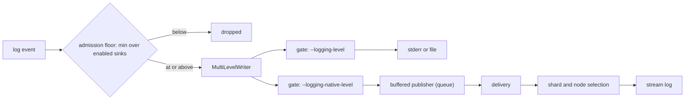

# Self-Stored Logs

Status: phase 1 (standalone and data nodes) **implemented**, with its buffering in the queue module (section 3.5); phase 2 (the liaison route, section 3.6) is **implemented**; phases 3 and 4 (the other producers, section 3.7) are **implemented** and under review.

BanyanDB self-stores its metrics into the `_monitoring` group but has no equivalent for its own
logs: `pkg/logger` writes to a single `io.Writer` fixed at `logger.Init` time, so logs leave the
process on stderr and are gone when a pod recycles. This document specifies a second, optional
destination for logs — native self-storage into a `_monitoring_log` stream group — alongside
normal logging, which is never disabled.

It follows the native metrics path where that path fits, and departs from it where logs are events
rather than sampled state: a missed metric flush costs nothing because the next one carries the
current value, while a dropped log line is data loss. That single difference is the source of most
departures here.

---

## 1. Feature introduction and scope

BanyanDB already self-stores its own telemetry, but only half of it. Metrics have a native path into the database; logs do not.

| | Metrics today | Logs today |
|---|---|---|
| Destination | `_monitoring` group, one Measure per metric | one `io.Writer`, fixed at `logger.Init` time |
| Turned on by | `--observability-modes=native` | always on, no choice of destination |
| Queryable, retained | yes, with a TTL | no, stderr is the log driver's problem |

> During an incident the metrics are in the database and the logs are not. When a pod recycles, they are gone.

This feature adds a second, optional destination for logs: native self-storage into a new `_monitoring_log` stream group, behind `--logging-native-enabled` (bool, default `false`). Normal logging keeps its current behaviour — one zerolog writer, stderr today, though zerolog also supports file writers — and is never disabled.

| | Roles | Rationale |
|---|---|---|
| In scope | standalone, data, liaison | reach stream storage directly |
| In scope | lifecycle, backup | colocated producers, writing to their host's data node |
| In scope | FODC — the on-demand diagnostics collector, agents plus a proxy | writing to a data node or a liaison as any producer does, so BanyanDB imports nothing from FODC |
| Out of scope | restore, migration | they run when the data tier is unavailable |

The sections that follow go roles, approach, configuration, failure modes.

## 2. Role → function → log destination

One binary, several roles. One property decides the destination: whether the process owns a storage engine or must reach one.

| Role | Function | Log destination |
|---|---|---|
| `standalone` | full server | own storage, in-process (`queue.Local()`) — as native metrics already do |
| `data` | shards, writes, queries | own storage, in-process (`TopicStreamWrite`) |
| `liaison` | front door: validate, route, batch | its write queue, as a stream write: over its tier-1 client, the pool spelled `tire1Client` in the code, to a liaison, whose queue syncs parts to the data nodes |
| `backup`, `lifecycle`, FODC agent beside data | snapshot, migration, diagnostics | colocated data node's cluster server, `127.0.0.1:17912` |
| FODC proxy, FODC agent beside a liaison | diagnostics, no colocated data node | liaison gRPC port (`--grpc-port`, default 17912) |
| `restore`, `migration` | offline tools | normal logging only |

> A liaison has local disk: it runs a two-tier write queue whose normal `StreamService/Write` route ends in part files, synced to the data nodes. What it lacks is the storage engine, so it holds a batch until a data node has it but can never be where logs are read back from.

Three shapes: in-process; the liaison writing through its write queue, as a stream write does; and every other producer writing to the data node beside it, or through a liaison's public write API (section 3.7).

> Restore and migration use normal logging only by construction, not as a gap to close later: a tool that runs while the database is down cannot log into it. The native flags are registered only by the server, backup, lifecycle and FODC binaries.

## 3. Proposed approach

### 3.1 The writer seam

One event, two level-gated writers under zerolog's `MultiLevelWriter`. The zerolog level becomes an admission floor — the more verbose of the enabled sinks — and each sink then applies its own threshold, letting native run at `info` while normal logging stays at `error`.



Worked example, normal logging at `error` and native at `info`, so the floor is `info`.

| event | admitted | normal sink | native sink |
|---|---|---|---|
| debug | no | – | – |
| info / warn | yes | dropped by its own gate | stored |
| error | yes | printed | stored |

Native policy is never found by parsing JSON per line. Every logger writes through one writer that knows its module, gates the console on the logger's own threshold, and resolves native policy for its module against the configuration in force, once per configuration. A package-level logger built with `GetLogger` before initialization therefore follows the configuration that initialization installs; callers keep `GetLogger`, `DefaultLevel` and `ToZapConfig` as they were, and the latter two act on the console threshold.

Native policy is resolved on the logger's **complete** module, every component it was named with, not on the module the console prints. A `--logging-modules` override shortens what is printed — `--logging-modules=measure` prints a `MEASURE.BLOCK` logger as `MEASURE` — and native policy must not follow it. The most specific native override wins, and an exclusion covers a module and its children: `measure` covers `MEASURE.BLOCK`, not `MEASUREMENT`.

### 3.2 Buffer and transport

| property | value |
|---|---|
| unit | one stream `WriteRequest` per event, drawn from and returned to a **pool**. Requests and their nested allocations are reused; a request returns to the pool only after its publish completes or it is dropped, with retained references cleared and oversized buffers discarded rather than kept |
| payload | values carried in tags. The `data:fields` tag holds **only** keys with no tag of their own — no duplicated body |
| bounds | `8MiB` held, queued and in flight; `64KiB` per event. Internal safety bounds, not flags: the memory protector decides when memory is short (section 5.1) |
| triggers | every `1s`, or at `100` events or a quarter of the byte bound. Internal |
| durability | none in the buffer — no WAL, no disk fallback. A liaison delivers into its write queue, which is on disk, as every stream write (section 3.6) |

The buffered publisher of the queue module owns the buffer (section 3.5). Its delivery goroutine selects over the stop signal, the flush ticker and the queue, so both triggers fire.

> When native is enabled the ring is live from logger initialisation; service start only begins draining it, so no startup line is stranded in a buffer nobody drains.

### 3.3 Routing and shard selection

Phase 1 follows native metrics. A standalone or data node writes its own events through its local write pipeline, always to shard `0` of `_monitoring_log`, which is created with one shard. No entity hash selects a shard and no event goes to another node, so each node's logs stay on that node. A group created by an earlier build with more shards still works, because every group has shard `0`. This aligns the first implementation with native metrics; it does not define node-local, non-replicated shards as a general contract.

> **Decided: the liaison writes its logs as a stream write.** A liaison sends `_monitoring_log/log` through the normal liaison stream write path: the tier-1 client, a liaison's write queue, and the part sync to the data nodes. The write queue already provides buffering, capacity control, persistence and delivery, the role the bounded buffer has on a single node, so the liaison adds no delivery or retry path of its own. An earlier version bypassed the queue for a memory-only route over the tier-2 client; review replaced it with this one. The other producers use the same paths, so no new topic is added (section 3.7).

Section 3.6 applies this decision to the single-shard group of phase 1.

Other producers receive no special path: they write to one data node or one liaison as a stream write (section 3.7).

| Rule | Behaviour |
|---|---|
| Filtering | the receiving node applies no level and no module override of its own — what arrives is what is stored |
| Echo | received events never enter its own logging path |
| Identity | `element_id` and identity tags pass through unchanged; identity lives in the element |

`--logging-native-enabled` governs only a process's own collection. `--logging-native-receiver-enabled` makes a node own the schema for the producers that write to it, with or without its own collection.

### 3.4 Schema

| object | value |
|---|---|
| group | `_monitoring_log`, catalog `STREAM`, TTL `--logging-native-ttl-days` (7), `Replicas` `0` — matching `_monitoring` |
| stream | `log`, one shared by every role |
| entity | `node_id`, `level` |
| searchable tags | `node_id`, `node_type`, `module`, `level`, `grpc_address`, `http_address`, `message`, `log_id` |
| data tag | `fields`, binary — the leftover keys only, omitted when there are none |
| index rules | none in v1 |

`level` is an entity tag; entity tags accept only equality and set membership, so selecting several levels uses `IN` rather than a negation. `module` stays an ordinary tag — module strings splice in group, measure and task names, so entity membership would give unbounded series cardinality. Nothing stores the original line verbatim: known keys become tags, and only the remainder lands in `fields`.

Having no index rules costs more than scan speed. An analyzer is configured on an index rule, so with none defined `MATCH` has no analyzer to tokenize with and falls back to comparing the value whole — `MATCH "timeout"` does not find `write timeout exceeded`, and it reports no match rather than an error. Full-text search over `message` is therefore an index rule away, not available now.

What narrows a query in v1 is the time range and equality or `IN` on the entity tags, `node_id` and `level`: they choose the series before the scan. A filter on any other tag, such as `module` or `message`, does not narrow it. It runs on the rows the scan returns, and a timestamp-ordered scan stops at the query's limit before the filter sees them. So a filter on `module` can return fewer rows than the limit while more matching rows exist. A reader looking for a module narrows by time and node first.

### 3.5 Buffered publishing in the queue module

Status: **implemented**, in answer to the review of #1419. Sections 3.2 and 5 describe the behaviour; this section describes who owns it.

Phase 1 first kept the whole buffering lifecycle in the logging module: a bounded channel, byte accounting, a consumer goroutine, batching, retries and the shutdown drain, which then published through `queue.Client`. That lifecycle now lives in the queue module, so that the distributed native logging of phase 2 reuses the same admission and lifecycle contract instead of a second copy.

| Logging module | Queue module |
|---|---|
| console and native levels, module filtering | nonblocking admission and capacity checks |
| recursion protection | queued and in-flight byte accounting |
| encoding events into pooled stream requests | batch formation and bounded retries |
| schema initialization and producer identity | local or remote delivery |
| log-specific outcomes and counters | completion, resource release and shutdown |

```text
Logger -> filter/encode -> BufferedPublisher.Offer      (logging)
                               |
                        bounded admission               (queue)
                               |
                         batch consumer                 (queue)
                               |
              Delivery: local now, to a located node in phase 2
```

#### Contract

`BufferedPublisher` is a new interface in `banyand/queue`. `BatchPublisher` and its callers do not change: the local batch publisher still delivers synchronously when `Close` runs, and the distributed one still sends during `Publish`.

```go
// Package queue.
type BufferedPublisher interface {
	// Offer accepts or refuses req without waiting for storage, the network
	// or free capacity, and reports the decision it made. On Accepted the
	// publisher owns req until it calls req.Release. On any refusal the caller
	// keeps req.
	Offer(req *BufferedRequest) Admission
	// Start begins delivery. Requests accepted before it are held.
	Start(d Delivery)
	// Close stops admission, drains within the drain timeout and returns even
	// when a delivery is stuck.
	Close()
	// Bytes reports the bytes charged against the allowance, and the part of
	// them in a delivery.
	Bytes() (charged, inFlight int64)
}

// Admission is the decision Offer made, taken at the moment it made it.
type Admission uint8

const (
	Accepted        Admission = iota // the publisher owns the request
	RefusedPressure                  // the memory pressure check reported high pressure
	RefusedFull                      // the allowance had no room for the request
	RefusedClosed                    // Close had already started
)

type BufferedRequest struct {
	Data    any           // the message body
	Done    func(Outcome) // terminal accounting: exactly once, by the drain deadline at the latest
	Release func()        // resource release: exactly once, after Done has returned, when neither Deliver nor Close can still read the request
	Bytes   int64         // what it holds, charged against the allowance until Release
}

type Outcome struct {
	Err       error  // the last delivery error, when there was one
	Reason    string // why it was not delivered: delivery_failed, retries_exhausted, shutdown_deadline
	Delivered bool   // only a completed delivery; acceptance never counts as written
}

type Delivery interface {
	// Deliver writes one batch. A failure wrapped with Retryable is retried;
	// any other ends the batch.
	Deliver(ctx context.Context, batch []any) error
}

func Retryable(err error) error // errors.Is finds both ErrRetryable and err
func NewBufferedPublisher(ctx context.Context, cfg BufferedConfig) BufferedPublisher
func NewLocalDelivery(client Client, topic bus.Topic, timeout time.Duration) Delivery
```

Phase 1 implements one `Delivery`, the local adapter: it publishes a batch to its topic through the local pipeline's batch publisher, turns the error map of `Close` into the batch's error, and marks a topic with no subscriber yet as retryable. The logging module wraps it to check the schema and stamp the node identity on each batch. Phase 2 addresses the same adapter to a located node (section 3.6).

#### Guarantees

| Concern | Rule |
|---|---|
| Ownership | A refusal: the caller keeps the request, counts the refusal under the reason `Offer` returned and releases it. `Accepted`: the queue owns it until `Release`. `Done` and `Release` each run exactly once. `Done` settles the accounting; `Release` runs after `Done` has returned, once neither `Deliver` nor `Close` can still read the request, and the logging module returns pooled requests to the pool only there. |
| Capacity | Each publisher has its own byte allowance (the 8MiB of section 3.2), so native logging cannot exhaust what ordinary writes use. Queued and in-flight bytes both count, until `Release`. `Offer` returns `RefusedPressure` while `protector.State()` is high and `RefusedFull` at the allowance, and never evicts what is queued: drop newest. The caller reads the reason from the decision itself, so it never re-reads the pressure state after the fact. |
| Batches | A batch closes at the event count, at a quarter of the allowance in bytes, or at the flush interval. Retained requests go back at the head of the queue and are sent in batches under the same limits, never in one combined batch. A request is retried once per interval, at most 10 times, then completed with `retries_exhausted`. |
| Readiness | The logging module creates the publisher with the sink, before logging initialization, so startup events are accepted. Before `Start` nothing is delivered and the same allowance bounds what is held; past it, drop newest. The logging module calls `Start` in `Serve`, once the node identity is known and after the first schema pass. A batch delivered before the schema is established ends as `schema_unavailable`; a local destination with no subscriber yet is retried. If `Close` comes first, every held request completes with `shutdown_deadline`. |
| Shutdown cut-off | `Offer` registers itself as active, then checks a closed flag. `Close` sets the flag, then waits for the active count to reach zero. Admission never waits, so that wait is short. After it, no `Offer` can still enqueue, an `Offer` that finds the flag set returns `RefusedClosed`, and every accepted request receives `Done` within the drain deadline: delivered, or `shutdown_deadline`. The wait is bounded by the drain deadline too. Past it, `Close` seals the queue and settles what is queued; an `Offer` that was still running enqueues after the seal, sees it, and settles what it added itself, so nothing is left queued with no delivery to take it. |
| Stuck delivery | `Close` returns after the drain deadline even when a `Deliver` call has not returned. The requests in that call receive `Done` with `shutdown_deadline` at the deadline, like any other request still held, so loss is accounted for on time. Their `Release` waits until `Deliver` returns, which may be never, and until `Close` has returned from their `Done` calls, so no memory a delivery or a `Done` still reads is reused. Only the delivery goroutine waits, so `Close` stays bounded; until then they stay charged against the allowance, at most one batch. If the stuck `Deliver` later succeeds, the events stay counted as lost: loss can be over-counted, never under-counted. |
| Recursion marker | `NewBufferedPublisher` takes the context every `Deliver` runs under. The native log publisher is built with the sink, before logging is initialized, and the mark is a logger, so the native log delivery adds `logger.WithNativeWrite` to that context for each batch. Downstream logging on the delivery goroutine is still marked as a native write (section 4.1). |

Flush interval, batch limits, retry count and deadlines remain internal, as in section 4.

#### What stays in the logging module

Filtering, the reserved exclusions, encoding into pooled requests, identity stamping, the schema retry, and the `native_log_*` counters. The counters take their reasons from the `Admission` that `Offer` returns and from `Outcome` values, so the closed `reason` set of section 5 does not change:

| From the queue | Counted as |
|---|---|
| `RefusedPressure` | `memory_pressure` |
| `RefusedFull` | `buffer_full` |
| `RefusedClosed` | `shutdown_deadline` |
| `Outcome` `shutdown_deadline` | `shutdown_deadline` |
| `Outcome` with `Err`: the schema was never established | `schema_unavailable` |
| `Outcome` with `Err`: the stream is incompatible | `schema_incompatible` |
| `Outcome` with `Err`: no subscriber on the topic, after the retries or at shutdown | `destination_unready` |
| `Outcome` with any other `Err`, a delivery panic included | `publish_failed` |
| a request the delivery could not encode | `encode_failed` |

`Done` can run while a stuck `Deliver` still holds the request, so what the delivery writes on the request and `Done` reads is atomic.

#### Tests

The queue package tests the guarantees through the `BufferedPublisher` interface: concurrent `Offer` and `Close`; a writer paused after it obtained the publisher and resumed after `Close` returned, which gets `RefusedClosed`; a writer paused inside `Offer`, which `Close` waits for, and one that outlasts the deadline, whose request is still settled; each refusal returning its own `Admission`; queued and in-flight accounting until `Release`; holding before `Start`; the size of every retried batch and retries paced once per interval; and a stuck `Deliver`: `Close` returns at the deadline, the stuck requests receive `Done` with `shutdown_deadline` by then, and their `Release` runs only after `Deliver` returns; and a stuck `Deliver` that returns while `Close` is still inside the `Done` it runs at the deadline, whose `Release` waits for that `Done` to return. The logging tests keep to filtering, encoding, identity, recursion protection, and real storage and query behavior.

### 3.6 Phase 2: the liaison route

Status: **implemented**, under review. The liaison stores its own logs. It has no storage engine, so it writes them as a stream write does: through its write queue.

It follows native metrics. A liaison's native metrics locate shard `0` of their group among the liaisons, publish over the tier-1 client to that liaison's write queue, and the queue syncs part files to the data nodes. Native logs do the same for shard `0` of `_monitoring_log`, with the selector and node registry the liaison's gRPC server uses for stream writes.

```text
Logger -> filter/encode -> BufferedPublisher.Offer                 (logging, as phase 1)
                               |
                     bounded admission, batches                     (queue, as phase 1)
                               |
               node delivery: locate, then publish once             (queue)
                               |
  tire1Client batch publisher, TopicStreamWrite, the liaison of shard 0 of _monitoring_log
                               |
  that liaison's write queue: part files on its disk, synced to the data node of shard 0
```

The buffer stays in front of the queue, because admission must not block and a publish over the network can. Past the buffer, the write queue does the work: it bounds what it takes with the disk watermark, keeps parts on disk, syncs them to the data nodes of the shard, and syncs to another data node when the shard's node goes away. `_monitoring_log` has `Replicas` `0`; a data node outage costs no logs while the liaison's disk holds them.

#### What phase 2 adds

| Part | Change |
|---|---|
| Queue module | `NewNodeDelivery(client Client, topic bus.Topic, node func() (string, error), timeout time.Duration) Delivery`: the local delivery of phase 1, with each batch addressed to the node that `node` returns when the batch is delivered. A failed locate is retryable, because nothing was published. Once a batch is published, its outcome is final: the delivery has no retry of its own. The queue module knows no group: the caller's `node` does. |
| Logging module | The delivery wrapper of phase 1, with the destination as a parameter: local on standalone and data nodes, node delivery on a liaison. Schema setup, identity stamping and the counters do not change. `locate` asks for shard `0`, replica `0` of `_monitoring_log`. |
| Liaison setup | `pkg/cmdsetup/liaison.go` creates the logging service with the tier-1 client, the stream liaison node registry that the gRPC server also uses, and the liaison's memory protector. It stops the service before the pipelines and clients, so the final drain can still send, and marks the role as supporting native logging, so the root command attaches the native sink when a liaison runs. |
| Batch publisher | `Publish` takes its logger from its context, for feedback protection below. |
| Write queue | The callback logs about an event of `_monitoring_log` as a native write, for feedback protection below. |
| Counters | `locate_failed` joins the closed `reason` set. No other new reason and no new metric. |

#### Failure handling

| Situation | Behaviour | Counted as |
|---|---|---|
| `locate` fails: no liaison registered on the tier-1 client yet, or the selector does not know the group yet | Both are transient at startup. Retryable: the batch stays at the head of the buffer and is retried once per interval, up to 10 retries, as `destination_unready` is in phase 1 | `locate_failed` after the retries or at shutdown |
| the publish fails, the liaison refuses the batch (disk over the watermark), or it does not answer in time | The batch is dropped. The write queue is the delivery path; the sink adds none | `publish_failed` |
| a data node is down | The liaison's write queue keeps the parts and syncs them once shard `0` has a data node again. Nothing is lost at the sink | – |
| a write to the liaison is stuck | as a stuck local write: settled at the drain deadline, released if it returns | `shutdown_deadline` |

#### Feedback protection across the hop

The native-write mark is a context value, so it does not cross the network. These log sites can see a native log write without it:

| Side | Log site | Rule |
|---|---|---|
| Sending liaison | the tier-1 batch publisher logs each node error of a batch | it takes its logger from the context of `Publish` with `FetchOrDefault`, as the stream write callback does. A failed native log batch then logs to the console only |
| Receiving liaison | the write-queue callback logs about an event it received: a refused write, no node for the shard, a failed index publish; and the queue's lookup of the shard's nodes | an event of `_monitoring_log` is logged as a native write, whatever its origin. The group reaches the log call, so the callback does not need the context mark |
| Receiving liaison, asynchronous | the group's write queue: flushes, merges and part sync | already logs under `_MONITORING_LOG`: the queue's logger is named after its group, and the reserved exclusion covers it and its children |

#### Unchanged

The buffer, its bounds, the memory policy of section 5.1, the schema, the entity `[node_id, level]` and the six flags. The adaptive budget proposed for this phase is replaced by section 5.1: the protector's nonblocking `State()` and the fixed bound. A liaison has a memory protector, so `State()` applies there too.

#### Tests

| Level | Test |
|---|---|
| Queue | node delivery with a mock client: the located node ID is on every message; a `locate` error or an empty node is retryable and publishes nothing; a failed publish, a node error in `Close`'s map and a timeout end the batch; success returns nil. Through the publisher, a batch held on a failed `locate` goes to the node located on the next attempt |
| Logging | a liaison addresses every message to the liaison of shard `0` and stamps its own identity; it counts `locate_failed` after the retries; an `Outcome` maps to the reasons above |
| Recursion | a failed tier-1 batch publish logs nothing that reaches native storage; the write-queue callback's log about a received `_monitoring_log` event is not stored, and the same log about another group is |
| Integration | two suites, a liaison and data nodes in one process. One runs the shared cases of phase 1 with the liaison as the producer. The other finds a liaison marker on the data node of shard `0`, stops that data node, and finds the next marker on the other data node through the liaison. With the write-queue callback dropping `_monitoring_log` events, the falsifier, the first marker is never stored |
| E2E | the liaison joins the identity set; its rows are placed on the data node of shard `0`, read from the query trace as the data-node placement check does; with that node paused, the write queue syncs the next marker to another data node |

Each new assertion is checked to fail when its change is reverted.

### 3.7 Phases 3 and 4: the other producers

Status: **implemented**, under review. Backup, lifecycle, the FODC agent and the FODC proxy store their own logs. None of them has a storage engine, and only lifecycle has a metadata client.

> **Decided: no new receiver.** Each producer writes through a path that already exists, the one a process in its place already uses. A producer beside a data node publishes `TopicStreamWrite` to that node's cluster server, as lifecycle's migration does; the data node writes it to its local storage. A producer beside a liaison or outside the cluster writes through the liaison's public `StreamService/Write`, as any client does; the liaison writes it to its write queue, as for every stream write since phase 2. There is no new proto message, topic, gRPC method or method-policy row. This replaces the receiver of phase 3 that section 3.3 described before.

```text
backup, lifecycle, FODC agent beside a data node
    --TopicStreamWrite (pub)--> that data node's cluster server, 127.0.0.1:17912 --> local storage
FODC agent beside a liaison, FODC proxy
    --StreamService/Write--> a liaison's public port, 17912 --> its write queue --> data node of shard 0
```

The producer encodes and stamps each event as a node does, with its own identity, and uses the code of the logging module, not a copy. On the cluster server route it also builds the internal request, shard `0` and entity `[node_id, level]`, as a data node does; on the public route the liaison does that, as for any client. Identity passes through unchanged, so a row tells which producer wrote it.

#### Destination and schema

| Rule | Behaviour |
|---|---|
| Destination | One address per producer. Backup and lifecycle use their existing `--grpc-addr`, the data node they already serve. The FODC binaries get `--logging-native-addr`, which `--logging-native-enabled` needs: without it the process refuses to start rather than drop every event. The FODC agent takes the route that `--logging-native-route` names, `cluster` (default) beside a data node or `public` beside a liaison. The route is configured, not read from the node role: the role is not known while the node is still starting, and on the wrong route every write is refused. The proxy always takes the public route. |
| Schema | A producer has no metadata client, so the cluster owns the schema. `--logging-native-receiver-enabled` (data and liaison nodes, default `false`) makes a node create and check the schema as section 3.4 describes, also when `--logging-native-enabled` is `false`. It does not attach the sink, so the node's own logs are not collected. |
| Acceptance | Not gated by the flag: a write to `_monitoring_log/log` is an ordinary stream write, and fails as a write to any missing stream does. |
| Back-pressure | The destination's own: the data node's write path, or the liaison's disk watermark. The producer's buffer stays in front, so admission never blocks. |
| Filtering | The producer filters with its own native flags. The receiving node applies no level or module filter of its own. |

#### Connection, security and delivery

| | Cluster server route | Public route |
|---|---|---|
| Client | its own `pub` client, the delivery of phase 2 addressed to one fixed node | a `StreamService/Write` stream per batch, one `WriteRequest` per event |
| Reconnect | a `pub` client made without metadata dials once. Lifecycle's keeper loop for its metrics client, which registers the node again when no connection is healthy, moves to the queue module unchanged and serves both clients: one reconnect rule, not a second copy | gRPC reconnects by itself |
| TLS | backup and lifecycle: the existing `--enable-tls` and `--cert`; the cluster server and the snapshot service share one port. FODC agent: `--logging-native-tls` and `--logging-native-ca-cert`. `pub` takes client TLS without its flag set | FODC: `--logging-native-tls` and `--logging-native-ca-cert` |
| Auth | none, as for every cluster server client | the liaison's RBAC, as for any client: `--logging-native-username` and `--logging-native-password`, sent as the `username` and `password` metadata. Writing needs the data-write permission on `_monitoring_log` |
| Outcome | a published batch is final, as in phase 2 | read per event from the write response: a missing stream is `schema_unavailable`, any other refusal `publish_failed` |

Every FODC dial is insecure today; the new flags cover only the native log connection.

#### Drop counters

| Producer | Where the `native_log_*` counters are visible |
|---|---|
| lifecycle | its metrics registry, as its native metrics are |
| FODC agent | its Prometheus registry, served on its metrics endpoint |
| FODC proxy | its `/metrics`, appended as its schema-consistency series are |
| backup | no endpoint: each loss on stderr as it happens, as on every producer, and one summary line at exit, written only when something was dropped |

#### What phases 3 and 4 add

| Part | Change |
|---|---|
| Logging module | A producer service: one of the two deliveries above, with the schema treated as established, because the producer cannot read it. The public-route delivery. One helper attaches the sink after `logger.Init` and starts and stops the service, for the binaries with no `run.Group`. The counters take any metrics factory, not only a registry. |
| Server | `--logging-native-receiver-enabled`. The logging service creates and checks the schema when this flag or `--logging-native-enabled` is set, and starts delivery only for the latter. |
| Data write path | The write callback logs about an event of `_monitoring_log` as a native write, as the liaison's write-queue callback does since phase 2. A remote write carries no context mark. |
| Queue | The node keeper moves here from lifecycle. `pub` takes client TLS and a logger without its flag set. |
| lifecycle, backup | native flags; `node_type` `lifecycle` or `backup`. |
| FODC agent, FODC proxy | native flags and the connection flags above; `node_type` `fodc-agent` or `fodc-proxy`. |

`node_id` is `POD_NAME`, else the host name, as lifecycle's native metrics use. The FODC agent uses `--pod-name` when it is set.

#### Lifetime

| Producer | Runs | Native delivery |
|---|---|---|
| lifecycle | `run.Group` | a unit of its group, stopped before the clients |
| backup, FODC proxy | plain main loop | started after `logger.Init`, stopped last before exit: the drain is bounded by `5s`, so a one-shot backup ends at most `5s` later |
| FODC agent | plain main loop | started with logging, before the node role is resolved, which does not choose its route, and stopped last before exit |

#### Failure handling

| Situation | Behaviour | Counted as |
|---|---|---|
| no connection to the destination | nothing is sent; retried once per interval, up to 10 times | `destination_unready` |
| public route: the stream is missing on the liaison | the event is refused | `schema_unavailable` |
| cluster server route: the data node has no schema, the flag is off there | the write fails on that node, but the data write callback reports success, so the producer counts the batch as written. This is the known gap of section 5, tracked in [apache/skywalking#14158](https://github.com/apache/skywalking/issues/14158); loss accounting for it stays partial until that fix lands | – |
| the write fails, is refused, or times out | the batch, or the refused event, is dropped | `publish_failed` |
| the liaison refuses the credentials | the batch is dropped, and one error is written to the console once | `publish_failed` |

#### Feedback protection

Received events never enter the receiving node's own logging. What its write path logs about them is a native write: the liaison's write-queue callback since phase 2, and with this change the data write callback and, for the public route, the liaison's `StreamService/Write` handler, its write session and the publisher that forwards the session's batches. Each asks `logger.ForGroup` by the event's group, because an event received over the network carries no mark from the sender's context. On the producer, the delivery runs under a context marked by `logger.WithNativeWrite`, as on every node. Its `pub` client logs under `NATIVE-LOG.CLIENT`, which the reserved exclusion covers, including the keeper loop on its own goroutine: a failed dial or a lost connection reaches the console and never native storage. The gRPC client of the public route does not log through BanyanDB's logger.

#### Unchanged

The schema, the buffer, its bounds and the memory policy. A producer with no memory protector relies on the fixed bound, as section 5.1 says. Restore and migration still offer no native flags.

#### Tests

Shared cases stay in `test/cases/nativelog` and run from each suite; deployment and role setup stay in the suites. Integration suites run in one process. Anything that needs separate processes, each with its own logger configuration, is in e2e. No suite is added to the flaky-test workflow.

| Level | Test |
|---|---|
| Logging | a producer stamps its own identity and addresses every batch to its destination; with no connection it counts `destination_unready` after the retries, and delivers again once the connection is back; on the public route a missing stream counts `schema_unavailable` and a refused credential `publish_failed`; a node with only the receiver flag creates the schema and attaches no sink |
| Queue | the keeper registers a node again when no connection is healthy, for both clients that use it; `pub` with client TLS set dials with TLS |
| Recursion | the data write callback's log about a received `_monitoring_log` event is not stored, and the same log about another group is; a failed dial of either client is not stored |
| Integration | two suites, one per route, each in one process: a producer writing to a data node with only the receiver flag, and one writing through a liaison with only the receiver flag. They run the shared cases with the producer as the node: the process's lines are stored under the producer's exact `node_id` and `node_type`, an info line is stored and not printed, and collection resumes after the log group is removed at runtime. The startup case is skipped, because the producer starts after the servers in the same process. Falsifier: with the receiver flag off, the log stream never becomes queryable |
| E2E, compose | backup beside one data node and lifecycle beside another, both nodes with only the receiver flag. The case asserts the exact set of producer identities, a known event of each, and from the query trace that each producer's rows are on its own data node only. A backup started without `--logging-native-enabled` logs and stores nothing. Lifecycle reports its counters on `/metrics`. With backup's data node paused, backup reports the loss on stderr; once the node resumes, backup stores new lines without being restarted |
| E2E, kind | the FODC case: an agent beside the data node, an agent beside the liaison and the proxy; the data node and the liaison have only the receiver flag. The case asserts that the stored identities are exactly the three pod names with their `node_type`, and that each process reports what it wrote on its `/metrics` |
| Credentials | a fake liaison in the logging tests checks the credentials of every write and refuses them with `PermissionDenied`; the e2e cases run without authentication |

Each new assertion is checked to fail when its change is reverted.

## 4. Parameters and configuration

Two independent namespaces; neither inherits from the other.

| namespace | flags | environment | notes |
|---|---|---|---|
| normal logging | `--logging-*` | `BYDB_LOGGING_*` | unchanged; typically `error` in production |
| native stream | `--logging-native-*` | `BYDB_LOGGING_NATIVE_*` | default level `info`, always JSON |

Every dashed flag binds to `BYDB_<UPPER_SNAKE>`, and the env value applies only when the flag was not set on the command line, so an explicit flag wins.

| flag | default | meaning |
|---|---|---|
| `--logging-native-enabled` | `false` | collect this process's own logs natively |
| `--logging-native-level` | `info` | root level of the native sink |
| `--logging-native-modules` / `--logging-native-levels` | `nil` | per-module overrides on the complete module, most specific wins, length-checked; an override cannot lift an exclusion |
| `--logging-native-exclude-modules` | `nil` | modules never sent natively, with their children; adds to the reserved `NATIVE-LOG` and `_MONITORING_LOG` and cannot remove them |
| `--logging-native-ttl-days` | `7` | retention, proposed when the group is created |
| `--logging-native-receiver-enabled` | `false` | data and liaison nodes: create and check the schema for the producers that write here, independent of collection (section 3.7) |
| `--logging-native-addr` | empty | FODC agent and proxy: where to write, a data node's cluster server or a liaison's public port (section 3.7); empty disables native logging |
| `--logging-native-route` | `cluster` | FODC agent: `cluster`, the data node's cluster server, or `public`, a liaison's public write API (section 3.7) |
| `--logging-native-tls` / `--logging-native-ca-cert` | `false` / empty | FODC agent and proxy: TLS for that connection only |
| `--logging-native-username` / `--logging-native-password` | empty | FODC agent beside a liaison and proxy: credentials for the liaison's RBAC, when it is on |

Level semantics are in section 3.1; the four existing `--logging-*` flags keep their names and defaults. Buffering, batching, write handling, shutdown and memory are internal: flush every `1s` or at `100` events, `5s` per publish, `5s` for the final drain, the bounds in section 3.2 and the memory protector's policy in section 5.1. None of them had an operator requirement that a flag would serve. The schema pass against metadata has its own internal timeout, separate from the write timeout: a slow destination is not a reason to wait longer on metadata.

### 4.1 Feedback protection

Logging caused by storing native logs must never be stored, or one stored line produces the next; it still reaches the console. Whole modules are not excluded for it, because the stream and storage modules serve every group and their logs about ordinary writes are worth keeping:

- The delivery publishes under a context marked by `logger.WithNativeWrite`, which carries a `NATIVE-LOG` logger. The stream write callback takes its logger from the context with `FetchOrDefault`, the existing way a logger is passed downstream, so what it logs about a native write is a child of `NATIVE-LOG`. Other writes log as before. Nothing is switched off process-wide.
- The storage of the log group logs under `_MONITORING_LOG`, including its asynchronous flushes and merges: a storage logger is named after its group.
- `NATIVE-LOG` and `_MONITORING_LOG` are reserved. An operator's exclusion list adds to them.

Measured on an in-process standalone node at native level `debug`, idle after startup: about 0.5 stored events per second with the reserved set, and the same without it. The reserved set removes the node's logging about its own log storage — about 700 lines of a 2200-line startup — and guards the paths that log on failure.

> With `--logging-native-enabled=false` — the default — no schema and no counters are created, nothing is admitted, and the cost is one atomic pointer load per event. The ring itself is allocated either way: the sink is built while the command tree is, before the flags are parsed, so the buffer exists for the lines emitted during startup. It is one channel of `8192` request pointers and holds nothing.

## 5. Failure modes

```
event -> producer -> buffer (queue) -> delivery -> schema -> selection -> publish -> destination
                                                                                       |
                      GracefulStop: stop admission, then bounded drain ----------------+
```

Every stage that can fail has a row, carrying one behaviour and one reason from the closed `reason` set on `native_log_dropped_total`. Nine of the reasons exist today; `locate_failed`, marked *phase 2*, is a stage a single node does not have and arrives with the liaison route of section 3.6.

The metric names carry the `native_log_` prefix. The native meter provider names each measure with the bare metric name inside the one `_monitoring` group, so a name must be unique across every component that reports there.

| Stage | Situation | Behaviour | Counter reason |
|---|---|---|---|
| producer | event over 64KiB | dropped whole, never truncated — a truncated JSON body is unparseable | `oversize_event` |
| producer | the encoded line is not the JSON the sink expects | dropped and counted; the caller is never made to care | `encode_failed` |
| buffer | the memory protector reports high pressure | drop the newest event, the writer still returning `(len(p), nil)` | `memory_pressure` |
| buffer | ring at its byte or event bound | drop the newest event; admission never waits for capacity and queued events are never evicted, so a burst keeps its head | `buffer_full` |
| delivery | stalled in a slow publish | the buffer absorbs it; batches capped at 25% of the byte bound, one in flight, so a stall cannot pin admission | – gauge `native_log_buffer_bytes{state="in_flight"}` |
| schema | the group or stream cannot be read or created at startup | retry every 10s, batch in hand dropped | `schema_unavailable` |
| schema | a `log` stream exists whose families, tag order or entity differ from this version's | refuse and count, with one error through normal logging. The schema check keeps running every 10s instead of the sink staying disabled, so an operator can drop and recreate the stream without a restart; waiting alone never clears it | `schema_incompatible` |
| selection | `locate` errors on a liaison: no liaison registered on the tier-1 client yet, or the group not yet known to the selector | retried once per tick, up to 10 retries, then dropped; never published to an empty node | `locate_failed` — *phase 2* |
| local publish | listener unhealthy | the bus skips it and drops the payload while returning an error, so any error means full batch loss | `publish_failed` |
| liaison publish | the publish to the liaison's write queue fails, the queue refuses it (disk over the watermark), or it does not answer in time | batch dropped, never re-queued: past the publish, the write queue owns delivery | `publish_failed` — *phase 2* |
| destination | local topic not yet subscribed | keep its events, still charged, at the head of the buffer, and retry them once per tick in batches under the same limits, up to 10 retries each, then drop. Nothing is retained at shutdown, where there is no next tick | `destination_unready` |
| destination | the `log` stream is dropped at runtime | **known gap**: the stream write callback logs `cannot handle write event` and reports success, so the batch is counted as written. The schema check recreates the stream within 10s. The fix is in the shared write callback, where a wrong status makes the liaison fail over the data node, so it lands in its own PR, tracked in [apache/skywalking#14158](https://github.com/apache/skywalking/issues/14158) | – |
| read path | a data node has not yet caught up on the schema | its query processor returns stream-not-exist and the distributed planner discards the whole response, blanking the query. **Pre-existing** for any group created while the cluster is running, user groups included — not introduced here. Mitigation is a one-site change in the planner, out of scope for this feature | – |
| shutdown | buffer still full at the drain deadline | remainder dropped once the 5s drain limit expires | `shutdown_deadline` |
| shutdown | an event is admitted after the drain began, by a writer that obtained the sink before it | refused as closed and counted, never left in a buffer nothing delivers | `shutdown_deadline` |
| shutdown | a local write is stuck | a local write runs on the delivery goroutine and does not honor its context, so it cannot be interrupted. Shutdown stops waiting at the 5s drain deadline; the events in that write are counted then, and their memory is freed only if the write returns | `shutdown_deadline` |

> No row blocks or retries forever, and the buffer never falls back to disk; a liaison's write queue is the normal stream path, not a fallback. Loss is bounded, and counted everywhere except the known gap above.

### 5.1 Memory

The sink follows the memory protector's own policy rather than a second one. On each admission it calls `State()`, the protector's nonblocking pressure check: it reads counters and never waits, so it is safe on every goroutine that logs. While `State()` is high, the newest event is dropped and counted as `memory_pressure`. The blocking `AcquireResource` is never called from the logging path. Where no protector is registered, `State()` reports low pressure and the buffer's own bounds hold.

The buffer still needs its own bound: protecting storage writes does not bound what waits in the buffer. It holds at most 8MiB, queued and in flight, and an event is charged its line, the memory its pooled write request holds, about 2KiB, and the capacity of that request's fields buffer, which a request reused from a larger event keeps up to 4KiB. A typical event is charged about 2.1KiB, so the bound admits about 3800 events. At the bound the newest event is dropped as `buffer_full`.

> Normal logging is never degraded by the sink. Native is the more verbose sink, so at normal `error` and native `info` a dropped native `info` event has no normal copy anywhere — the drop counters are the only record it existed.

> With `--observability-modes=native` alone those counters travel the same transport as the logs, so the same outage loses both. Keep `prometheus` enabled alongside, which is what makes a loss visible during an outage. A periodic drop summary on stderr was considered and is not implemented: it would print on the path the outage already degrades, and the counters cover the same ground.
