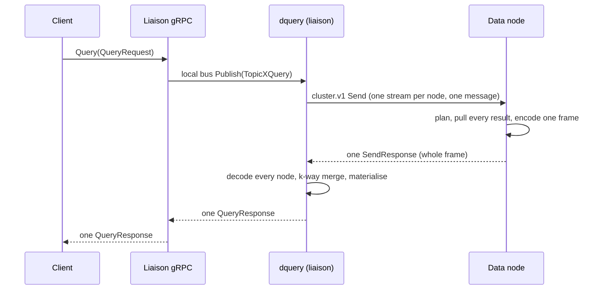
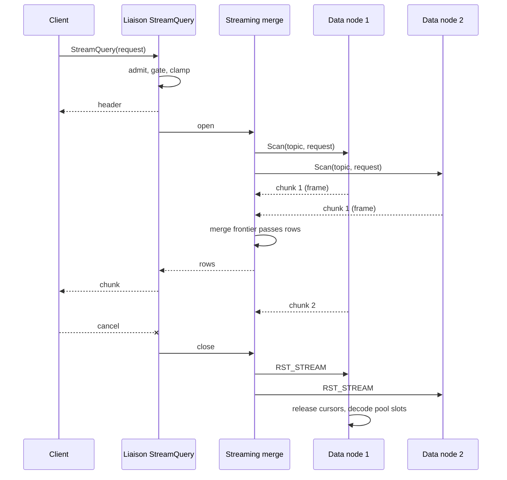
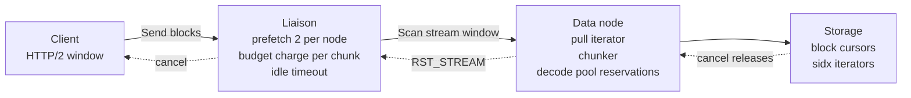

# Streaming API: progressive queries and acknowledged write streams

Status: **accepted, not yet implemented**. Decisions recorded in §13 on 2026-10-14 and 2026-10-15.

**Milestone split (§1.1).** 0.12.0 implements the streaming *process* behind the existing APIs:
the internal `Scan` transport, chunked emission on data nodes, an incremental merge on the liaison
that the existing unary `Query` RPCs run on, and the `Write` rework. No query result changes. The
public streaming *API* (`StreamQuery`, its gateway route, the streaming bydbctl options and BydbQL
streaming) moves to the next milestone. Implementation order in both milestones: trace, then
stream, then measure, one PR per model.

This document analyses the "Frontier Observability Database Streaming APIs" report (an interactive
survey of Berserk, InfluxDB 3.0, GreptimeDB, Grafana Loki, ClickHouse, OpenObserve, Quickwit and
VictoriaMetrics), measures BanyanDB's current write and query paths against it, and specifies a
streaming API for BanyanDB: a server-streaming query RPC that emits results progressively with
end-to-end backpressure and early exit, and a batched, acknowledged, flow-controlled write stream.
Both are additive to the public API. The internal liaison-to-data-node transport gains one
server-streaming RPC.

Code references are to `origin/main` at `f445f295` plus the measure batch v2 and scan path v2 work
on this branch.

---

## 1. Summary

BanyanDB already has a bidirectional `Write` stream, but it behaves as a batch envelope: a
successful write is acknowledged only when the client half-closes the stream, and the data node
persists a batch only when the liaison closes its internal stream. Queries are unary: a data node
drains its whole result into one message, the liaison materialises every node's result before it
merges, and the client receives one response. Nothing between the client and the storage engine
can slow a producer down except a hard rejection.

The design adds one RPC per model and reworks one:

| RPC | Shape | What it changes |
|---|---|---|
| `StreamQuery` (new) | server streaming | Results leave the data node, the liaison and the server in chunks as soon as the merge frontier passes them. Memory at every hop is bounded by chunks in flight, not by the result, so the memory protector admits a query on that bound and a result of any size runs inside it. Under pressure a stream pauses instead of failing. Cancelling the stream stops the scan on every data node. |
| `Write` (existing) | bidirectional streaming | Acknowledgement and persistence per sealed batch while the stream stays open, bounded liaison memory for long-lived streams, a typed status and a retry hint added to the response, and retry of busy batches at the liaison so an open stream is paused instead of dropped under memory pressure. The signature and the request message do not change. |

Internally, `cluster.v1.Service` gains `Scan`, a server-streaming RPC that carries one topic
message out and a sequence of chunk bodies back. Each chunk is one of the existing columnar frames
(trace frame, stream frame, measure frame v4); the frame formats do not change.

The `Query` RPCs stay as they are. `Write` keeps its signature and its request contract; only its
acknowledgement timing, its flow control and two added response fields change.

### 1.1 Milestone scope

**0.12.0: the streaming process behind `Query` and `Write`.**

| Part | Sections | Delivered |
|---|---|---|
| `Write` rework | §5.3, §7 write path | As specified: per sealed batch acknowledgement and application, the sender queue, in-flight limit, busy retry, `status_code`, `retry_after_ms` and `STATUS_SERVER_BUSY`. |
| Internal transport | §6 | `cluster.v1.Service/Scan`, `bus.StreamListener`, `queue.Client.Scatter`, node streams opened under the caller's context, the idle deadline with heartbeats of §6.2. |
| Data nodes | §8, data-node parts | `RevStream` and the chunker: a data node sends its result in chunks of the existing frames as it produces them, instead of materialising it into one message. |
| Liaison | §8, liaison parts | The distributed plans merge node streams incrementally, decoding one chunk at a time, and the unary `Query` RPCs collect the merged result into today's response. |
| Pressure | §7.1, "drain, do not hold" | Between chunks, as specified. |

The unary `Query` keeps its exact results. It still holds the whole response, so the liaison
reads every node stream to its end and keeps today's whole-result dedup: the global trace-ID map
for trace, and the existing element and data-point rules for stream and measure. The run-scoped
dedup and its documented difference (§5.5, §13 decision 2) belong to the public stream only. Each
data node already stops at `limit + offset` as today, so reading to the end costs what it costs
now. Admission and the response charge are unchanged for the same reason (§3.2).

What the unary `Query` gains:

- **No per-node response size limit.** A data node's result is no longer bounded by the 32 MiB
  publisher receive limit, because it arrives in chunks.
- **Lower peak memory.** A data node no longer holds its whole result before sending, and the
  liaison holds decoded rows plus the chunks in flight instead of every node's frame at once.
- **Cancellation reaches the data nodes**, which today keep scanning until a fixed deadline.
- **Long scans can finish.** The fixed 5 s (trace, stream) and 15 s (measure) per-node deadlines
  become idle deadlines reset by every chunk and heartbeat (§6.2), so a needle search over a large
  range is bounded by the client's deadline, not by a constant.

**Next milestone: the public streaming API.** `StreamQuery` per model (§5.1, §5.2, §5.5), its
gateway route, `AdmitStreamContext` and the footprint invariant for streams (§7.1), the streaming
bydbctl options (§10), BydbQL streaming (§5.4) and their tests and benchmarks. Decisions 1, 2 and
4 of §13 apply there. It reuses the 0.12.0 transport unchanged: the public stream is the liaison
merge of 0.12.0 with chunks forwarded to the client instead of collected.

## 2. What the report describes and what applies here

The report's thesis is that observability engines are replacing request-response APIs with two
asymmetric streams: continuous ingestion over client or bidirectional gRPC streams, and progressive
query execution over server streams. It supports the thesis with an engine matrix, vendor
benchmarks, a four-tier backpressure model, and an "agentic" early-exit contract. The table below
lists each claim, the evidence the report gives, and the decision for BanyanDB.

| Report claim | Evidence in the report | Decision for BanyanDB |
|---|---|---|
| Ingestion should be a long-lived gRPC stream with per-batch acknowledgement and reactive backpressure. | Berserk OTLP ingest with watermark backpressure; GreptimeDB bidirectional gRPC stream at 1.35M rows/s versus 1.17M unary (batch 1,000). | Adopt. `Write` is already a stream, but its acknowledgement and persistence happen at end of stream. The design keeps `Write` and moves both to sealed batches. See §5.3. |
| Query results should stream progressively so a client can act on the first rows and cancel. | Berserk progressive KQL snapshots; Loki `Tail`; ClickHouse `ExecuteQueryWithStreamOutput`; VictoriaMetrics chunked `/api/v1/export`. | Adopt. `StreamQuery` per model, with cancellation propagated to every data node. See §5.2 and §7. |
| Backpressure must propagate through four tiers: collector, HTTP/2 window, ingest queue watermark, engine. | Interactive flow-control panel. | Adopt the model and map it onto BanyanDB's existing parts: HTTP/2 windows (already sized from memory), the memory protector, the query budget and the decode pool. See §7. |
| Clients should receive retryable `RESOURCE_EXHAUSTED` and `UNAVAILABLE` errors with backoff. | Tier 1 description. | Already the case for query admission and the load-shedding interceptor. `Write` gains a `retry_after_ms` hint on acknowledgements and liaison-side retry of busy batches, so an open stream is paused instead of killed. |
| Early exit must send `RST_STREAM` so the backend stops computing. | Agentic simulator. | Adopt. gRPC cancellation already does this at the transport; the design makes every hop observe it between chunks and release scan resources. |
| Columnar wire formats (Arrow IPC, Flight) beat row protobuf by removing per-record allocation. | GreptimeDB Flight `DoPut` 2.99M rows/s versus 73k for SQL text; radar chart. | Already done on the internal hop: the measure frame v4 sends 8-byte-padded buffers that the receiver slices in place (an Arrow-compatible layout), and the trace and stream frames are columnar. This design keeps those frames and streams them. Not adopted: Arrow Flight as a public protocol. It would add a second schema system and a large dependency for a client base that speaks protobuf. The columnar frame could be exposed later behind a Flight `DoGet` if a consumer needs it. |
| Agents want `--stop-when` and `--stop-cmd` contracts evaluated on the stream. | Berserk CLI. | Partially. Stopping is a client decision: the server provides cancellation and progress events, and `bydbctl` gains `--stop-when` and `--stop-after` on top of them. The server evaluates no user expression and runs no command. |
| A completion delimiter tells the client the result is whole. | Berserk `# Query Complete`. | Adopt as a typed trailer event. A stream that ends without a trailer is incomplete. |

The report's throughput figures are vendor measurements of other engines on other workloads. They
set the direction, not the targets. The targets for BanyanDB are in §11.

## 3. BanyanDB today

### 3.1 The write path

Every model exposes `rpc Write(stream WriteRequest) returns (stream WriteResponse)`. One
`WriteRequest` carries one row (one trace span, one stream element, one measure data point), the
target `metadata` on the first message, and an optional write spec.

The liaison handler (`banyand/liaison/grpc/trace.go`, `stream.go`, `measure.go`) creates one
`BatchPublisher` for the lifetime of the client stream. Per row it validates, navigates to a shard
and a node, and publishes an `InternalWriteRequest` to that node. The publisher opens one
`cluster.v1.Service/Send` stream per node on the first row for that node and sends every later row
on it with `batch_mod = true` (`banyand/queue/pub/batch.go`).

Three properties follow, all visible in the code:

- **Application and acknowledgement happen at end of stream.** The data node appends every batch
  message to a slice and only calls the write listener when the liaison closes the internal stream
  (`banyand/queue/sub/helpers.go`, `handleBatch` and `handleEOF`). The listener introduces an
  in-memory part and waits for it to be applied (`banyand/trace/tstable.go`, `mustAddMemPart`);
  flushing to disk stays asynchronous, as for every write, and a row the listener cannot handle is
  logged and skipped, not reported (`banyand/trace/write_standalone.go`). So an acknowledgement
  today means "the batch was dispatched and applied under the storage engine's guarantees", not
  "every row is on disk". The liaison closes the internal stream in `publisher.Close()`, which runs
  in the handler's `defer`, that is, when the client half-closes. Successful acknowledgements are
  replayed from `succeedSent` in that same `defer`. A client that keeps a stream open receives no
  success acknowledgement and its rows are not applied until it closes. The batch-open-duration
  histogram has buckets up to 86,400 s.
- **Liaison memory grows with the stream.** `succeedSent` holds one entry per row until the stream
  ends. The data node's `dataCollection` holds every row's bytes until end of stream.
- **Flow control is binary.** Under high memory pressure the load-shedding stream interceptor
  rejects new streams with `RESOURCE_EXHAUSTED` (`banyand/liaison/grpc/server.go`); an open stream
  is only slowed by HTTP/2 window exhaustion. There is no per-batch signal. The response `status` is
  the string form of `model.v1.Status`.

The SkyWalking Java client works with this by opening a stream per flush, so its streams are short.
Any client that wants a long-lived stream cannot have one today.

### 3.2 The query path

Every model exposes a unary `Query`. In a cluster:



The relevant facts:

- **One message per node per query.** `pub.publish` opens one `Send` stream per message and
  `future.Get` reads exactly one `SendResponse` (`banyand/queue/pub/pub.go`). The data node's
  `dispatchMessage` sends exactly one response (`banyand/queue/sub/sub.go`). Message size limits
  bound the result: 10 MiB into a data node (the data node's `--max-recv-msg-size` default, which
  governs requests it receives), 32 MiB from a data node to the liaison (the publisher's receive
  limit), and the client's own limit (4 MiB by default in gRPC) from the liaison out. The liaison's
  own `--max-recv-msg-size` governs requests it receives, not the chunks it sends.
- **Every hop materialises.** The data node drains `iter.Iterator[model.TraceResult]` into a slice
  before it encodes (`banyand/query/processor.go`, `buildFrameTraceResults`). The liaison decodes
  every node's frame, runs the k-way merge to completion, and builds a slice
  (`pkg/query/logical/trace/trace_plan_distributed.go`). The stream and measure paths do the same
  (`StreamVecExecutable.ExecuteVectorized` returns every batch; the measure distributed plan collects
  `frames [][]byte` before it reduces).
- **The engine is already pull-based.** `TraceQueryResult.Pull`, `MeasureQueryResult.Pull`, the
  measure scan path v2 and the stream sorted merge produce rows on demand. Only the edges collect.
- **Memory is bounded by rejection, not by flow.** The query budget's pool is a quarter of the
  protector limit and a single query may hold an eighth of the pool; the protector's available
  bytes count only after a 10% headroom of the limit is subtracted. A window (`limit + offset`)
  above 100,000 is rejected with `INVALID_ARGUMENT`. Below that, `admitQuery` estimates the window
  at 4 KiB per row plus 1 MiB and rejects the query with `RESOURCE_EXHAUSTED` when that does not
  fit the assignment; with a 4 GiB limit the largest admissible window is about 32,500 rows.
  `ChargeResponse` then charges twice the encoded response size at the end, after the whole result
  has been built, and fails the query if it no longer fits. The measure scan fails mid-scan with
  `block scan quota exceeded` when decoded blocks outgrow the per-query quota, and a measure query
  that goes through the series index can hit `ChargeResult`'s 100,000-result ceiling in the index
  lookup. List-all sentinels (`MaxInt32`, `MaxUint32`) skip the window estimate but still fail at
  the response charge or the message size limits. Only the engine's `AcquireResource` waits under
  pressure; every other point rejects. See §7.1 for the full table.
- **Cancellation does not reach the data node.** `pub.publish` opens every internal `Send` stream
  with `context.Background()` plus the broadcast timeout, not the caller's context
  (`banyand/queue/pub/pub.go`). A client that cancels therefore stops nothing on the data node; the
  scan runs to completion or to the timeout, and the response is discarded at the liaison.
- **Standalone has a separate shape.** Standalone subscribes the data-node processor directly on the
  local bus with `distributed = false` and returns protobuf, not a frame.

### 3.3 Existing streaming conventions

The repository already has server-streaming RPCs whose shape this design follows:
`database.v1.NodeSchemaStateService/StreamGroupSchemaState` emits a `oneof` of typed events
terminated by a trailer that lets the receiver detect a torn read, and `schema.v1` has `ListSchemas`
and `WatchSchemas`. The internal transport has `cluster.v1.ChunkedSyncService/SyncPart`, a chunked
bidirectional stream with a `SERVER_BUSY` status that tells the sender to back off.

## 4. Goals and non-goals

Goals (the milestone of each is in §1.1; goals 1, 2 and 4 belong to the public stream of the
next milestone, goals 3, 5 and 6 to 0.12.0):

1. A client can start consuming a query result before the server has finished producing it, and
   can stop it at any point. Stopping stops the scan on every data node.
2. A streaming query obeys the memory protector and returns results of any size at the same
   time: its resident footprint is a function of node count, prefetch depth and chunk size, never
   of result size, so it is admitted on that footprint, runs inside the protector's limit however
   large the result, and is paused rather than failed when pressure rises (§7.1).
3. A long-lived write stream receives acknowledgements per batch, has each batch applied on the
   data nodes per batch, and is paused rather than dropped under memory pressure.
4. Results are byte-for-byte the same as the unary RPCs for every query the unary RPCs accept,
   except where §5.5 states a documented difference.
5. No change to the frame formats, the storage engine, or the signatures and request messages of
   the existing RPCs.
6. The existing unary `Query` RPCs run on the streaming process with byte-for-byte the same
   results, no per-node response size limit, cancellation that reaches the data nodes, and no
   fixed whole-call deadline on a node.

Non-goals:

- Arrow Flight or any second public wire format.
- Server-side stop conditions beyond `limit`. Stopping is the client's job.
- Subscriptions or tailing (push of new data as it arrives). The stream ends when the query ends.
- Rolling-upgrade compatibility on the internal hop. 0.12 upgrades the whole cluster at once
  (`docs/operation/upgrade.md`), so the new internal RPC has no negotiation and no fallback.
- TopN and Property streaming. Their results are small; BydbQL streams them as a single chunk.

## 5. Public API

### 5.1 Shared messages

The stream messages below are for the next milestone (§1.1); `STATUS_SERVER_BUSY` ships in
0.12.0 with the `Write` rework.

Added to `api/proto/banyandb/model/v1/query.proto`:

```proto
// StreamOptions tunes a server-streaming query. Every field is optional.
message StreamOptions {
  // max_chunk_rows caps the rows (traces, elements or data points) in one chunk.
  // 0 means the server default for the model.
  uint32 max_chunk_rows = 1;
  // max_chunk_bytes caps the encoded size of one chunk. A single row larger than
  // this is sent alone in its own chunk. 0 means the server default (2 MiB).
  uint64 max_chunk_bytes = 2;
  // progress_interval_ms asks for StreamProgress events at most this often while
  // no chunk is ready. 0 disables progress events.
  uint32 progress_interval_ms = 3;
}

// StreamHeader is the first event of a server-streaming query.
message StreamHeader {
  // group_statuses reports the per-group gate outcome, as QueryResponse does.
  map<string, Status> group_statuses = 1;
  // short_circuit is true when the gate or an empty clamped time range ended the
  // query before execution. Only a trailer follows.
  bool short_circuit = 2;
}

// StreamProgress is an optional liveness event.
message StreamProgress {
  uint32 nodes_total = 1;
  uint32 nodes_done = 2;
  uint64 rows_sent = 3;
  uint64 bytes_sent = 4;
}

// StreamStats is carried by the trailer.
message StreamStats {
  uint64 rows = 1;
  uint32 chunks = 2;
  uint64 bytes = 3;
  uint32 nodes_queried = 4;
  // duration_ms is measured at the liaison from admission to trailer.
  uint64 duration_ms = 5;
}
```

Added to `api/proto/banyandb/model/v1/write.proto`:

```proto
enum Status {
  // ... existing values up to STATUS_SCHEMA_NOT_APPLIED = 10 ...
  // STATUS_SERVER_BUSY: the data node is under memory pressure; the batch was not written.
  STATUS_SERVER_BUSY = 11;
}
```

### 5.2 `StreamQuery`

Next milestone (§1.1).

Each model's service gains one server-streaming RPC. The trace definition is shown in full; stream
and measure differ only in the chunk payload.

```proto
// banyandb/trace/v1/query.proto
message StreamQueryRequest {
  QueryRequest query = 1 [(validate.rules).message.required = true];
  model.v1.StreamOptions options = 2;
}

// TraceChunk carries whole traces. A trace is never split across chunks.
message TraceChunk {
  repeated Trace traces = 1;
}

message StreamTrailer {
  model.v1.StreamStats stats = 1;
  // trace_query_result carries the query trace when QueryRequest.trace is set.
  common.v1.Trace trace_query_result = 2;
}

// StreamQueryResponse is the streaming element: one header, zero or more chunks
// and progress events in any interleaving, then one trailer.
message StreamQueryResponse {
  oneof event {
    model.v1.StreamHeader header = 1;
    TraceChunk chunk = 2;
    model.v1.StreamProgress progress = 3;
    StreamTrailer trailer = 4;
  }
}

// banyandb/trace/v1/rpc.proto
service TraceService {
  rpc StreamQuery(StreamQueryRequest) returns (stream StreamQueryResponse) {
    option (google.api.http) = {
      post: "/v1/trace/data/stream"
      body: "*"
    };
  }
}
```

| Model | Chunk message | Payload | Default `max_chunk_rows` |
|---|---|---|---|
| trace | `TraceChunk` | `repeated Trace traces` | 256 traces |
| stream | `ElementChunk` | `repeated Element elements` | 4,096 elements |
| measure | `DataPointChunk` | `repeated DataPoint data_points` | 8,192 data points (one batch) |

The request wraps `QueryRequest` instead of extending it so that `QueryRequest` validation, the
RBAC extractors and the BydbQL transformer keep producing exactly today's message, and the
streaming knobs cannot leak into the unary RPC.

Naming follows the repository's existing server-streaming RPCs (`StreamGroupSchemaState`,
`StreamMetrics`, `StreamLifecycle`). On `StreamService` the full method reads
`banyandb.stream.v1.StreamService/StreamQuery`; the stream package already uses `streamQuery`
prefixes for its bus topic and processor, so the Go identifiers do not collide, but the
alternative `QueryStream` is listed as an open decision in §13.

Over the HTTP gateway a server-streaming RPC is a chunked response of newline-delimited JSON
objects, each `{"result": <StreamQueryResponse>}` or `{"error": <Status>}`. `bydbctl` consumes that
form (§10). The gateway's HTTP server sets a 30 s write timeout and a 60 s idle timeout
(`banyand/liaison/http/server.go`), which would cut any stream longer than that; the streaming
routes extend the write deadline per chunk through `http.ResponseController` so the deadline
applies between chunks rather than to the whole response.

Authorisation of a streaming RPC happens inside the handler, not in the interceptor: the stream
interceptor authorises a method with a nil request (`banyand/liaison/grpc/methodpolicy.go`), and
only the write path has a request-aware frame authoriser. `StreamQuery` authorises the wrapped
`QueryRequest` with the same group-scoped decision the unary RPC uses, after `Recv` of the request
and before the header is sent or any node stream is opened, so a denied group in a multi-group
request is refused before any output.

### 5.3 `Write`: the same RPC, acknowledged per sealed batch

`rpc Write(stream WriteRequest) returns (stream WriteResponse)` keeps its signature, its
one-row-per-message request, its first-message metadata rule and its sticky metadata and spec
switching. What changes is when the liaison persists and acknowledges, how it applies
backpressure, and two fields added to the response:

```proto
// banyandb/trace/v1/write.proto; stream and measure gain the same two fields.
message WriteResponse {
  common.v1.Metadata metadata = 1;
  uint64 version = 2;
  string status = 3;
  // status_code is the typed form of status. New clients should read it.
  model.v1.Status status_code = 4;
  // retry_after_ms, when non-zero, asks the client to pause sending for that
  // long. It rides on an acknowledgement and does not change that
  // acknowledgement's status.
  uint32 retry_after_ms = 5;
}
```

Semantics:

- **Acknowledgement and application per sealed batch, not per stream.** The liaison still groups
  rows per node, but it seals a node's batch by size or age: at 8 MiB or 200 ms after its first
  row, whichever comes first. Both values are fixed. A sealed batch is one `cluster.v1 Send` stream in batch
  mode, exactly as today, and the data node applies it when that stream closes, exactly as today;
  the data node code does not change, and an acknowledgement keeps today's meaning (§3.1): the
  batch was applied under the storage engine's guarantees. When the node acknowledges the batch,
  the liaison sends the existing `WriteResponse` for every message the batch held. Each sealed
  batch snapshots the metadata and spec in force when it was opened and re-sends them on its first
  message, so a metadata switch mid-stream lands on the batch that follows it. Half-close seals
  every open batch and acknowledges the rest before the server completes, so a client that reads
  acknowledgements only after `onCompleted` sees exactly today's behaviour, and a client that reads
  them as they arrive gets each within the 200 ms seal age plus one round trip.
- **Send-then-read clients must not deadlock.** The repository's own fixtures, and any client
  written against today's contract, send every row, half-close, and only then read
  (`test/cases/trace/data/data.go`). If the liaison's acknowledgement `Send` blocked while such a
  client is still sending, the two would wait on each other once the client's receive window filled.
  So acknowledgements leave through a dedicated sender goroutine fed by a queue that is never
  allowed to block `Recv`; a client that does not read accumulates that queue in liaison memory,
  which is exactly today's `succeedSent` profile, while a client that reads concurrently keeps it
  near empty. The in-flight limit below throttles on data-node acknowledgements, never on the
  client's reading, so it cannot deadlock a send-then-read client either.
- **Bounded liaison memory for clients that read.** The pending-acknowledgement list is kept per
  node batch and dropped when the batch is acknowledged and its responses have been sent, so a
  stream open for a day holds only the rows of its open and in-flight batches instead of
  everything it ever received.
- **Retry batches are owned by the session.** A sealed batch keeps its own serialised copy of each
  row until it is acknowledged, so a busy retry never replays memory a caller has recycled. The
  internal `BatchPublisher` keeps its API and semantics; its other callers (lifecycle row replay,
  gossip trace writes) are untouched. Only a batch the data node reports as not applied (`DISK_FULL`
  or `STATUS_SERVER_BUSY` returned before the listener ran) is retried automatically; a batch whose
  outcome is unknown (stream broke, timeout) is reported, never replayed by the liaison.
- **Per-row rejections** (schema not found, invalid timestamp, expired schema, navigation failure)
  are replied immediately, as today, now with `status_code` set.
- **Unknown outcome.** A message the stream never acknowledged (the stream broke) is of unknown
  outcome and the client retries it on a new stream, the rule clients already follow today.
  Retries are safe where writes are idempotent: measure (versioned upsert), stream with a client
  `element_id`, and trace (spans are deduplicated by span ID at query time).
- **Backpressure.** The liaison keeps a window of sealed, unacknowledged batches per node per
  stream. The window starts at 4, grows by one for every window's worth of clean acknowledgements
  up to 16 (but not while the liaison's own memory protector reports high pressure), and halves,
  down to 1, when a node refuses a batch with `DISK_FULL` or `STATUS_SERVER_BUSY`. When the window
  is full, it stops calling `Recv`, so the client's HTTP/2 window
  fills and the client blocks: that is the enforcement, and it needs no client support. When the memory protector reports high pressure, or a data node rejects a batch with
  `DISK_FULL` or with the new `STATUS_SERVER_BUSY` (the batch write listener's health check gains a
  memory-pressure verdict, mirroring `SYNC_STATUS_SERVER_BUSY` on the chunked sync), the liaison
  sets `retry_after_ms` on the acknowledgements it sends and keeps the stream open. A busy batch is
  retried by the liaison with backoff, so clients that do not understand the new status are not
  asked to; only when pressure persists past the stream's deadline (30 s when the client set none) does the
  batch fail with `STATUS_SERVER_BUSY` and the stream end with `RESOURCE_EXHAUSTED`, as the
  load-shedding interceptor does for new streams today.
- **Typed status.** `status_code` is set on every response; the string `status` stays for existing
  clients.

Compatibility: the request message is untouched, the response gains two fields, and
acknowledgements may now arrive before half-close. The SkyWalking bulk write processors receive
responses asynchronously and act on the status without correlating it to a message, so earlier
responses change nothing for them; an unknown status string maps to `STATUS_UNSPECIFIED` in the
Java client's `StatusUtil`, so `STATUS_SERVER_BUSY` cannot break an existing switch, and the
terminal `RESOURCE_EXHAUSTED` still fails the flush as it does today. Go clients that send
everything before reading are covered by the sender queue above. The row-per-message cost at the
liaison (one `Recv`, validate, navigate and one internal send per row) is measured in §11; if it
dominates, an additive repeated-row field on `WriteRequest` is the follow-up, not a new RPC.

### 5.4 BydbQL

Deferred (§13, decision 4): the BydbQL stream will carry the table result the measure QL-gaps
work introduces, with the columns in the header and rows in the chunks. The per-model variant
below is the fallback shape and is kept for reference; it is not implemented in the three model
PRs.

```proto
// banyandb/bydbql/v1/rpc.proto
service BydbQLService {
  rpc StreamQuery(StreamQueryRequest) returns (stream StreamQueryResponse) {
    option (google.api.http) = {
      post: "/v1/bydbql/query/stream"
      body: "*"
    };
  }
}

// banyandb/bydbql/v1/query.proto
message StreamQueryRequest {
  QueryRequest query = 1 [(validate.rules).message.required = true];
  model.v1.StreamOptions options = 2;
}

message StreamTrailer {
  model.v1.StreamStats stats = 1;
  common.v1.Trace trace_query_result = 2;
}

message StreamQueryResponse {
  oneof event {
    model.v1.StreamHeader header = 1;
    stream.v1.ElementChunk stream_chunk = 2;
    measure.v1.DataPointChunk measure_chunk = 3;
    trace.v1.TraceChunk trace_chunk = 4;
    measure.v1.TopNResponse topn_result = 5;
    property.v1.QueryResponse property_result = 6;
    model.v1.StreamProgress progress = 7;
    StreamTrailer trailer = 8;
  }
}
```

The BydbQL service parses, binds and transforms exactly as today, authorises the transformed
`QueryRequest` with `AuthorizeTransformedRequest`, then dispatches to the model's streaming handler.
TopN and property queries run their unary RPC and are emitted as header, one result event, trailer,
so a client can use one RPC for every query type.

### 5.5 Semantics of a streaming query

Next milestone (§1.1). The 0.12.0 unary `Query` keeps today's semantics exactly.

- **Order.** Chunks are in the query's order. Concatenating every chunk yields the same sequence
  as the unary response.
- **Chunk boundaries** are not stable across runs and carry no meaning. A trace is never split
  across chunks. A chunk never exceeds `max_chunk_bytes` unless it holds a single row larger than
  that.
- **Limit and offset** are applied at the liaison, as today. The stream ends after `limit` rows and
  the liaison cancels every node stream still open, so data nodes stop scanning.
- **Header before execution.** The gate (`group_mod_revisions`) and the created-at clamp run first;
  their outcome is the header. A short-circuit is header then trailer.
- **Trailer means complete.** A stream that ends with a gRPC status and no trailer is incomplete.
  Status codes follow the unary RPCs: `INVALID_ARGUMENT`, `FAILED_PRECONDITION` (group pending
  deletion), `RESOURCE_EXHAUSTED` (admission, budget, memory), `CANCELED` and `DEADLINE_EXCEEDED`
  (client), `UNAVAILABLE` or `INTERNAL` for a data node failure. A data node failure after chunks were
  sent still ends the stream with an error, as the unary RPC fails the whole query today.
- **Tracing.** With `QueryRequest.trace = true` each data node sends its trace in its last chunk and
  the liaison places the assembled trace in the trailer.
- **Idle timeout.** If the client does not read for `--stream-query-idle-timeout` (default 60 s) the
  liaison ends the stream with `DEADLINE_EXCEEDED` and releases every node stream. This bounds how
  long a slow consumer can pin data-node resources.
- **Dedup is scoped to a run of equal sort keys.** The liaison merge holds the rows that share the
  current sort key, merges equal trace IDs among them with `mergeTraceResultSpans` (spans and
  source-only tag columns alike, as the unary path does), and releases the run when the key
  changes. A trace is written to exactly one node per shard (`nodeRegistry.Locate(group, name,
  shard, 0)`) and replicas carry identical data, so within one lifecycle stage every copy of a
  trace carries the same key and lands in the same run: the merge is exact for every single-stage
  query, and for every trace-ID-ordered query whatever the stages. The unary path keeps a map of
  every trace ID for the whole result and merges a copy that arrives later into an entry it already
  holds; a stream cannot repair an entry it has already sent, and the design deliberately adds no
  buffering for that case (§13, decision 2).
- **Documented difference: traces split across lifecycle stages.** Only a migration between
  stages (hot and warm) can leave one trace's spans on two nodes, and then with different sort
  keys. For a key-ordered query that resolves to more than one stage, such a trace is emitted as
  two entries, each with the spans its stage holds, when its parts sort apart; no span is lost, and
  a by-ID query of that trace, which is trace-ID ordered, returns it whole. Stream elements and
  measure data points deduplicate within the same run scope, as replicas carry identical keys, and
  have no cross-stage split.

## 6. Internal transport

### 6.1 `cluster.v1.Service/Scan`

```proto
// banyandb/cluster/v1/rpc.proto
message ScanRequest {
  string topic = 1;
  uint64 message_id = 2;
  bytes body = 3;
  VersionInfo version_info = 4;
  string group = 5;
  string sender_node = 6;
  string sender_role = 7;
  string sender_tier = 8;
  // max_chunk_bytes is the liaison's cap for one chunk body.
  uint64 max_chunk_bytes = 9;
  // max_chunk_rows is the liaison's cap for one chunk's rows.
  uint32 max_chunk_rows = 10;
}

// ScanResponse is one chunk. The last chunk has last = true and may carry an
// empty body; an error chunk ends the stream. A response with an empty body and
// last = false is a heartbeat: the node is still scanning and has nothing to send.
message ScanResponse {
  uint64 message_id = 1;
  uint32 seq = 2;
  bytes body = 3;
  bool last = 4;
  string error = 5;
  model.v1.Status status = 6;
  // trace carries the data node's query trace on the last chunk when tracing is on.
  common.v1.Trace trace = 7;
  VersionCompatibility version_compatibility = 8;
}

service Service {
  rpc Scan(ScanRequest) returns (stream ScanResponse);
}
```

A dedicated RPC is chosen over multi-reply `Send` because `Send` couples a request to exactly one
reply in both the publisher's `future` and the subscriber's dispatch, and its batch fork is the
write path. `Scan` is one gRPC server stream per node per query: cancellation is the client closing
the stream, flow control is the stream's HTTP/2 window, and the publisher reads chunks with a
bounded prefetch.

Chunk bodies reuse the existing codecs: a `[]byte` frame passes through under the same per-topic
allow-list `marshalResponse` applies today, and the receiver decodes with `TopicResponseMap`. The
raw-frame magic byte continues to make a frame fail loudly if it ever reaches a protobuf decoder.

### 6.2 Bus and queue primitives

```go
// pkg/bus
// Sink receives the chunks a StreamListener emits. Send blocks while the
// requester applies backpressure and returns ctx.Err() when the requester is gone.
type Sink interface {
    Send(ctx context.Context, chunk Message) error
}

// StreamListener handles one message by emitting zero or more chunks. Returning
// nil ends the stream cleanly; returning an error ends it with that error.
type StreamListener interface {
    CheckHealth() *common.Error
    RevStream(ctx context.Context, message Message, sink Sink) error
}

// banyand/queue
// NodeStream is one node's chunk sequence. Next returns io.EOF after the last
// chunk. Close cancels the node's scan.
type NodeStream interface {
    Node() string
    Next(ctx context.Context) (bus.Message, error)
    Close()
}

type Client interface {
    // Scatter opens one Scan stream per node that matches the message's node
    // selectors, as Broadcast does, and returns the streams without reading them.
    Scatter(ctx context.Context, topic bus.Topic, message bus.Message, opts ScatterOptions) ([]NodeStream, error)
}

type Server interface {
    SubscribeStream(topic bus.Topic, listener bus.StreamListener) error
}
```

`pub` implements `Scatter` with one `Scan` call per node, opened under the caller's context so a
client cancellation closes every node stream (today's `publish` uses a background context, §3.2),
and a receive goroutine per stream that fills a channel of depth `prefetch` (default 2); `Next`
reads the channel, `Close` cancels the stream's context. A transport error is delivered as a
terminal error, never as `io.EOF`, so a broken node stream cannot be read as a clean end; `Scatter`
closes the streams it already opened when a later one fails to open. `sub` implements `Scan` by
resolving the topic's `StreamListener` and passing a sink that marshals and calls `stream.Send`, so
the gRPC window is the backpressure. The local queue implements `Scatter` outside `Bus.Publish`,
which runs listeners synchronously under the bus lock: it runs the listener on its own goroutine
with the same cancellation-aware bounded channel, releases any queued value when the consumer
closes early, and its sink passes Go values (a `[]model.TraceResult` chunk, not a frame), so
standalone runs the same liaison code as a cluster without encoding.

**Deadlines.** Today every node call carries a fixed whole-call deadline: 5 s for trace and stream
(`defaultQueryTimeout` in their distributed plans) and 15 s for measure (`--dst-broadcast-timeout`).
A long scan, such as a needle search over a large time range, cannot finish inside it. `Scan`
replaces it with an idle deadline. A node stream lives as long as the caller's context; while a
data node scans without output it sends a heartbeat; the liaison fails a node stream that sends
nothing, neither chunk nor heartbeat, for 15 s. The liaison states that idle timeout in the `Scan`
request (`idle_timeout_ms`) and the data node heartbeats at a fifth of it (at least every 50 ms,
and every 2 s when the request states none), so the two sides cannot disagree and neither needs a
flag. A dead or wedged node is still detected within the idle
timeout, while a slow but live scan is bounded only by the client's own deadline and by
cancellation.

### 6.3 Data flow



The merge pulls a node's next chunk only when that node's current chunk is exhausted and the
frontier needs it. With prefetch 2 and the 4 MiB internal chunk cap, a liaison holds at most two
encoded chunks in flight plus the one being decoded per node, about 12 MiB encoded per node per
query regardless of the result size; §7.1 adds the decoded expansion and the other terms.

## 7. Flow control and memory

The report's four tiers map onto BanyanDB as follows.



Query path:

1. **Client to liaison.** `stream.Send` blocks when the client stops reading. The liaison's send
   loop is the only consumer of the merge, so the merge stops pulling, the node streams stop being
   read, and the data nodes' `Send` calls block in turn.
2. **Liaison.** Admission is unchanged (`admitQuery`). The streaming path charges each chunk's
   bytes to the query lease when the chunk is built and refunds them after `Send` returns; the
   lease gains `Refund`. In-flight bytes, not cumulative bytes, are what the lease tracks, so the
   per-query assignment bounds concurrency rather than result size. The liaison retains nothing
   across the whole query; the only state beyond the chunks in flight is the current run of equal
   sort keys (§5.5), charged as it grows and released when the key changes.
3. **Data node.** The chunker pulls from the plan's iterator and stops pulling while `sink.Send`
   blocks. The measure scan path's per-cursor reservations and the decode pool's prefetch already
   wait under memory pressure; a blocked stream simply does not advance them. The trace path's
   `queryResult` and the stream sorted merge are pull-based and hold one batch at a time.
4. **Early exit.** Cancellation reaches the data node as the `Scan` stream closing. The chunker
   checks the context between rows and returns; `te.Close()` releases cursors, segments and decode
   slots through the existing release paths that the leak checks (`verifyNoScanLeaks`,
   `OutstandingOwnerPins`, `traceQueryResultTracker`) already cover.

Write path:

1. **Client to liaison.** The liaison stops calling `Recv` once a `Write` stream has a full window of sealed, unacknowledged batches on any node. The client's window
   fills.
2. **Liaison to data node.** One `Send` stream per sealed batch and the HTTP/2 window, as today.
   The data node's `CheckHealth` reports disk today; it gains a memory-pressure verdict reported as
   `STATUS_SERVER_BUSY`, which the liaison absorbs by retrying the batch with backoff.
3. **Signals.** `retry_after_ms` on acknowledgements lets a client pause before its window fills,
   which keeps its own buffers small. A client that ignores it is still throttled by tier 1.

Defaults, all overridable by flag (§9):

| Knob | Default | Why |
|---|---|---|
| public `max_chunk_bytes` cap | 2 MiB | Under the 4 MiB receive limit most gRPC clients ship with. |
| internal `max_chunk_bytes` | 4 MiB | Under the 32 MiB publisher limit with room for four in flight. |
| node prefetch depth | 2 chunks | One being decoded, one in flight. |
| idle timeout | 60 s | Bounds pinned data-node resources for a stalled client. |
| write seal | 4,096 rows, 8 MiB, 200 ms | Keeps the data node's batch write small and acknowledgement latency under a quarter second. |
| write in-flight batches | 4 per node | Enough to cover one round trip at the seal rate. |

### 7.1 Obeying the memory protector while returning massive results

Today a query that would need more memory than its share is rejected, at one of these points:

| Point | Rule today | Effect |
|---|---|---|
| Liaison admission | `window × 4 KiB + 1 MiB` must fit the assignment, which is the smallest of an eighth of the pool, the pool's remainder and the protector's available bytes; the pool is a quarter of the protector limit | `RESOURCE_EXHAUSTED` before execution |
| Data node admission | the same budget on the data node | the same |
| Measure scan quota | decoded block bytes must stay under the per-query quota | `block scan quota exceeded` mid-scan |
| Response charge | twice the encoded response must fit what is left of the assignment | `RESOURCE_EXHAUSTED` after the whole scan |
| Load shedding | protector state high (available bytes at or under 20% of the limit) | new streams rejected |
| Engine acquire | `AcquireResource` waits with backoff until usage plus size fits the limit | waits, not rejects |

Every rejection except the last exists because the unary path must hold the whole result. The
streaming path replaces "estimate the result, reject if it does not fit" with "reserve the
footprint, which does not depend on the result":

**Invariant.** Every allocation a streaming query makes at the liaison is charged to its lease
before it is made, and the charged bytes never exceed

```
F = nodes × (prefetch × internal_chunk_cap + decoded_chunk)   -- encoded chunks in flight plus
                                                             -- the one being decoded per node
  + 2 × public_chunk_cap                                      -- the chunk being built and its
                                                             -- protobuf encoding copy
  + run_state                                                 -- the current run of equal keys
  + oversized                                                 -- rows or traces above the cap
```

where `decoded_chunk` is the internal cap times a decode expansion factor (the trace frame decoder
copies span bytes and builds tag objects; 2 is the planning value, measured in §11), `run_state`
is the rows of the current equal-key run held for dedup, and `oversized` is any single row, or any
whole trace, larger than the chunk cap, charged at its actual size. With the defaults and eight
data nodes the fixed part is about 8 × (8 + 8) + 4 = 132 MiB. The gRPC transport's own send and
receive buffers sit outside the lease and inside the protector's headroom.

`F` is therefore not "any result size": it is any number of rows, with two explicit bounds. A run
of equal keys, or an oversized row or trace, that exceeds what is left of the assignment fails the
query with `RESOURCE_EXHAUSTED`, which is what the unary path does today for the same input. At the data node, the bytes held are the blocks the current chunk borrows plus the
chunk being encoded; frames copy every borrowed value, so a block is released when its chunk is
encoded, and the scan quota bounds concurrently decoded blocks rather than the total scanned.

**Admission.** `StreamQuery` admits with `AdmitStreamContext(ctx, footprint)`, which
reserves `F` against the same pool and the same per-query maximum as today. The liaison knows the
node set before it scatters, so `F` is computed from the real node count and the request's
options. If `F` does not fit, the liaison first shrinks prefetch to one and the chunk cap down to
512 KiB; only when the minimum footprint does not fit is the query rejected, with the same
`RESOURCE_EXHAUSTED` as today. The 4 KiB-per-row window estimate no longer applies to a streaming
query, so a windowed query up to the 100,000 cap is admissible on any protector limit that fits
`F`. Chunks charge the lease when built and refund it when sent (§7), so the lease tracks bytes in
flight and the response charge at the end disappears.

**Under pressure: drain, do not hold.** The measure decode pool already has the rule that matters
(`banyand/measure/scan_decode_pool.go`, `reserveCurrent`): a query waits on the protector only
while it holds nothing, because two queries that each wait for memory the other holds stay stuck
until their contexts end. The streaming path keeps that rule at every hop. Under high pressure a
stream stops acquiring (no new prefetch, no new block decode, no new node stream) but keeps
draining what it already holds: the data node finishes and sends the chunk in progress and releases
its blocks, the liaison keeps sending built chunks to the client and refunding them. Memory is
released by the pause, never pinned by it. The engine's `AcquireResource` waits until usage plus
the requested size fits the limit, so acquisition resumes as soon as the drain makes room. If a
stream can make no progress for `--stream-query-pressure-timeout` (default 30 s) it ends with
`RESOURCE_EXHAUSTED`. New streams are still rejected while the state is high, as the load-shedding
interceptor does today, because admitting them would only add footprints to a node that already
has too little room. The test in §11.3 runs several streams under pressure at once and asserts
they all progress.

**What streaming does not bound, stated plainly.**

- Aggregation state. A non-bucketed group-by, a TOP, or a liaison reduce holds one entry per
  group. That state is charged to the lease as it grows and the query fails with
  `RESOURCE_EXHAUSTED` when it exceeds the assignment, exactly as today. Time-bucketed aggregation
  streams bucket by bucket and is bounded. A spill or partial-flush for high-cardinality groups is a
  follow-up outside this design.
- A single row, a whole trace or an equal-key run larger than what is left of the per-query
  assignment fails as today (the two bounds of the invariant above).
- Measure index-mode dedup suppresses a series across sort windows, so its seen-set is charged
  and bounded by the number of series the query touches, as in the unary path.

**Writes.** A `Write` stream holds at most one open and 16 sealed
batches per node (the window's ceiling), so its liaison footprint is at most `nodes × 17 × 8 MiB`,
however long it runs; the window shrinks under pressure, so it is usually far less. Beyond that the liaison stops reading. Under high pressure the liaison retries busy
batches with backoff instead of failing the stream, and new write streams are rejected by the
interceptor as today. Ingestion of any size proceeds at the rate the protector allows.

## 8. Execution per model

### 8.1 Trace (first)

Data node (`banyand/query/processor.go`): `traceQueryProcessor` gains `RevStream`. It admits,
plans and executes as `executeQuery` does, then pulls `model.TraceResult` values into a chunker
bounded by rows and estimated bytes, encodes each full chunk with `EncodeTraceResultFrame` (the
frame already takes a slice of results, so a chunk is a frame of fewer traces) and sends it. The
trailer chunk carries the query trace. Standalone emits the `[]model.TraceResult` slice itself.

Liaison (`pkg/query/logical/trace/trace_plan_distributed.go`): `distributedPlan` gains
`ExecuteStream`, which scatters, wraps each `NodeStream` in a `sort.Iterator` that decodes one
frame at a time, and feeds the existing lazy k-way merge `sort.NewItemIter`. Two properties of
that merge need handling: `sort.Iterator` has no error channel, so the adapter records a node
stream's terminal error and the plan checks every adapter before it emits the trailer, failing the
query rather than ending it clean; and `Next` pops the winner and immediately pulls the winner's
source before returning, so a chunk boundary on the winning node costs one network pull before the
current row is handed on, which is accepted (the prefetch usually has the next chunk ready). The
adapters acquire their first heads under the query context, so a cancellation during start-up is
honoured. A dedup stage follows the merge and applies the single rule of §5.5: equal trace IDs
are merged within a run of equal keys (`mergeTraceResultSpans`, including source-only tag
columns) and the run is released when the key changes; there is no whole-query map and no
buffering. `distributedTraceLimit` applies offset and limit on the stream and closes the node
streams when the limit is reached.

Liaison gRPC (`banyand/liaison/grpc/trace.go`): `StreamQuery` runs admission, gate and clamp,
sends the header, then converts merged `model.TraceResult` values to `tracev1.Trace` per chunk and
sends them, charging and refunding the lease per chunk. The `Write` handler keeps its per-row
`validateWriteRequest` and `navigateWithRetry` and hands each row to a write session that appends
it to the node's open batch, seals batches by size or age, and acknowledges per sealed batch.

### 8.2 Stream (second)

`StreamVecExecutable.ExecuteVectorized` returns every batch. It is replaced on the local index scan
by `OpenVectorized(ctx) (BatchIterator, *BatchSchema, error)` where `BatchIterator.NextBatch`
yields one merged, deduplicated, limited batch at a time; the M4 pipeline (sorted merge, distinct,
limit) already works batch by batch internally, so the change is to stop collecting at the top. The
data node's `RevStream` encodes one stream frame per batch. The liaison's distributed merge on
`comparableElement` becomes lazy over node streams with first-seen element-ID dedup scoped to the
order-key run. `StreamService.StreamQuery` and the `Write` rework reuse the trace chunk loop and
write session through a small per-model adapter (row type, chunk type, validate and navigate
functions).

### 8.3 Measure (third)

Rows (no aggregation): the data node's `RevStream` encodes one frame v4 per `RecordBatch` as the
pipeline emits it; the liaison's `executeRows` merge becomes lazy over node streams and keeps both
of today's dedup rules (`distributed_rows.go`): within a sort group, one row per (series ID,
timestamp) keeping the highest version, and in index mode the suppression of a (group, series ID)
already seen in an earlier sort group, whose seen-set is charged to the lease.

Aggregation: partial results need every input. The supported shapes:

- **Time-bucketed group-by on a part-scan measure.** The data node streams bucket by bucket, and
  every node emits buckets in time order. The liaison reduces a bucket and emits it once every
  node's stream has passed that bucket (a watermark), so a long time range streams at bucket
  granularity. Memory is bounded by the groups within one bucket, not by the chunk size, and that
  bucket state is charged to the lease. Index-mode measures have no ascending-timestamp guarantee,
  keep their bounded non-streaming fallback, and emit their result after the scan.
- **Group-by without buckets, TOP, and multi-group schema adaptation.** The data node sends its
  partial when the scan ends; the liaison reduces, applies TOP and the multi-group schema merge as
  today, and emits the finalised result split into chunks of the normal size, never as one
  oversized message. The RPC is the same; only the latency profile matches the unary RPC. The
  COUNT_DISTINCT single-stage check and the lifecycle node-selector resolution are reused from
  `dquery` unchanged.

`TopN` stays unary.

## 9. Configuration

The 0.12.0 streaming work adds no flags: operators do not restart nodes to retune, so each value is
a constant, derived from another value, or adapts to load.

| Value | Setting | How it is set |
|---|---|---|
| Scan chunk rows | 256 trace / 4096 stream / 8192 measure | constant on the liaison |
| Scan chunk bytes | 4 MiB internal (0.12.0); 2 MiB public (next milestone) | constant on the liaison |
| Scan prefetch | 2 chunks per node | constant |
| Scan idle timeout | 15 s | constant on the liaison, sent in the `Scan` request |
| Scan heartbeat interval | idle timeout / 5, at least 50 ms; 2 s if the request states none | derived on the data node |
| Write batch seal | 8 MiB or 200 ms after the first row | constants |
| Write window | 4, between 1 and 16 batches per node | AIMD: +1 per window of clean acknowledgements, halved on `DISK_FULL` or `STATUS_SERVER_BUSY`, frozen while the liaison is under memory pressure |
| Write pressure timeout | the stream's deadline, else 30 s | derived per stream |

Next milestone, for the public streaming API: `--stream-query-idle-timeout` (60 s) and
`--stream-query-pressure-timeout` (30 s).

No environment variables and no compatibility switches, in line with the 0.12 upgrade policy.

Observability:

- Liaison counters and histograms per model: `stream_query_started_total`,
  `stream_query_finished_total{outcome=complete|cancelled|error|idle}`,
  `stream_query_chunks_total`, `stream_query_chunk_bytes_total`,
  `stream_query_first_chunk_seconds`, `stream_write_batches_total{status}`,
  `stream_write_rows_total`, `stream_write_ack_seconds`, `stream_write_backpressure_total{reason}`.
- Data node: `scan_chunks_emitted_total`, `scan_early_exit_total` (the stream was cancelled before
  the iterator was exhausted), `scan_rows_unscanned_estimate` where the plan can estimate it.
- Query and ingestion access logs record streaming calls with the same fields as unary plus chunk
  and byte counts; the slow-query log fires on time to first chunk and on total duration.

## 10. Clients

Next milestone (§1.1). In 0.12.0 clients change only through the `Write` rework of §5.3.

- **bydbctl**: `bydbctl trace|stream|measure query --stream` (and `bydbctl query --stream` for
  BydbQL once decision 4 of §13 is met)
  consume the gateway's newline-delimited JSON and print each chunk as it arrives (YAML by default,
  `--output ndjson` for pipelines). `--stop-after N` stops after N rows; `--stop-when <expr>` stops
  when a client-side expression over the received rows holds, which is the report's agentic contract
  implemented where it belongs. The command reads the HTTP body incrementally; buffering it would
  defeat the stream and trip the gateway's write deadline. bydbctl has no data write command today
  and this design does not add one.
- **bydbctl agent**: the controlled MCP bridge keeps its five tools; a later change can let its
  query tool read the stream and stop early.
- **Java client**: a `StreamQuery` iterator is a follow-up in the client repository. The existing
  bulk write processors need no change: they consume responses asynchronously and act on status,
  so per-batch acknowledgements simply arrive earlier; a later change can honour `retry_after_ms`
  and keep one stream open across flushes.

## 11. Verification

This section covers the whole design. The 0.12.0 subset, which verifies the unary `Query` on the
streaming process and the `Write` rework, is listed in §12.1; the `StreamQuery` verifier, gateway,
bydbctl, RBAC-for-new-method, slow-consumer and stream-mode benchmark rows belong to the next
milestone.

### 11.1 Layers

| Layer | Where | What it proves |
|---|---|---|
| Unit | `pkg/bus`, `banyand/queue`, `banyand/query`, `banyand/liaison/grpc` | Chunker boundaries, `Scatter` cancellation, lease charge and refund, write session sealing, run-scoped dedup. Run with `-race`. |
| Fixture equivalence | `test/cases/{trace,stream,measure}` tables registered by `test/integration/standalone/query` and `test/integration/distributed/query` | Every existing case gives the same answer through `StreamQuery` and through BydbQL `StreamQuery` as through the unary RPCs, in standalone and in a cluster. |
| Behaviour, end to end | new `streaming_*_test.go` suites under `test/integration/distributed/query` and `test/integration/standalone/query` | Early exit, slow consumer, idle and pressure timeouts, protector obedience, node failure, write acknowledgement and durability, RBAC, gateway framing. |
| Client, end to end | `bydbctl/internal/cmd/*_test.go` against `setup.EmptyStandalone` | `--stream`, `--stop-after`, `--stop-when` and write acknowledgement reporting over the HTTP gateway. |
| Benchmark | `test/integration/distributed/querybench` (docker-gated), `scripts/bench-vectorized.sh` style micro benches | Latency, time to first chunk, throughput, allocations, RSS, for streaming against unary on the same cluster and data. |
| Soak | `querybench` soak tests under `run-docker.sh` | Hours of mixed streaming, cancelled and unary queries with long-lived writes; leak and heap-growth gates. |

### 11.2 Fixture equivalence, end to end

The corpus is the roughly 270 cases under `test/cases/{trace,stream,measure}/data/input`, each a
request YAML with a `want` YAML and, for most, a `.ql` twin. Today each case runs through
`VerifyFn`, which issues the unary RPC, compares with `want`, and round-trips the `.ql` through
`BydbQLService.Query`. The streaming work adds a second verifier, `VerifyStreamFn`, that:

1. issues `StreamQuery` with the same request, reads to the trailer, concatenates the chunks and
   compares with the same `want` (so no fixture is regenerated and `DisOrder`, `IgnoreElementID`,
   `WantErr` and `WantErrCode` keep their meaning);
2. asserts the header's `group_statuses` equal the unary response's, and the trailer's
   `stats.rows` equals the row count;
3. repeats the request with `max_chunk_rows` of 1, 7 and the default, and separately with
   `max_chunk_bytes` of 1 KiB, 64 KiB and the default, asserting the concatenation is identical
   each time, which proves neither row nor byte boundaries carry meaning; every `Args` behaviour
   (`WantEmpty`, `SkipQL`, `Stages`, the time-range offsets and the result normalisation) is
   honoured exactly as `VerifyFn` honours it;
4. round-trips the `.ql` through `BydbQLService.StreamQuery` and compares with the unary BydbQL
   result (added with the deferred BydbQL PR, §13 decision 4; the model PRs run items 1 to 3).

The verifier is registered as additional Ginkgo tables, following the existing
`RegisterTable("Vec (distributed): Scanning Traces")` pattern, in both the standalone and the
distributed suites. The distributed table also asserts, as the vectorized trace table does for
frames, that the chunk counters moved: `Scan` streams opened, chunks encoded on the data nodes and
decoded on the liaison, all greater than zero, and that in standalone the frame counters stay at
zero because the local scatter passes values without encoding. The stage-split case of §5.5 gets a
dedicated fixture that pins both the streaming shape and the unary shape.

The three model tables are added one at a time with the implementation order, trace first.

### 11.3 Behaviour suites, end to end

Each test boots the in-process cluster the distributed query suite already uses (two data nodes,
one liaison, schema preloaded through `setup`), seeds its own data, and ends with the leak gates
the measure soak uses: block cursor refs, owner pins, scan reservations, decode tasks, query
results and goroutines back to their idle baseline.

| Test | Action | Assertion |
|---|---|---|
| Early exit | Stream a query over one million spans, cancel after the first chunk | Every data node's scan counter stops advancing within the chunk interval; `scan_early_exit_total` increments; leak gates pass; the time from cancel to resource release is under one second. |
| Limit stops nodes | Windowed query with `limit` 100 over a result of one million | Node streams are closed as soon as the liaison has merged the window; data-node rows scanned stay close to `nodes × (limit + offset)`. |
| Slow consumer | Read one chunk, sleep | Liaison lease stays within `F` from §7.1; data-node reservations stay at prefetch bound; after `--stream-query-idle-timeout` the stream ends with `DEADLINE_EXCEEDED` and the gates pass. |
| Massive result, small protector | `--allowed-bytes` 512 MiB, list-all over five million rows | Streaming completes and the lease's used bytes never exceed `F`; the unary RPC on the same limit is rejected at admission; a windowed 100,000-row query is admitted in streaming and rejected in unary. The decode expansion factor is measured here and recorded. |
| Pressure drain | Force the protector high mid-stream through the test hook with four streams running, release it after ten seconds | Chunks already built are still delivered during the pause, no new blocks are decoded, no error, every stream resumes and completes; holding pressure past `--stream-query-pressure-timeout` ends only the streams that could make no progress, with `RESOURCE_EXHAUSTED`. |
| Adversarial merges | Stage-split traces across the offset and limit boundary, in key order and in trace-ID order; replica copies of a trace interleaved with other traces of the same key; duplicate spans with source-only tag columns; a run of 50,000 equal keys; conflicting measure versions; index-mode series repeated across sort groups; a node with no rows; empty buckets | Each equals the unary result, except the accepted multi-stage key-ordered stage-split case, whose two-entry shape is pinned with every span present; the equal-key run is charged and fails cleanly when the assignment is made too small. |
| Transport failures | Error while a node's first head is fetched; a node that closes without a last chunk; a scatter where the second node fails to open; cancel while a send or receive is blocked | Every case ends with a gRPC error and no trailer, opened streams are closed, gates pass; a clean end is never inferred from a transport error. |
| Node failure | Kill one data node mid-stream | The stream ends with `UNAVAILABLE` and no trailer; the surviving node's scan is cancelled; gates pass. |
| Cancel storm | 64 concurrent streams cancelled at random points, 200 rounds, `-race` | No panic, no leak, counters monotonic. |
| Tracing | `trace: true` | The trailer carries one data-node sub-trace per node and the liaison span, matching the unary response's trace tree. |
| RBAC | Method policies for the new methods, a read-only user, a denied user, and a user denied one of two groups in a multi-group request | `StreamQuery` is allowed as `data:read`; every denial returns `PERMISSION_DENIED` before the header and before any `Scan` stream is opened (the data-node counters do not move). |
| Gateway | `POST /v1/trace/data/stream` through the HTTP gateway, including a stream throttled to last two minutes | Newline-delimited JSON, one `{"result":…}` per event, `{"error":…}` on failure; the concatenation equals the gRPC result; the stream outlives the server's 30 s write timeout. |
| Write acknowledgement | One `Write` stream sending for ten minutes at a steady rate while reading concurrently | Every message is acknowledged within the seal age plus one round trip; the pending list never exceeds one open plus a window of sealed batches per node; the liaison heap is flat. |
| Send-then-read writer | A client that sends 200,000 rows, half-closes, then reads, with the server's and the client's flow-control windows both smaller than the acknowledgements | The stream completes with every acknowledgement delivered; no deadlock. |
| Applied before ack | Send, wait for an ack, kill the liaison, query the data nodes | Every acknowledged row is readable (applied under the storage engine's guarantees); unacknowledged rows are of unknown outcome and the test client retries them without duplicates in measure and stream. |
| Write pressure | Force the protector high during a write stream, and separately make a data node answer `STATUS_SERVER_BUSY` | Acknowledgements carry `retry_after_ms`; busy batches are retried by the liaison and acknowledged after release; past the pressure timeout the stream ends with `RESOURCE_EXHAUSTED` and the unacknowledged batches are reported, not replayed. |
| Write compatibility | The existing write integration suites, a flush-per-stream client, a metadata switch mid-stream that straddles a seal, and the lifecycle row-replay and gossip paths | Unchanged results; the switched metadata lands on the following batch; the internal publisher callers are untouched. |

### 11.4 Client, end to end

`bydbctl/internal/cmd` tests already run commands against a live standalone over the HTTP gateway.
New cases: `trace query --stream` prints chunks as they arrive and ends with the trailer summary;
`--output ndjson` emits one row per line; `--stop-after 10` ends the stream after ten rows and the
server-side counter shows the scan stopped; `--stop-when 'count >= 3'` on a filter that matches
more; a stream throttled past 30 s still completes, proving the command consumes the body
incrementally.

### 11.5 Benchmarks

Three tiers, all comparing streaming against unary on the same build, cluster and data in the same
run, so the comparison needs no baseline checkout.

**Micro, `go test -bench` with `benchstat`.** Chunker encode per chunk against one whole-result
encode on real stored blocks (the `vectorized_gates_benchmark_test.go` fixtures); `Scatter`
round trip on the local queue; lease charge and refund; write session seal and acknowledgement
fan-in. Reported as `benchstat` tables as the batch v2 work did.

**Macro, `querybench` under `run-docker.sh`.** The harness already boots a cluster per
`(engine, mode, scenario, cardinality)` combination in its own process, writes the data set, runs
warmup and timed queries, hashes responses for correctness and captures CPU and heap profiles. It
gains:

- a `DQB_MODE=stream` value next to the only mode the harness accepts today (`vec`), so each
  scenario runs unary and streaming on identical data, and the correctness hash of the concatenated
  chunks must equal the unary hash; the harness also gains a `stream` engine (`DQB_ENGINE` knows
  only `measure` and `trace`), with its own seeding, scenario builder, response hashing and report
  columns, delivered with the stream PR;
- scenarios `scan_all` and `trace_tag_filter` as they are, plus `list_all` for each engine (the
  `MaxInt32` sentinel over the whole data set) which unary cannot complete at the larger
  cardinalities and streaming must;
- new `Result` fields: time to first chunk (p50, p95, p99), chunks and chunk bytes per query, peak
  RSS and peak heap in use during the timed phase, and the lease's maximum used bytes;
- a write scenario, `write_stream`, that drives the harness's existing writers in two modes,
  flush-per-stream and one long-lived stream, at batch sizes 1, 100 and 1,000 rows per flush,
  reporting rows per second and acknowledgement latency p50 and p99.

The sweep is the harness's standard one, 1,000 to 2,000,000 rows or spans, four CPUs and 8 GiB,
and the merged `distributed-querybench.md` goes into the PR.

**Targets**, each a gate in the report:

| Workload | Metric | Target |
|---|---|---|
| trace tag filter, stream index scan, measure scan, 100k and 1M rows, limit 100 | time to first chunk | below the unary total latency at every cardinality |
| the same, total latency | streaming against unary | within 10% |
| list-all, 1M and 2M rows, every engine | completion and the query's incremental memory (peak RSS during the timed phase minus the idle RSS after seeding) | completes; incremental memory flat across cardinalities, within 20% of the 100k run |
| list-all, 1M rows | rows per second end to end | within 10% of the unary rows per second at the largest cardinality unary completes |
| cancel after first chunk, 1M rows, incremental plans only (trace, stream rows, measure rows and bucketed aggregation) | data-node CPU seconds per query | under 10% of the uncancelled run |
| write, 1 / 100 / 1,000 rows per flush | rows per second | long-lived stream at or above flush-per-stream at every batch size |
| write, long-lived stream | acknowledgement latency p99 | under the 200 ms seal age plus 50 ms |

### 11.6 Soak

Two soaks under `run-docker.sh`, following `TestMeasureVecSoak`:

- **Streaming query soak.** Workers run a mix of unary, streaming-to-completion and
  streaming-cancelled-at-random queries over the three engines, with a background writer on a
  long-lived `Write` stream, for `DQB_SOAK_DURATION` (one hour by default, smoke at five minutes).
  Gates: heap growth under `SOAK_HEAP_GROWTH_MAX_PCT` of the workload's own heap, cursor refs,
  owner pins, reservations, decode tasks, query results and goroutines back to baseline, chunk and
  early-exit counters monotonic and greater than zero, every completed stream's trailer row count
  equal to its unary twin's.
- **Write soak.** Four long-lived `Write` streams at a fixed rate for the same duration with the
  protector forced high for fifteen seconds in every ten minutes, under the 30 s pressure timeout
  so the gate tests recovery, not termination; a separate pass holds pressure for 45 s and asserts
  the stream ends with `RESOURCE_EXHAUSTED` and the client reconnects and resends its unacknowledged
  batches without duplicates. Gates: every message acknowledged, no duplicate rows on read-back,
  liaison heap flat, `retry_after_ms` observed during every pressure window and absent outside
  them.

The soaks are gated by environment, as `TestMeasureVecSoak` is (`DQB_SOAK=1` with the engine),
and the slow workflow selects Ginkgo suites by label, so it does not run them today. Each PR adds an
explicit smoke invocation of its soak to the slow workflow (five minutes, in-process cluster); the
full durations run on demand through `run-docker.sh`.

## 12. Implementation plan

### 12.1 0.12.0

One PR per model, each building, linting and testing green on its own:

- **Trace PR: shared transport plus trace.** Step 0 below without the public pieces (no
  `model/v1` stream messages, no `AdmitStreamContext`, no gateway deadline extension), plus the
  idle deadline and heartbeats; then the trace data-node `RevStream` and chunker, the incremental
  liaison merge collected by the unary `Query` with today's global trace-ID map, and the trace
  `Write` rework with `WriteResponse` fields and `STATUS_SERVER_BUSY`.
- **Stream PR.** `OpenVectorized` and `BatchIterator`, the stream `RevStream`, the incremental
  merge with today's element dedup, the stream `Write` rework.
- **Measure PR.** The measure `RevStream`, incremental `executeRows` and aggregation reduce with
  today's dedup rules, the measure `Write` rework.

Verification per PR (§11): the existing unary query suites, standalone and distributed, are the
equivalence oracle and must pass unchanged; the internal chunk caps are swept down to one row and
1 KiB through test hooks so every fixture also runs with many chunks per node; and the behaviour
cases that apply to the unary path run: cancellation reaching the data nodes, a node result larger
than 32 MiB, a long needle scan past the old fixed deadline with heartbeats, transport failures,
node failure, the cancel storm, pressure drain, and every write case. The benchmarks compare the
unary path before and after on the same data (latency, liaison and data-node peak memory, large
results, needle scans) and include the write scenarios.

### 12.2 Next milestone: the public API

`StreamQuery` per model on the 0.12.0 transport, the run-scoped dedup of §5.5, `AdmitStreamContext`
and the stream footprint of §7.1, the gateway route and its deadline extension, the bydbctl
streaming options, the public-stream rows of §11, then BydbQL streaming. The steps below describe
the whole design; §12.1 says which parts ship in 0.12.0.

### 12.3 Steps

Each step builds, lints and tests green before the next. The trace work includes the shared
transport; stream and measure reuse it.

**Step 0, shared transport.**
`model/v1` and `cluster/v1` proto additions and `make generate`; `pkg/bus` `Sink` and
`StreamListener`; `queue.Client.Scatter`, `queue.Server.SubscribeStream`, `NodeStream`; `pub`
(`Scan` client, prefetch channel, cancel), `sub` (`Scan` server, sink to `stream.Send`, raw-body
allow-list), `local` (outside `Bus.Publish`, §6.2); `BudgetLease.Refund` and
`QueryBudget.AdmitStreamContext` (footprint reservation with prefetch and chunk-cap shrinking,
§7.1); a drain-not-hold pressure helper that consults the protector state between acquisitions
with the pressure timeout; liaison helpers for chunk charging, idle-timeout send, in-handler
authorisation of the wrapped request before any output (§5.2), gateway write-deadline extension
per chunk for the streaming routes, access-log fields for chunks and bytes
(`pkg/accesslog/query_log.go`), metrics, and method policies for the new methods. Files: `api/proto/banyandb/{model,cluster}/v1`,
`pkg/bus`, `banyand/queue/{pub,sub,local.go,queue.go}`, `pkg/query/budget.go`,
`banyand/protector/query_budget.go`, `banyand/liaison/grpc/{methodpolicy.go,rbac_extractors.go,metrics.go}`.

**Step 1, trace.**
Proto: `StreamQueryRequest`, `TraceChunk`, `StreamTrailer`, `StreamQueryResponse`, the
`StreamQuery` RPC with its gateway annotation, and the two fields added to `WriteResponse`. Data node:
`traceQueryProcessor.RevStream` and the chunker (`banyand/query/processor.go`, new
`banyand/query/chunker.go`), subscription in `banyand/query/query.go`. Liaison: `ExecuteStream` and
the run-scoped dedup (`pkg/query/logical/trace/trace_plan_distributed.go`, `trace_plan_merge.go`),
`dquery` entry that returns the merged iterator instead of a bus message, `TraceService.StreamQuery`
and the `Write` rework (`banyand/liaison/grpc/trace.go`, new `stream_query.go` holding the
model-independent chunk loop and new `write_session.go` holding the sealing and acknowledgement
session), the data node's memory-pressure verdict in the batch write listener's `CheckHealth`.
Tests (§11): the trace `VerifyStreamFn` tables in both query suites, the full behaviour suite of
§11.3 (it is model-independent, so it lands here and later models only add their fixture tables and
engine-specific cases), the bydbctl `trace query --stream` cases, the `querybench` `DQB_MODE=stream`
dimension with `trace_tag_filter`, `list_all` and `write_stream`, and the micro benches. The
benchmark report for trace is part of this step's PR. Docs: `docs/interacting/client.md`,
`docs/api-reference.md` (generated), CHANGES.md.

**Step 2, stream.**
`OpenVectorized` and `BatchIterator` on the local index scan
(`pkg/query/executor/interface.go`, `pkg/query/logical/stream/stream_plan_indexscan_local_vectorized.go`,
`banyand/stream`), `streamQueryProcessor.RevStream` with one frame per batch, lazy distributed merge
(`stream_plan_distributed.go`), `StreamService.StreamQuery` and the `Write` rework through the
shared session. Tests: the stream fixture tables, the element-ID dedup and index-order cases in the
behaviour suite, bydbctl `stream query --stream`, and the stream `list_all` and index-scan
benchmark scenarios with their report.

**Step 3, measure.**
`measureInternalQueryProcessor.RevStream` (rows: frame per batch; aggregation: per-bucket partials
or one partial), lazy `executeRows` and the bucket watermark reduce in
`pkg/query/vectorized/measure/plan/distributed.go`, `MeasureService.StreamQuery` and the `Write`
rework. Tests: the measure fixture tables including the time-bucketed aggregation cases, the
replica-dedup and bucket-watermark cases in the behaviour suite, the `scan_all`, `top_with_filter`
and measure `list_all` benchmark scenarios in streaming mode with their report.

**Step 4, BydbQL and clients.**
`BydbQLService.StreamQuery` with single-chunk TopN and property, and the `.ql` round trip added
to every `VerifyStreamFn` table; bydbctl `--stop-after`, `--stop-when` and `query --stream` for
BydbQL; the two soaks of §11.6 with their smoke presets in CI; the merged benchmark report across
all three engines; Java client issue filed.

Rough size: step 0 about 1,500 lines, step 1 about 2,500, step 2 about 2,000, step 3 about 2,500,
step 4 about 1,000, tests included. PR grouping per §13: steps 0 and 1 as the trace PR, step 2 as
the stream PR, step 3 as the measure PR. Step 4 is deferred until the measure QL-gaps table result
exists and then becomes its own PR; the per-model bydbctl commands and the per-model benchmark
reports ship with their model's PR and do not wait.

## 13. Decisions

Taken on 2026-10-14; decision 7 on 2026-10-15. Decisions 1, 2 and 4 apply to the public API of
the next milestone.

1. **RPC name: `StreamQuery`**, with `StreamQueryRequest` and `StreamQueryResponse` per
   package, and `Scan` with `ScanRequest` and `ScanResponse` on `cluster.v1.Service`. Verified
   against the repository's buf configuration (`lint.use: STANDARD`, buf 1.60.0): with every
   message, field, RPC and the `STATUS_SERVER_BUSY` value of §5 and §6 added to the protos,
   `buf lint`, `buf build` and `buf breaking --against` the current branch all pass. The check
   needed three imports the sketches did not show: `banyandb/model/v1/write.proto` in
   `model/v1/query.proto` for `Status`, `banyandb/model/v1/query.proto` in `bydbql/v1/query.proto`
   for the shared stream messages, and `banyandb/common/v1/trace.proto` in `cluster/v1/rpc.proto`.
2. **Trace dedup is run-scoped only; accept** the documented difference of §5.5 for every
   key-ordered query that resolves to more than one lifecycle stage, windowed or list-all.
   Single-stage queries and trace-ID order stay exact. Buffering the window for the multi-stage
   key-ordered windowed case was considered after the review and dropped on 2026-10-14 to keep one
   merge rule, no stage detection and no second mode; the trace query logic itself does not change.
3. **Per-model delivery: `StreamQuery` and the `Write` rework ship together per model**, trace
   first.
4. **BydbQL streaming waits for the measure QL-gaps table result.** The QL-gaps work is owned
   separately and is not part of this design. When its table result (columns and rows) exists,
   BydbQL `StreamQuery` streams that shape: the header carries the columns, the chunks carry rows.
   The per-model variant sketched in §5.4 is the fallback shape, kept for reference only. Until
   then the per-model `StreamQuery` RPCs serve every client, including bydbctl.
5. **One PR per model.** PR 1 is the shared transport plus trace (steps 0 and 1), PR 2 is
   stream, PR 3 is measure. BydbQL streaming, the BydbQL bydbctl command and the merged
   three-engine benchmark report form a later PR after decision 4 is met.
6. **Defaults as listed** in §7 and §9. They are shipped as flag defaults and tuned from the
   benchmark report of each PR, not before.
7. **Milestone split.** 0.12.0 implements only the streaming process behind the existing `Query`
   and `Write` APIs (§1.1, §12.1), with the unary `Query` results unchanged. The public streaming
   API moves to the next milestone (§12.2). Decision 3 becomes: the internal streaming of `Query`
   and the `Write` rework ship together per model; decision 5's PRs are the three 0.12.0 model PRs.

Reviewed on 2026-10-14 by Codex (read-only, against the code). Its verified findings are folded
in: the cancellation gap in `pub.publish`, the 10% admission headroom and `INVALID_ARGUMENT` above
the window cap, the applied-not-flushed meaning of a write acknowledgement, the measure dedup
rules, the Java client's status handling, the send-then-read deadlock, the run-scoped merge, the
footprint terms, the drain-not-hold pressure rule, in-handler authorisation, the gateway write
timeout, the k-way merge's error and advancement behaviour, local scatter outside the bus lock,
and the querybench, soak-gating and CI corrections in §11.

## 14. Risks

- **Client receive limits.** A chunk over the client's limit fails the stream at the client. The
  2 MiB default cap and the "one oversized row alone" rule keep this to rows that would already
  fail a unary response.
- **Gateway consumers.** REST clients must parse newline-delimited JSON for the streaming paths;
  the unary paths are unchanged.
- **Pinned resources.** A stalled client pins up to prefetch chunks per node plus the data node's
  current window until the idle timeout. The timeout and the per-query budget bound it.
- **Dedup semantics.** Covered in §5.5 and decision 2.
- **Earlier acknowledgements.** A client that sends everything and reads only after half-close
  keeps working because acknowledgements are queued at the liaison and never block `Recv` (§5.3);
  its liaison memory is today's profile. A client that reads concurrently gets the bounded profile.
  The one behaviour that changes is timing: acknowledgements arrive before half-close.
- **Footprint terms that are estimates.** The decode expansion factor and the equal-key run size
  are planning values until §11 measures them; a wrong estimate makes admission too generous, and
  the per-allocation charge then fails the query at the assignment rather than exceeding the
  protector.
- **Gateway timeouts.** The HTTP server's 30 s write timeout must be extended per chunk on the
  streaming routes; a route that misses that extension cuts every stream longer than 30 s.
- **Measure aggregation.** Only time-bucketed aggregations stream; the others keep unary latency
  and their group state is the one thing streaming does not bound (§7.1). The API is uniform so
  clients need not special-case.
- **Queries without a client deadline.** Replacing the fixed node deadline with an idle deadline
  means a query from a client that sets no deadline runs until it finishes or the client
  disconnects. Heartbeats keep a dead node from hanging it, and cancellation releases everything,
  but a pathological full scan is no longer cut at 5 or 15 s. If that proves a problem in
  practice, a liaison-wide maximum query duration is the follow-up.
- **Internal RPC addition.** `Scan` is new; an old data node would answer `UNIMPLEMENTED`. 0.12
  requires whole-cluster upgrades, so no fallback is built.

## Appendix: code references

| Topic | Location |
|---|---|
| Write handler, deferred acknowledgements | `banyand/liaison/grpc/trace.go` (`Write`, `succeedSent`), `stream.go`, `measure.go` |
| Batch publisher, one stream per node per batch | `banyand/queue/pub/batch.go` |
| Data node batch collect and end-of-stream write | `banyand/queue/sub/helpers.go` (`handleBatch`, `handleEOF`) |
| Single-reply query transport | `banyand/queue/pub/pub.go` (`publish`, `future.Get`), `banyand/queue/sub/sub.go` (`dispatchMessage`, `marshalResponse`) |
| Local bus futures | `pkg/bus/bus.go` |
| Data node trace query, frame emit | `banyand/query/processor.go` (`executeQuery`, `buildFrameTraceResults`) |
| Trace frame | `pkg/query/logical/trace/trace_frame.go` |
| Liaison trace merge | `pkg/query/logical/trace/trace_plan_distributed.go`, `trace_plan_merge.go` |
| Stream vectorized executable | `pkg/query/executor/interface.go`, `pkg/query/logical/stream/stream_plan_indexscan_local_vectorized.go` |
| Measure distributed plan | `pkg/query/vectorized/measure/plan/distributed.go` |
| Measure frame v4 | `pkg/query/vectorized/frame/columnar.go` |
| Admission and budget | `banyand/liaison/grpc/query_admission.go`, `banyand/protector/query_budget.go`, `pkg/query/budget.go` |
| Load shedding and window sizing | `banyand/liaison/grpc/server.go` |
| Existing server-streaming conventions | `api/proto/banyandb/database/v1/rpc.proto` (`StreamGroupSchemaState`), `api/proto/banyandb/cluster/v1/rpc.proto` (`SyncPart`) |
| Upgrade policy | `docs/operation/upgrade.md` |
