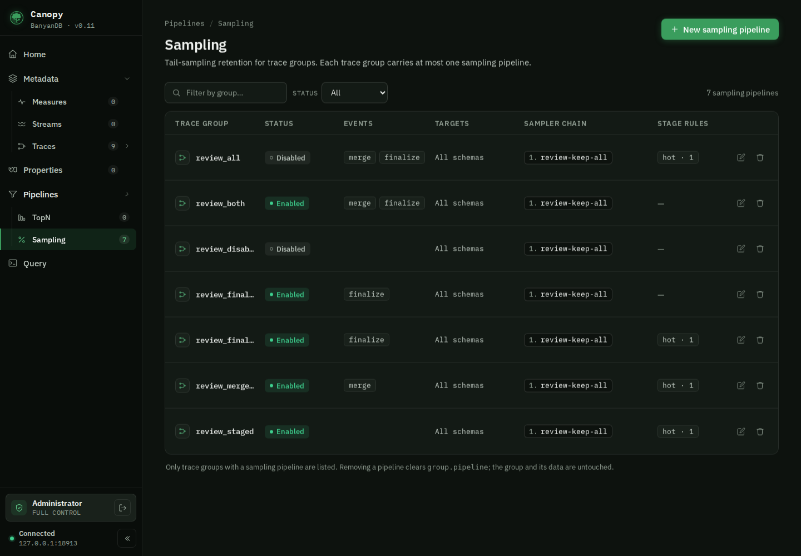

# Web Console (Canopy)

Canopy is the official web console of BanyanDB. It is a standalone web application — a React single-page app served by a Node.js BFF — that connects to the BanyanDB HTTP API (the gRPC-gateway on port `17913`) and lets you browse schemas, query measures, streams, traces and properties from a browser.

Canopy ships as a separate Docker image, `apache/skywalking-banyandb:<version>-canopy`, and runs as its own process alongside a BanyanDB server. BanyanDB itself exposes only the client API under `/api` on port `17913`. Canopy is also published as a tarball, `skywalking-banyandb-<version>-canopy.tgz` — see [Get Binaries](../installation/binaries.md) for the download location and the unpack-and-run steps.

## Run with Docker

Canopy needs a BanyanDB server it can reach, a session secret and a users file. Create a `users.yaml` listing the console users (see [Generating a password hash](#generating-a-password-hash)):

```yaml
- username: admin
  passwordHash: <bcrypt hash>
  role: admin    # admin (read-write) | readonly
```

`BANYANDB_TARGET` must be reachable from inside the Canopy container. When BanyanDB runs in another container, put both on the same Docker network and point at its container name (a bare `localhost` would refer to the Canopy container itself):

```shell
docker network create banyandb-net
docker network connect banyandb-net banyandb   # your BanyanDB container

docker run -d \
  --network banyandb-net \
  -p 4000:4000 \
  -e BANYANDB_TARGET=http://banyandb:17913 \
  -e SESSION_SECRET=<random secret of at least 32 characters> \
  -e CANOPY_USERS=/etc/canopy/users.yaml \
  -v $(pwd)/users.yaml:/etc/canopy/users.yaml:ro \
  --name canopy \
  apache/skywalking-banyandb:<version>-canopy
```

Replace `<version>` with the release you run, for example `0.11.1-canopy`.

Open http://localhost:4000 and log in with one of the users defined in the file.

If the BanyanDB server enforces Basic-Auth on its HTTP API, configure the upstream credential so Canopy attaches it to every proxied API request:

```shell
-e BANYANDB_UPSTREAM_USERNAME=<username> \
-e BANYANDB_UPSTREAM_PASSWORD=<password>
```

## Generating a password hash

`passwordHash` is an argon2id hash (a standard `$argon2id$v=19$m=…,t=…,p=…$salt$hash` string, portable with SkyWalking Horizon UI) of the user's password, not the password itself. Existing bcrypt hashes (`$2a$`/`$2b$`/`$2y$`) still verify, with a startup warning asking you to rehash. Generate an argon2id hash with the Canopy image — the trailing `-e` is Node's eval flag, since the image entrypoint is `node`:

```shell
docker run --rm apache/skywalking-banyandb:<version>-canopy \
  -e "require('hash-wasm').argon2id({password:'your-password',salt:require('crypto').randomBytes(16),parallelism:1,iterations:3,memorySize:19456,hashLength:32,outputType:'encoded'}).then(console.log)"
```

`role` is `admin` or `readonly`; Horizon's `viewer` is accepted as `readonly`, and `maintainer`/`operator` as `admin`. Users can also be configured with `CANOPY_AUTH_CONFIG` (a YAML/JSON file with an `auth:` section: `backend: local`, `local.users`, and `session.cookieName`/`ttlMinutes`/`cookieSecure`), with `CANOPY_AUTH_BACKEND` and `CANOPY_AUTH_SESSION_*` overrides. `CANOPY_USERS` is an alias for `auth.local.users`. With `backend: local` and no users, Canopy starts and every login is refused; there is no default admin. Single sign-on (OIDC/OAuth2), API tokens and break-glass accounts are described in the [Canopy authentication design](../../canopy/docs/auth-design.md) and the Canopy README. Sessions are kept in server memory (a restart signs everyone out), expire after `ttlMinutes` (default 60) of inactivity, and a role change or user removal takes effect on the next request.

## Run from source

The [Canopy README](https://github.com/apache/skywalking-banyandb/tree/main/canopy) covers running from a checkout in two shapes: the two-terminal dev setup (SPA dev server on `5173`, BFF on `4000`), and a production build where the BFF alone serves the built SPA on `4000`. Its [`.env.example`](https://github.com/apache/skywalking-banyandb/blob/main/canopy/.env.example) documents every setting: session secret, user file, reverse-proxy base path and metrics monitoring target.

## Sampling pipelines



Open **Pipelines → Sampling** to manage the optional retention pipeline on an
existing TRACE group. Each group has at most one pipeline; its identity is the
group name. **New sampling pipeline** selects a TRACE group without a pipeline. The detail
page shows its events, grace periods, ordered sampler chain, schema targets and
lifecycle stage rules. **Edit** supports both Form and YAML views.

Enable **MERGE** for sampling during compaction and **FINALIZE** for sampling at
segment finalization. The configuration model allows these events and lifecycle
stage rules in any combination: MERGE only, FINALIZE only, stages only, or any
combination of them.
Both events use the ordered `pipeline.plugins` chain; stage rules use their own
chains. Clearing both event checkboxes saves `enabledEvents: []` and leaves stage
rules active while the pipeline is enabled. With both events off, an enabled
pipeline must have a stage sampler chain. Otherwise, disable the pipeline. An
empty or omitted event list does not enable MERGE implicitly.

Existing configurations that relied on the former implicit MERGE default must
explicitly include `PIPELINE_EVENT_MERGE` to retain merge-time sampling. During a
rolling upgrade, older data nodes still apply that default; disabling both events
requires the updated data nodes.

For example, this pipeline configuration enables both
without installing a sampler (replace `my-traces` with the selected group):

```yaml
group: my-traces
pipeline:
  enabled: true
  enabledEvents:
    - PIPELINE_EVENT_MERGE
    - PIPELINE_EVENT_FINALIZE
  mergeGrace: 7200s
  finalizeGrace: 300s
  plugins: []
  stages: []
  schemaNames: []
  schemaNameRegex: ''
```

Durations use protobuf JSON notation (seconds with an `s` suffix). An omitted
`mergeGrace` uses the engine's two-hour default; an omitted `finalizeGrace` uses
five minutes. Empty schema targets apply to all trace schemas in the group.
The YAML view contains the selected `group` and its `pipeline` mapping, using
the camelCase keys shown above. Keep the group name unchanged.

Add samplers in execution order. A sampler references a `.so` basename already
installed in the server's trusted plugin directory; Canopy does not upload or
build plugins. Its `config` is a plugin-defined JSON object. For example, a
`pipeline.plugins` entry may be:

```yaml
plugins:
  - name: retention
    sampler:
      path: retention.so
      symbol: NewSampler
      abiVersion: 1
      config: {}
```

Use **Stage rules** to configure an ordered sampler chain for each source stage.
The lifecycle agent applies it before migrating out of that stage, independently
of MERGE and FINALIZE. Enter a configured source stage name (for example, `warm`
for warm → cold), or the source node's `type` label for the implicit initial tier
(for example, `hot` for hot → warm). The terminal stage has no outgoing migration.
Install the plugin in the lifecycle agent's trusted plugin directory and enable
its native plugin host as well as configuring the pipeline.

For stage-only sampling, leave both event checkboxes off and add a stage sampler:

```yaml
group: my-traces
pipeline:
  enabled: true
  enabledEvents: []
  stages:
    - stage: hot
      plugins:
        - name: retention
          sampler:
            path: retention.so
            abiVersion: 1
```

Saving a sampling pipeline preserves the group's storage settings and lifecycle
stages. Editing the group's TTL or lifecycle stages also preserves its pipeline.
**Remove** clears only the pipeline configuration; the group and its
trace schemas remain. Read-only users can inspect pipeline details.
